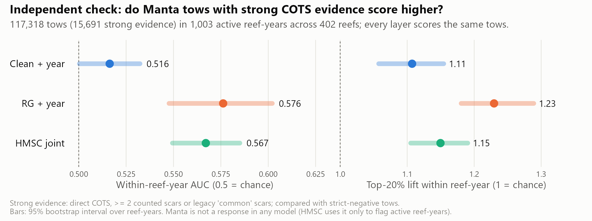
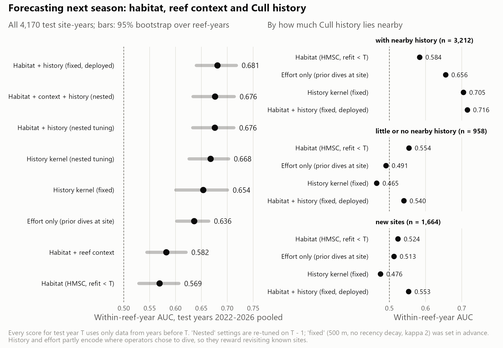

<!-- Results section for the technical report. Every number is taken from the
tables in ../outputs/tables/ (see ../README.md for the table behind each
result). Figures are built by ../scripts/07, 13 and the analysis scripts. -->

# Results

Throughout, a *problematic* cull dive is one with a catch per unit effort
(CPUE) of at least 0.02 COTS per minute of bottom time. A *low-density* dive
found COTS below that threshold, and a *ghost* dive found none. Unless stated
otherwise, performance is measured *within* reef-years: does a layer rank the
places where COTS were found above the places where they were not, on the
same reef in the same year? This removes differences between reefs and years,
which the survey-year term in the habitat models already captures. An
area under the curve (AUC) of 0.5 indicates no discrimination.

Key findings:

- The habitat layers rank locations within a reef only weakly. On
  independent manta tow data, the best layer (RG + year) reached a within
  reef-year AUC of 0.58.
- Recent cull history forecast the following season's problematic sites
  better than habitat alone (AUC 0.68 vs 0.57), but partly reflects where
  crews have chosen to dive.
- Ranking manta tows by the habitat layer found fewer aggregations than
  thinning tows at random. Evenly spaced (systematic) thinning retained at
  least 95 % of aggregations with up to 40 % fewer tows.
- A habitat model trained on manta tows within reef-years ranked held-out
  tows best (AUC 0.61) and found more aggregations than the cull-trained
  layer. It did not improve the choice of cull sites.
- The habitat layer alone could not reduce the number of cull sites searched
  without losing problematic dives roughly in proportion. Combined with the
  previous season's cull and manta records, it reduced the designated sites
  searched by 6–13 percentage points and avoided 6–12 points more low-density
  dives for the same share of problematic dives retained.

## Spatial predictions

Three habitat layers were produced at the scale of individual reefs
(@fig-maps):

- **Clean + year:** an XGBoost model on 12 terrain and habitat layers plus
  survey year.
- **RG + year:** the same model with five ReefGuide layers added (wave height
  and period, turbidity, bathymetry and slope).
- **HMSC joint:** a joint model of Cull, SALAD and RHIS evidence at 120 m.

A fourth layer combined the HMSC habitat probability with a kernel of past
cull outcomes (HMSC + history). A fifth, the manta model, was trained on
strong-evidence and negative manta tows within reef-years
(@sec-manta-model).

The two XGBoost layers placed their highest within-reef ranks along reef
margins and outer slopes. Examples include the western and southern rim of
Eyrie Reef, both long margins of Batt Reef and the ring reef of Lady
Musgrave. The HMSC habitat layer was more diffuse at its coarser 120 m
resolution and also ranked parts of the reef flat and back reef highly. The
HMSC + history layer was dominated by locations of past high-density finds,
for example the south-western margin of Batt Reef and the eastern side of
Eyrie Reef. It therefore summarises where COTS have been culled rather than
where suitable habitat lies. The 90 % posterior interval of the HMSC
probability was typically 0.1–0.3 wide, so cell-level differences of a few
percentage points are not meaningful.

The layers agreed only moderately on which cells rank highest. Median
within-reef Spearman correlations were 0.41 between clean + year and
RG + year, 0.33 between clean + year and HMSC, and 0.24 between RG + year and
HMSC. RG + year was available for 61 % of 120 m cells within GBR reef
polygons. The primary search-planning layer therefore used RG + year where
available and a calibrated clean + year prediction elsewhere:
- 54 reefs were covered entirely by RG + year;
- 2,586 reefs used a mixture of both;
- 920 reefs used clean + year only.

{#fig-maps width="100%"}

## Independent validation against manta tows

Manta tows were not used to fit any layer (HMSC used them only to flag active
reef-years). They therefore provide an independent test. All three layers
scored the same 117,318 tows in 1,003 active reef-years on 402 reefs. Within
each reef-year, the 15,691 tows with strong COTS evidence were compared with
tows that recorded neither COTS nor feeding scars (@fig-manta, @tbl-manta).
Strong evidence meant a direct COTS sighting, at least two counted scars, or
scars recorded as "common" in legacy surveys.

RG + year discriminated best (AUC 0.576, 95 % CI 0.548–0.602), followed by
HMSC (0.567, 0.549–0.585). Clean + year was close to chance (0.516,
0.500–0.532). RG + year placed 23 % more strong-evidence tows in each reef's
top-ranked 20 % than expected by chance.

| Layer | Within reef-year AUC (95 % CI) | Top-20 % lift (95 % CI) |
|---|---|---|
| Clean + year | 0.516 (0.500–0.532) | 1.11 (1.06–1.15) |
| RG + year | 0.576 (0.548–0.602) | 1.23 (1.18–1.29) |
| HMSC joint | 0.567 (0.549–0.585) | 1.15 (1.11–1.19) |

: Discrimination between strong-evidence and negative manta tows within reef-years. Lift is the share of strong-evidence tows in a reef-year's top 20 % of tows, relative to the 20 % expected by chance. Intervals are 95 % bootstrap intervals over reef-years. {#tbl-manta}

{#fig-manta width="100%"}

## Forecasting with cull history

Cull records showed that high-density areas persisted between seasons at a
scale of about 0.5–1 km. This was tested with a strictly forward validation
(@fig-forward, @tbl-forward). For each test year from 2022 to 2026, every
score was built only from data collected in earlier years. Scoring used
first-visit cull site-years in active reef-years that contained both
outcomes: 4,170 site-years in 315 reef-years.

The HMSC habitat model refitted on earlier years reached an AUC of 0.569.
A kernel of prior cull outcomes reached 0.654. Combining the two (the
deployed setting, specified before validation) reached 0.681 (95 % CI
0.640–0.718). Re-tuning the kernel each year on the previous season did not
improve on the fixed setting (0.676).

The gain depended on history being available nearby. Where it was, the
combined score reached 0.716. Where history was sparse, it fell to 0.540,
and at sites never previously culled it was 0.553. A score based only on how
often crews had dived a site reached 0.636. Much of the forecast skill
therefore reflects where operators chose to work, rather than independent
evidence of habitat.

Reef-context predictors at 0.5–1 km did not improve habitat forecasts
robustly (0.582 vs 0.569, overlapping intervals). These were windward and
seaward position, distance to reef edge, upwind open water, distance to
channels, reef area, and eReefs current speed and steadiness. Their effect
varied between years from −0.04 to +0.07.

| Score | All site-years | With nearby history (n = 3,212) | Little or none (n = 958) | New sites (n = 1,664) |
|---|---:|---:|---:|---:|
| Habitat (HMSC refit before test year) | 0.569 | 0.584 | 0.554 | 0.524 |
| Habitat + reef context | 0.582 | 0.600 | 0.520 | 0.514 |
| Dive effort only | 0.636 | 0.656 | 0.491 | 0.513 |
| History kernel | 0.654 | 0.705 | 0.465 | 0.476 |
| Habitat + history (deployed) | **0.681** | **0.716** | **0.540** | **0.553** |

: Forward validation of within reef-year AUC for problematic cull site-years, test years 2022–2026 pooled. Each score uses only data from before the test year. {#tbl-forward}

{#fig-forward width="100%"}

## Operational application

### Planning a reef visit

@fig-plans illustrates how the primary search-planning layer would be used
on two reefs. These reefs are in the layer's training data, so the example
shows the planning logic rather than independent performance.
- **Batt Reef manta survey (4 August 2025):** keeping the 79 of 131 tows that
  crossed the highest-ranked cells would have retained 32 of the 42
  strong-evidence tows.
- **Eyrie Reef manta survey (26 October 2023):** keeping 56 of 92 tows would
  have retained 9 of 11.
- **Dive plans:** fifteen dive sites were placed on top-ranked diveable cells
  (0.5–16 m deep, at least 400 m apart). On both reefs, every cull site that
  produced a problematic dive in the corresponding cull season (2025 for Batt,
  2024 for Eyrie) lay within the layer's top 30 %.

{#fig-plans width="100%"}

### Thinning manta surveillance

The number of manta tows that could be cut without missing COTS
aggregations was evaluated in two steps. Cull crews dive where manta tows
detect COTS, and the layer is trained on cull data, so scoring tows with the
deployed layer would partly test it against its own source. Each reef's tows
were therefore scored by a model refitted without that reef's cull data
(5-fold leave-reef-out). An aggregation was defined as strong-evidence tows
within 500 m of each other in one survey. It counted as found if at least
one of its tows was kept. Three thinning strategies kept the same number of
tows per survey:
- the layer's top-ranked tows;
- a random selection;
- evenly spaced (systematic) tows around the reef.

Systematic thinning retained the most aggregations at every level of effort
(@fig-aggregations). At 60 % of tows kept, it found 96.6 % of the 1,900
aggregations of two or more strong-evidence tows, compared with 94.0 % for
random selection and 88.1 % (86.6–89.5 %) for the layer. The largest cut
that still found at least 95 % of aggregations was:
- 40 % of tows for systematic thinning;
- 30 % for random selection;
- 20 % for the layer.

The layer concentrated the kept tows in a few high-scoring stretches and
missed aggregations in low-scoring ones. It found slightly more isolated
single strong-evidence tows than random selection (64 % vs 61 % at 60 %
kept). Scoring with the deployed rather than the held-out layer overstated
its performance by 1–3 percentage points.

{#fig-aggregations width="100%"}

### Selecting cull sites with the habitat layer

The cull question was whether crews could dive fewer sites without missing
problematic densities. Candidate sites were all 15,884 designated cull sites
on 576 reefs, including the 11,585 sites never dived. Each site was ranked
among the designated sites on its reef by the RG + year model refitted
without that reef's cull data. The analysis then asked which of the 29,813
dives made in 918 reef-years from 2018 to 2026 would still have occurred if
only the top-ranked sites had been dived (@fig-sites).

The held-out layer retained problematic dives only slightly faster than
low-density or ghost dives:
- **Top 70 % of sites:** 77.2 % (72.9–80.8 %) of problematic dives retained,
  while 24.6 % of low-density and 29.5 % of ghost dives were avoided. These
  sites accounted for 75.6 % of all dives, so a ranking that could not tell
  outcomes apart would have retained 75.6 % of problematic dives and avoided
  24.4 % of the others.
- **Top 50 % of sites:** 59.8 % (55.5–64.5 %) of problematic dives retained,
  with 44.9 % of low-density and 48.2 % of ghost dives avoided.

Within reef-years, the AUC for problematic versus low-density dives was 0.57,
and versus ghost dives 0.60. The deployed layer appeared stronger (0.61 and
0.66) only because it had been trained on these dives. Forty-three per cent
of the site-years ranked in a reef's top 30 % were at sites that had never
been dived.

{#fig-sites width="100%"}

### Adding the previous season's cull and manta records

The site ranking was then extended with evidence from the previous season
only, never from the season being searched:
- cull dives at the site (any problematic dive, or dived with none
  problematic);
- the rate of problematic dives and dive effort within about 300 m;
- strong-evidence and total manta tows within about 300 m.

These terms were combined with the held-out habitat rank in a logistic model
fitted on other reefs (5-fold leave-reef-out). Because the evidence raises
both problematic and low-density sites, rankings were compared at matched
retention. Each was set to keep the same share of problematic dives, and the
sites searched and dives avoided were then compared (@fig-evidence,
@tbl-evidence).

At 90 % of problematic dives retained (2018–2026), the combined ranking:
- reduced the share of designated sites searched from 88 % to 82 %;
- increased low-density dives avoided from 10 % to 16 %;
- increased ghost dives avoided from 13 % to 21 %.

Non-problematic dive time avoided rose from 11 % to 19 %. All four
differences were supported by paired bootstrap intervals that excluded zero.
Gains were larger in 2022–2026. At 80 % retention, the sites searched fell
from 74 % to 61 % and low-density dives avoided rose from 20 % to 32 %.

Most of the improvement came from the evidence terms. A ranking built from
last season's evidence alone performed almost as well as the combined
ranking. The habitat layer contributed mainly by ordering sites without
recent evidence. It was the only information for the 30 % of reef-years
whose reef had not been visited in the previous season. On those reefs
(11 % of dives), no ranking discriminated well (AUC about 0.53).

The fitted model ranked sites higher when strong manta tows or problematic
dives had been recorded nearby. It ranked them markedly lower when a site
had been dived the previous season without a problematic result. A site that
had itself been problematic ranked lower than its neighbourhood suggested,
consistent with culling having reduced densities there. Among dives actually
made, discrimination between problematic and low-density dives improved only
slightly (AUC 0.57 to 0.59). The reduction in search area came mainly from
ranking unproductive and never-dived sites lower. Results using a three-season
evidence window were similar.

| Problematic dives retained | Designated sites searched | Low-density dives avoided | Ghost dives avoided | Non-problematic dive time avoided |
|---|---|---|---|---|
| 90 % | 88 % → 82 % (−11 to −1) | 10 % → 16 % (+2 to +10) | 13 % → 21 % (+4 to +13) | 11 % → 19 % (+4 to +12) |
| 80 % | 73 % → 67 % (−11 to −3) | 22 % → 28 % (+2 to +10) | 27 % → 36 % (+5 to +14) | 23 % → 31 % (+4 to +13) |

: Habitat-only ranking → habitat plus previous-season evidence, compared at matched retention of problematic dives (held out, 2018–2026; 30,037 dives in 926 reef-years). Brackets give the 95 % paired bootstrap interval of the difference in percentage points. {#tbl-evidence}

{#fig-evidence width="100%"}

A caveat applies to the search-area results in @fig-sites and
@fig-evidence. A ranking is credited when it agrees with where crews chose to
dive, and crews already use the previous season's knowledge. Part of the
apparent reduction therefore formalises current practice. COTS densities at
designated sites that were never dived cannot be verified from these data.

### Training the habitat model on manta tows {#sec-manta-model}

Manta tows provide about 20 times more training rows than cull site-years.
They also cover reef areas that were searched but never dived. A habitat
model was therefore also trained on manta tows, with strong COTS evidence as
the response and strict negatives as the alternative. It was fitted on the
same leave-reef-out folds as the cull-trained model and evaluated on both
goals (@fig-manta-model). A second version fixed each reef-year's
strong-tow rate as an offset and omitted survey year, so that it could learn
only where COTS occurred *within* a reef-year.

The within reef-year manta model ranked held-out tows best:
- AUC 0.612 (0.578–0.636), compared with 0.575 for the manta model with year
  and 0.547 for the cull-trained model;
- top-20 % lift 1.33, compared with 1.15 for the cull-trained model.

At 60 % of tows kept, it found 91.0 % of aggregations, 2.8 percentage points
more than the cull-trained model (95 % CI +1.1 to +4.6). This was still below
random (94.0 %) and systematic (96.5 %) thinning.

For cull-site selection, training on manta tows gave no benefit. The manta
model with survey year ranked cull sites at chance (AUC 0.48 for problematic
vs low-density dives), because survey year accounted for 70 % of its fitted
gain. The within reef-year version matched the cull-trained model over
2018–2026 (AUC 0.566 vs 0.567). Once the previous season's evidence was
added, all three habitat models avoided the same share of low-density dives
(about 15.5 % at 90 % of problematic dives retained).

The within reef-year manta model was refitted on all 198,852 labelled tows
and mapped at 30 m wherever the ReefGuide layers exist (@fig-maps, third
column). It agreed with the cull-trained RG + year layer in favouring reef
margins and outer slopes. It placed more weight on the exposed perimeter,
for example the eastern rim of Eyrie Reef, and the northern and western rim
of Lady Musgrave, where RG + year favours the southern rim. Manta tows follow reef perimeters, so its values in the
back reef and lagoon are extrapolations.

{#fig-manta-model width="100%"}
