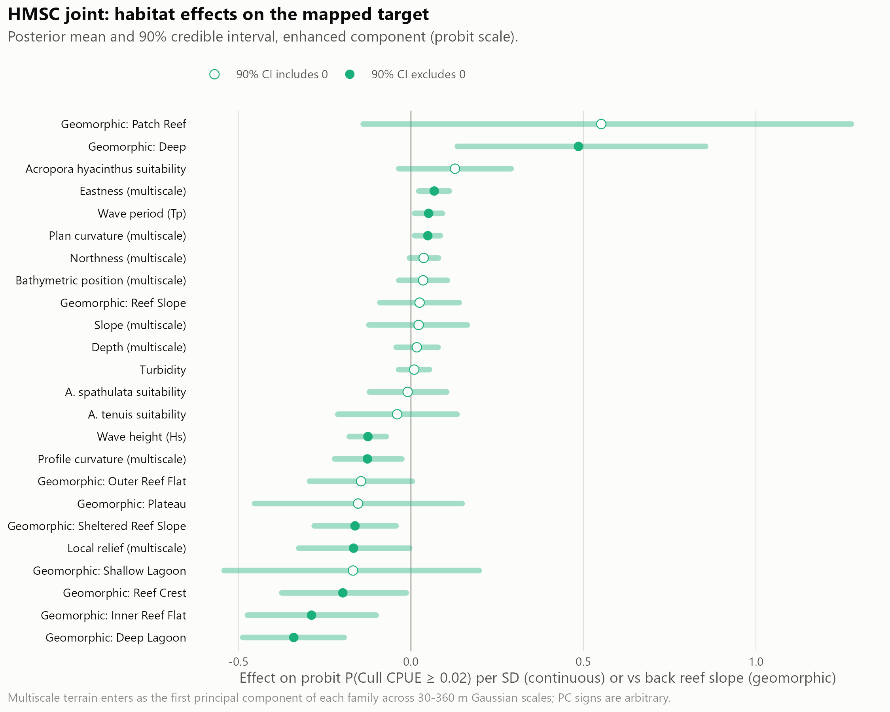
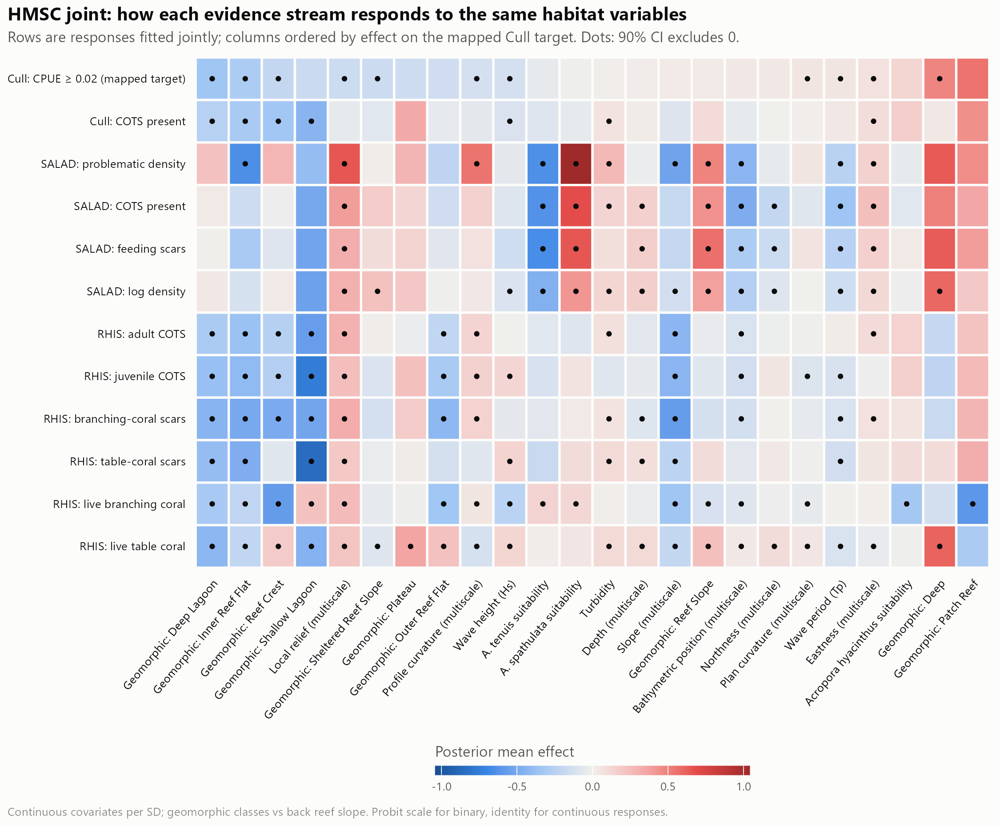
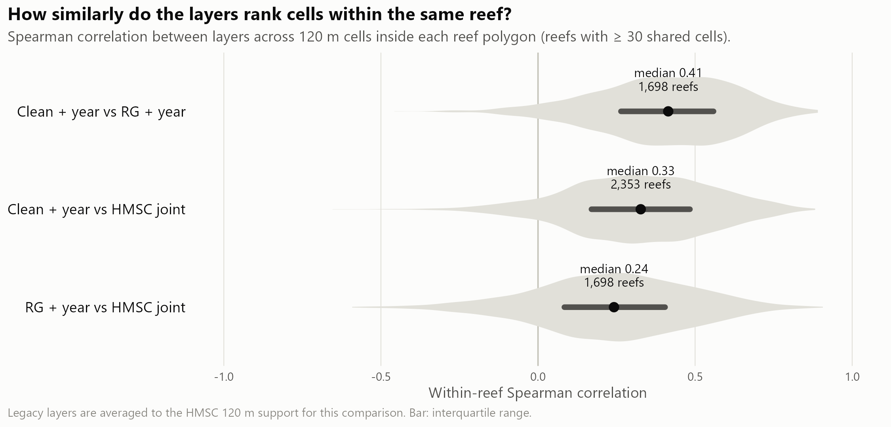
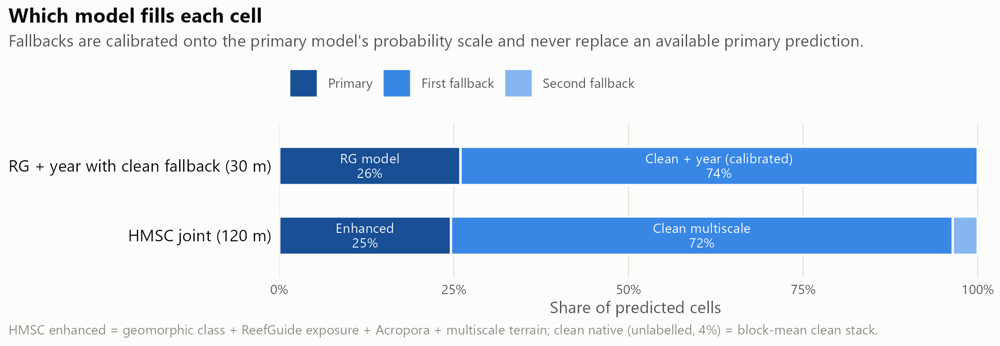
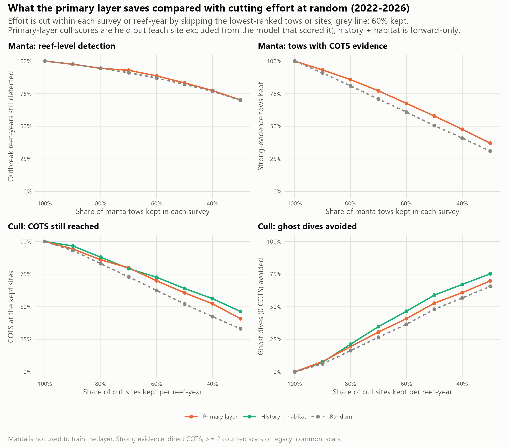
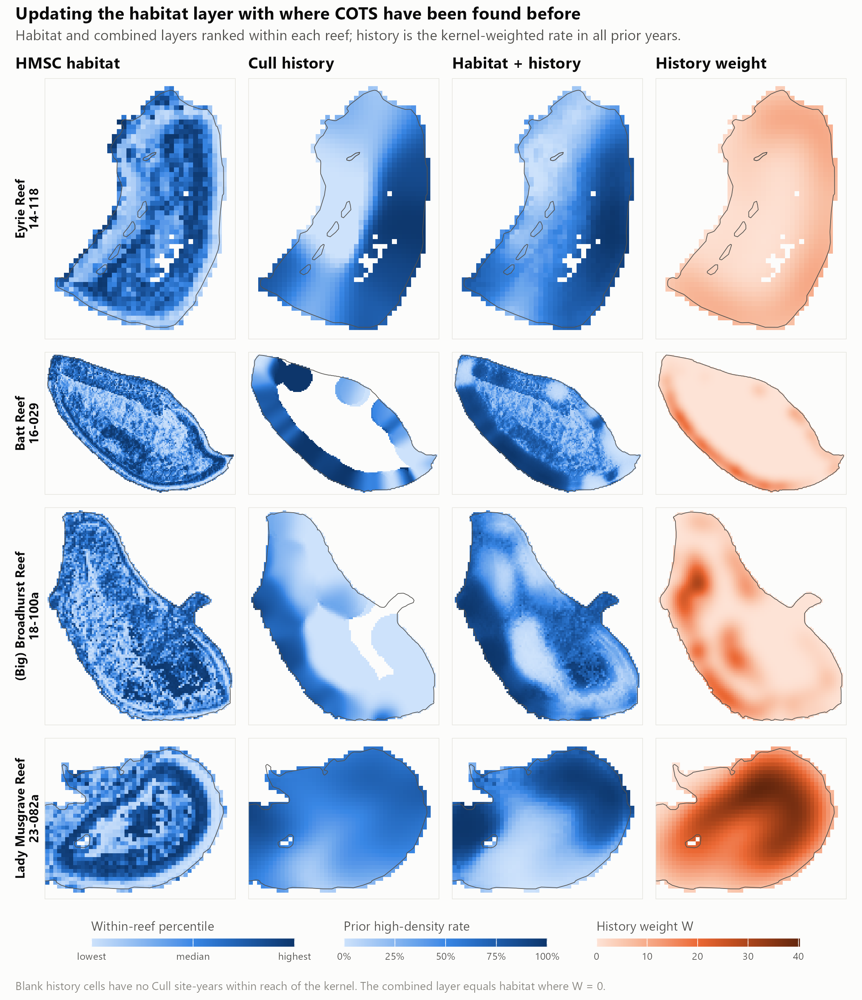

<!-- Public-facing technical report (CCIP final-report Output A; Work Plan
outputs E and H). Readers: COTS Control Program managers, vessel operators and
scientists. Australian English. Every result is read from ../outputs/tables
(or ../outputs/site_ranking) by inline R; see ../README.md for the script
behind each table. Personnel listed in the Work Plan: S. Matthews, T. Iwanaga,
M. Bode, O. Stewart, S. Choukroun, B. Beesley, J. Wilmes / I. Ryan; authorship
is for the team to decide. -->

```{r}
#| label: setup
#| include: false
source("msw_helpers.R")
msw_tables_dir <- Sys.getenv("MSW_TABLES", "../outputs/tables")
sr_dir <- "../outputs/site_ranking"

# Formatting ---------------------------------------------------------------
p0 <- function(x) pct(x, 0)
p1 <- function(x) pct(x, 1)
a2 <- function(x) num(x, 2)
a3 <- function(x) num(x, 3)
pp <- function(x) formatC(100 * abs(as.numeric(x)), format = "f", digits = 0)
gpp <- function(lo, hi) sprintf("%+.0f to %+.0f", 100 * as.numeric(lo), 100 * as.numeric(hi))
ci3 <- function(est, lo, hi) sprintf("%s (95%% CI %s–%s)", a3(est), a3(lo), a3(hi))
cip <- function(est, lo, hi, d = 1) sprintf("%s (95%% CI %s–%s)", pct(est, d), pct(lo, d), pct(hi, d))

# Tables -------------------------------------------------------------------
mic  <- tab("manta_independent_check.csv")
fv   <- tab("forward_validation_summary.csv")
la   <- tab("layer_agreement_summary.csv")
lcov <- tab("layer_coverage_on_reef_polygons.csv")
rsrc <- tab("search_planning_reef_sources.csv")
fbc  <- tab("legacy_rg_clean_fallback_calibration.csv")
hcov <- tab("hmsc_joint_coverage.csv")
hist <- tab("history_combined_layer_summary.csv")
ops  <- tab("operations_headline.csv")
agg  <- tab("manta_aggregation_cv_summary.csv")
mxc  <- tab("manta_aggregation_cv_max_cut.csv")
mrt  <- tab("manta_response_tow_check.csv")
mra  <- tab("manta_response_aggregations.csv")
mrc  <- tab("manta_response_cull_auc.csv")
mri  <- tab("manta_response_importance.csv")
csc  <- tab("cull_site_selection_cv.csv")
csa  <- tab("cull_site_selection_auc.csv")
ccov <- tab("cull_site_selection_coverage.csv")
und  <- tab("cull_site_selection_undived.csv")
ema  <- tab("cull_site_evidence_matched.csv")
eauc <- tab("cull_site_evidence_auc.csv")
ecov <- tab("cull_site_evidence_coverage.csv")
srf  <- tab("site_ranking_forward.csv")
src  <- tab("site_ranking_2027_coefficients.csv")
eng  <- tab("exploration_new_ground_check.csv")
spx  <- tab("search_plan_examples.csv")
rsc  <- tab("reefscan_presence_check.csv")
hsum <- rbind(tab("hmsc_enhanced_joint_production_summary.csv"),
              tab("hmsc_clean_joint_production_summary.csv"),
              tab("hmsc_clean_native_joint_production_summary.csv"))

pri  <- read.csv(file.path(sr_dir, "cots_cull_site_priority_2027.csv"), stringsAsFactors = FALSE)
cls  <- read.csv(file.path(sr_dir, "cots_cull_site_priority_classes_2027.csv"), stringsAsFactors = FALSE)
expl <- read.csv(file.path(sr_dir, "cots_exploration_areas_2027.csv"), stringsAsFactors = FALSE)

# Accessors ----------------------------------------------------------------
AGG_ALL <- "aggregations (>= 2 strong tows), all years"
AGG_RECENT <- "aggregations (>= 2 strong tows), 2022-2026"
ag <- function(keep, col, subset = AGG_ALL) pick(agg, subset = subset, keep = keep, col = col)
mx <- function(col, subset = AGG_ALL) pick(mxc, subset = subset, col = col)
ev <- function(metric, retention, score, period = "2018-2026", col = "value")
  pick(ema, metric = metric, retention = retention, score = score, window = "last_season", period = period, col = col)
cs <- function(metric, sites, score = "leave-reef-out", period = "2018-2026", col = "value")
  pick(csc, period = period, score = score, sites_searched = sites, metric = metric, col = col)
fw <- function(score, metric, period = "2019-2026", col = "value")
  pick(srf, period = period, score = score, metric = metric, col = col)
fvh <- function(method, subset = "all", col = "within_reef_year_auc") pick(fv, subset = subset, method = method, col = col)
mi <- function(layer, col) pick(mic, layer = layer, col = col)
mt <- function(model, metric, col = "value") pick(mrt, model = model, metric = metric, col = col)
op <- function(metric, col, period = "2022-2026") pick(ops, period = period, metric = metric, col = col)

# Frequently used values -----------------------------------------------------
n_sites   <- ccov$designated_sites
n_reefs   <- ccov$reefs_with_sites
n_ever    <- ccov$sites_ever_dived
cs_dives  <- cs("problematic_dives_kept", 0.7, col = "dives")
cs_ry     <- cs("problematic_dives_kept", 0.7, col = "reef_years")
cs_prob   <- cs("problematic_dives_kept", 0.7, col = "problematic_dives")
cs_low    <- cs("problematic_dives_kept", 0.7, col = "low_dives")
cs_ghost  <- cs("problematic_dives_kept", 0.7, col = "ghost_dives")
ev_dives  <- pick(eauc, window = "last_season", subset = "all", score = "habitat", col = "dives")
ev_ry     <- pick(eauc, window = "last_season", subset = "all", score = "habitat", col = "reef_years")
nv_dives  <- pick(eauc, window = "last_season", subset = "reef not visited", score = "habitat", col = "dives")
nv_ry     <- pick(eauc, window = "last_season", subset = "reef not visited", score = "habitat", col = "reef_years")
n_noev    <- sum(pri$evidence == "no recent evidence on this reef (habitat only)")
n_probev  <- sum(pri$evidence == "problematic dive here last season")
n_mantaev <- sum(pri$evidence == "strong manta evidence nearby last season")
n_quiet   <- sum(pri$evidence == "dived last season, nothing problematic")
fw_dives  <- fw("cull_all", "sites_searched_at_90", col = "dives")
fw_ry     <- fw("cull_all", "sites_searched_at_90", col = "reef_years")
year_gain_manta <- pick(mri, model = "manta", Feature = "Year", col = "gain")
clsv <- function(p, col) cls[[col]][cls$priority == p]
```

**Suggested citation:** [TO CONFIRM: Authors (2026). Where to look for crown-of-thorns starfish on a reef: fine-scale habitat layers and evidence-based search priorities for COTS surveillance and culling. Report to the Great Barrier Reef Foundation, COTS Control Innovation Program (CCIP-BR-13). Australian Institute of Marine Science, Townsville. DOI/URL.]



# Executive summary {.unnumbered}

The COTS Control Program spends most of its vessel time looking for crown-of-thorns starfish (COTS): towing manta observers around reefs and diving designated cull sites, many of which turn out to hold few or no COTS. This project asked whether fine-scale maps of where COTS are likely to be found on a reef could help crews (1) manta tow less without missing COTS aggregations and (2) search fewer cull sites without missing problematic densities (at least 0.02 COTS per minute of bottom time). Every result below was scored on data the model had not seen and compared with a no-information baseline using the same effort.

**Key findings**

- **Habitat maps rank places within a reef only weakly.** On independent manta tows, the best cull-trained layer reached a within-reef AUC of `r a2(mi("RG + year", "within_reef_year_auc"))` (0.5 is chance). A layer trained on manta tows reached `r a2(mt("within", "auc"))`. The maps can set search order. They cannot pinpoint aggregations.
- **For manta surveillance, spread the tows evenly.** Skipping tows evenly around the reef (for example two in every five) still found at least 95% of aggregations with `r p0(mx("systematic_point"))` fewer tows. Dropping the tows a model ranked lowest allowed only a `r p0(mx("layer_cv_point"))` cut, worse than dropping tows at random (`r p0(mx("random_point"))`).
- **For cull sites, last season's dives and tows are what let crews search less.** Habitat alone barely beat no information. Adding the previous season's cull and manta records cut the share of designated sites searched from `r p0(ev("sites_searched", 0.9, "habitat"))` to `r p0(ev("sites_searched", 0.9, "combined"))` for the same 90% of problematic dives. Low-density dives avoided rose from `r p0(ev("low_dives_avoided", 0.9, "habitat"))` to `r p0(ev("low_dives_avoided", 0.9, "combined"))`, and ghost dives (no COTS) avoided from `r p0(ev("ghost_dives_avoided", 0.9, "habitat"))` to `r p0(ev("ghost_dives_avoided", 0.9, "combined"))`. Gains were larger in 2022–2026.
- **The approach held up season by season.** Trained only on earlier seasons, it avoided more low-density dives than habitat alone in every season from 2022 and searched fewer sites in every season from 2023.
- **Past cull records forecast next season's problematic sites well** (AUC `r a2(fvh("combined_fixed"))` vs `r a2(fvh("habitat"))` for habitat). This partly reflects where crews choose to dive, so it is reported as a map of known aggregation sites, not habitat.

**What was delivered**

- A 2027 priority ranking of all `r int(n_sites)` designated cull sites on `r int(n_reefs)` reefs (classes A–D; CSV and KMZ).
- `r int(nrow(expl))` exploration areas on `r int(length(unique(expl$reef_name)))` reefs. These are high-ranked habitat outside the cull sites and away from recent tows, so that search does not keep consolidating on the same places.
- 30 m habitat layers for the Great Barrier Reef, a known-aggregation-sites layer and a reproducible pipeline that is re-run each season.

**What managers can do now**

- Thin manta surveillance systematically if effort must be cut. Do not use habitat layers to choose which tows to drop.
- Order cull-site searches by the 2027 ranking and work down the classes. The lowest class (D) is the realistic candidate to defer.
- Add one or two exploration areas per reef visit and log the outcome.

**Main limitations.** `r p0(n_noev / nrow(pri))` of designated sites are on reefs with no dives or tows in the last 12 months, and there the ranking is close to chance. Rankings learned from past effort partly encode crew behaviour. Densities at never-dived sites cannot be verified. The products have not yet been trialled in the field or reviewed by experts zone by zone.



# Background

## The management problem

Outbreaks of crown-of-thorns starfish (*Acanthaster* cf. *solaris*; COTS) are a major cause of coral loss on the Great Barrier Reef [@death2012decline; @pratchett2017thirty]. The COTS Control Program suppresses outbreaks by manual culling, which can protect coral when it is sustained at the right reefs [@westcott2020efficacy]. Most of the program's vessel and diver time goes into finding COTS, not killing them:

- **Manta tow surveillance.** Observers are towed around a reef, usually along its perimeter, to record COTS and feeding scars and to assess the reef's outbreak status.
- **Cull dives.** Crews dive designated cull sites (`r int(n_sites)` sites on `r int(n_reefs)` reefs in the current EoTR cull-site register). They choose sites from manta results and their knowledge of where COTS were found before. `r p0(cs_ghost / cs_dives)` of held-out cull dives from 2018 to 2026 found no COTS (ghost dives), and a further `r p0(cs_low / cs_dives)` found COTS below the action threshold (low-density dives).

Decisions about where to tow and dive are made reef by reef, at a scale of tens to hundreds of metres. Reef-scale outbreak models and metapopulation models do not resolve that scale. [TO CONFIRM: wording on how sites and tow paths are chosen in current practice, e.g. the Integrated Pest Management framework and contractor guidance.]

## The decisions this work supports

This report is judged against two uses, set with the program:

1. **Manta tow less without missing COTS aggregations.**
2. **Search fewer cull sites without missing problematic densities**, defined as catch per unit effort (CPUE) ≥ 0.02 COTS per minute of bottom time. In practice this means avoiding ghost dives and low-density dives.

A tool is useful only if it beats a no-information baseline on held-out data, for the same effort. Any cut in effort saves time; only the difference from the baseline is the tool's contribution.

## Project objectives

The CCIP-BR-13 Work Plan set three objectives:

1. Develop GBR-wide predictive fine-scale habitat suitability models by connecting fine-scale COTS data to new high-resolution benthic and coral habitat data.
2. Optimise and standardise surveillance paths to improve outbreak detection and operational efficiency, including a comparison against traditional perimeter-based surveillance.
3. Refine management strategies for distinct reef habitat types through predicted suitable habitat and metapopulation modelling.

This report covers Objectives 1 and 2. It also reports a cull-site selection analysis that grew out of them (@sec-cull) and the resulting 2027 operational product. [TO CONFIRM: where the fine-scale connectivity networks (Work Plan output F) and the prototype metacommunity model (output G, Objective 3) are reported, and a one-paragraph status summary if they are to be mentioned here.] Appendix E maps the Work Plan outputs to the sections of this report.

# Methods

Model reporting follows the ODMAP structure for species distribution models where it applies [@zurell2020odmap].

## Data

- **Cull dives** (COTS Control Program; custodian GBRMPA). One record per dive with site, date, COTS culled and bottom time. Dives were matched to designated cull sites by site name, with a spatial fallback; `r p1(ccov$dive_match_rate)` of dives were matched. [TO CONFIRM: years of cull records used to train the habitat models, and the data-access agreement.]
- **Designated cull sites.** The EoTR cull-site register (KMZ, November 2025): `r int(n_sites)` site polygons on `r int(n_reefs)` reefs, of which `r int(n_ever)` had ever been dived.
- **Manta tows** (COTS Control Program). `r int(mt("within", "auc", col = "tows"))` labelled tows, `r int(mt("within", "auc", col = "strong_tows"))` with strong COTS evidence, in `r int(mt("within", "auc", col = "reef_years"))` reef-years. [TO CONFIRM: years covered.]
- **Other COTS observations** used in the explanatory joint model only: SALAD imagery surveys and Reef Health and Impact Surveys (RHIS). [TO CONFIRM: custodians and years.]
- **Predictors** on a 30 m grid (GDA2020 / MGA zone 55):
  - a "clean" stack of 12 layers: nine terrain derivatives of a 30 m bathymetry and three coral habitat-suitability surfaces for *Acropora* taxa [CITATION NEEDED: bathymetry source; coral suitability models (Guillaume et al. 2025, as cited in the progress report)];
  - five ReefGuide layers: significant wave height, wave period, turbidity, bathymetry and slope [CITATION NEEDED: ReefGuide data source];
  - for the joint model, the GBR10 geomorphic map and reef features [CITATION NEEDED].

  Appendix B lists the predictor codes.

## Definitions

- **Problematic dive:** a cull dive with CPUE ≥ 0.02 COTS per minute of bottom time. **Low-density dive:** COTS found but CPUE < 0.02. **Ghost dive:** no COTS found.
- **Strong-evidence tow:** a manta tow with a direct COTS sighting, at least two counted feeding scars, or scars recorded as "common" in legacy surveys. **Strict negative:** neither COTS nor scars recorded.
- **Aggregation:** strong-evidence tows within 500 m of each other in one survey (reef and date). An aggregation counts as found if at least one of its tows is kept, because that tow triggers a closer search.
- **Within reef-year AUC:** the probability that a randomly chosen positive location on a reef in a given year is ranked above a randomly chosen negative one on the same reef in the same year. 0.5 means no discrimination. **Top-20% lift:** the share of positives in a reef-year's top-ranked 20%, divided by 20%.

Survey year and reef identity dominate raw COTS probabilities. Operational decisions are made within a reef, so all performance is measured within reef-years.

## Habitat layers

Four habitat models were fitted (Appendix A lists the files):

- **Clean + year.** Gradient-boosted trees [XGBoost; @chen2016xgboost] predicting whether a cull site-year was problematic, from the 12-layer clean stack plus survey year. Full coverage of the domain.
- **RG + year.** The same model with the five ReefGuide layers added. It covers `r p0(pick(lcov, layer_id = "legacy_rg_year2026", col = "fraction"))` of reef-polygon cells.
- **Primary search-planning layer.** RG + year where available; elsewhere clean + year, calibrated onto the RG probability scale. Each 30 m cell carries its percentile within its reef polygon and a priority class (top 10%, 10–20%, 20–30%). `r int(sum(rsrc$source == "RG only"))` reefs are covered by RG + year alone, `r int(sum(rsrc$source == "mixed"))` by a mixture and `r int(sum(rsrc$source == "clean fallback only"))` by the fallback alone.
- **Manta model (within reef-year).** XGBoost on the RG stack, trained on strong-evidence versus strictly negative manta tows. Each reef-year's strong-tow rate enters as a fixed offset and survey year is omitted, so the trees can learn only *where within a reef-year* COTS are seen.

Two further layers serve other purposes:

- **HMSC joint model** [@ovaskainen2017hmsc; @tikhonov2020hmsc]. An explanatory model at 120 m of how cull, SALAD and RHIS evidence respond to habitat, conditional on the reef being active that year. Three components were fitted, with a fallback where predictors are missing. All passed the convergence gates (minimum effective sample size ≥ 400, maximum upper potential scale reduction factor ≤ 1.1; Appendix C). It is not the operational map.
- **Known aggregation sites.** A kernel (Gaussian, σ = 500 m) of the problematic rate at earlier cull site-years. It is blended with the HMSC habitat probability as (κ*p* + *WH*)/(κ + *W*), where *H* is the kernel rate, *W* its evidence weight and κ = 2. These settings were fixed before validation.

## Validation design

- **Leave-reef-out.** Cull crews dive where manta tows found COTS, so a cull-trained model scored on manta tows or on its own cull dives is partly scored against its own source. For every analysis of operational use, each reef was scored by a model refitted without that reef's data (5-fold cross-validation over reefs).
- **Forward in time.** Any score that uses history was validated strictly forward: for each test season, only data from earlier seasons were used.
- **Baselines at the same effort.**
  - Manta tows: random thinning (exact expectation) and systematic thinning (every *n*th tow around the reef, averaged over starting points).
  - Cull sites: random selection, whose expected retention equals the share of dives kept.
  - Evidence-based rankings: the habitat-only ranking.
- **Matched retention.** Evidence moves both problematic and low-density sites up the ranking. Cull-site rankings were therefore compared at the same share of problematic dives retained (80–95%), set in advance.
- **Uncertainty.** 500 bootstrap resamples of the independent unit (reef-years for cull and tow metrics, surveys for aggregations), paired across scores.

## Analyses

**Independent manta check.** Every habitat layer scored the same `r int(mi("RG + year", "tows"))` manta tows in `r int(mi("RG + year", "reef_years"))` active reef-years on `r int(mi("RG + year", "reefs"))` reefs where all layers exist.

**Cull history forecast.** For each test year from 2022 to 2026, first-visit cull site-years were scored by habitat (HMSC refitted on earlier years), dive effort, the history kernel and the blend. `r int(fvh("combined_fixed", col = "site_years"))` site-years in `r int(fvh("combined_fixed", col = "reef_years"))` reef-years contained both outcomes.

**Manta thinning.** Within each survey, tows were cut to 90–30% of the total, by model rank (leave-reef-out), at random or systematically. The share of aggregations still found was recorded. Tow order is not recorded, so tows were ordered by bearing from the survey centre.

**Cull-site selection.** All designated sites on a reef, including never-dived ones, were ranked by the held-out habitat score (mean over the site polygon). For each share of sites searched, the analysis recorded the share of actual problematic, low-density and ghost dives that would still have occurred.

**Adding last season's evidence.** Each designated site received evidence terms from the previous season only:

- cull dives at the site (any problematic dive; or dived with none problematic);
- the problematic rate and dive effort among cull dives nearby (Gaussian kernel, σ = 300 m);
- strong-evidence and total manta tows nearby (same kernel).

Four rankings were compared: habitat only, evidence only (logistic regression), habitat + evidence (logistic regression), and a simple rule (sites flagged last season first, then habitat). The regressions were fitted on other reefs (leave-reef-out).

**Season-by-season forward test.** For each season 2019–2026, the habitat + evidence model was fitted only on dives from earlier seasons. Three training windows (all earlier seasons, last 5, last 3) and three habitat terms (cull-trained rank, an ensemble with the manta model, or both) were compared.

**2027 products.** The chosen model (cull-trained habitat rank + evidence, all earlier seasons) was fitted on `r int(src$training_dives[1])` dives from `r src$training_years[1]`. "Last season" for 2027 is the most recent 12 months of data, 1 June 2025 to 31 May 2026, because calendar 2026 holds only January–May. Sites were classed by their rank on the reef: A (top 20% of the reef's sites), B (20–50%), C (50–80%) and D (bottom 20%). Exploration areas were drawn from 30 m cells 0.5–16 m deep in the reef's top 30% of habitat (mean of the primary-layer and manta-model percentiles), more than 100 m from any designated cull site and more than 150 m from any manta tow in the last five seasons. Nearby pockets were joined, split into compact areas of about 9 ha and smoothed. The ten highest-ranked areas per reef, at least 350 m apart, were kept.

**Software.** R 4.5.0 with xgboost, Hmsc and terra [TO CONFIRM: package versions used for the archived model fits]. All inputs are pinned by SHA-256 checksum, and the pipeline is re-run from scripts 00–21 (Appendix F).

# Results

<!-- Evidence map (key message → tables / figures)
1. Habitat layers rank weakly within reefs → manta_independent_check, manta_response_tow_check, layer_agreement_summary; fig01, fig02b, fig03
2. Cull history forecasts well but encodes operator behaviour → forward_validation_summary; fig09
3. Systematic thinning beats model-ranked thinning for manta → manta_aggregation_cv_summary/_max_cut, manta_response_aggregations; fig13, fig16
4. Cull-site gain comes from last season's evidence → cull_site_selection_*, cull_site_evidence_*, site_ranking_forward; fig14, fig15
5. 2027 product + exploration areas → site_ranking/*, exploration_new_ground_check; fig17
-->

## Habitat layers rank locations within a reef only weakly

The habitat layers show consistent broad patterns but discriminate only weakly between places on the same reef. Across the GBR, each layer's absolute values mostly reflect survey year and region (@fig-overview). Within reefs, the cull-trained layers placed their highest ranks along reef margins and outer slopes (@fig-maps). The HMSC layer was more diffuse at 120 m. The history blend was dominated by where COTS had been culled before.

{#fig-overview width="100%"}

{#fig-maps width="100%"}

On independent manta tows, RG + year discriminated best among the cull-trained layers, at `r ci3(mi("RG + year", "within_reef_year_auc"), mi("RG + year", "auc_low"), mi("RG + year", "auc_high"))` (@tbl-manta, @fig-manta). Clean + year was close to chance. The manta model, trained on tows but scored leave-reef-out, reached `r ci3(mt("within", "auc"), mt("within", "auc", "low"), mt("within", "auc", "high"))` (@sec-manta).

```{r}
#| label: tbl-manta
#| tbl-cap: "Discrimination between strong-evidence and strictly negative manta tows within reef-years. Manta tows were not used to fit any of these layers. Lift is the share of strong-evidence tows in a reef-year's top 20% of tows, divided by 20%. Intervals are 95% bootstrap intervals over reef-years."
knitr::kable(data.frame(
  Layer = mic$layer,
  `Within reef-year AUC (95% CI)` = sprintf("%s (%s–%s)", a3(mic$within_reef_year_auc), a3(mic$auc_low), a3(mic$auc_high)),
  `Top-20% lift (95% CI)` = sprintf("%s (%s–%s)", a2(mic$top20_lift), a2(mic$lift_low), a2(mic$lift_high)),
  check.names = FALSE), align = "lll")
```

{#fig-manta width="100%"}

The layers also disagree on which cells rank highest. Median within-reef Spearman correlations were `r a2(pick(la, pair = "Clean + year vs RG + year", col = "median"))` between clean + year and RG + year, `r a2(pick(la, pair = "Clean + year vs HMSC joint", col = "median"))` between clean + year and HMSC, and `r a2(pick(la, pair = "RG + year vs HMSC joint", col = "median"))` between RG + year and HMSC (Appendix D). Where both cull-trained layers exist, the fallback and RG rankings correlate at only `r a2(fbc$spearman)`, so ranks near the RG coverage boundary within a reef are less reliable.

## Past cull records forecast well but encode where crews dive

Problematic sites persist between seasons at a scale of about 0.5–1 km. In the strictly forward test, the blend of habitat and cull history reached a within reef-year AUC of `r ci3(fvh("combined_fixed"), fvh("combined_fixed", col = "auc_low"), fvh("combined_fixed", col = "auc_high"))`, against `r a3(fvh("habitat"))` for habitat alone (@tbl-forward, @fig-forward).

Much of this skill reflects operator behaviour. A score based only on how often crews had dived a site reached `r a3(fvh("effort"))`. The gain also depended on history nearby: `r a3(fvh("combined_fixed", "with nearby history"))` where it existed, `r a3(fvh("combined_fixed", "little or no nearby history"))` where it was sparse and `r a3(fvh("combined_fixed", "new sites"))` at sites never culled before. History lies within reach of only `r p1(hist$fraction_with_history)` of 120 m reef cells, so the blend equals the habitat layer across most of the reef. Reef-context predictors at 0.5–1 km (windward position, distance to reef edge, channels, eReefs currents) did not improve habitat forecasts robustly (`r a3(fvh("habitat_context"))` vs `r a3(fvh("habitat"))`, overlapping intervals).

This layer is delivered as a map of **known aggregation sites** for briefing crews, not as habitat.

```{r}
#| label: tbl-forward
#| tbl-cap: "Forward validation: within reef-year AUC for problematic cull site-years, test years 2022–2026 pooled. Each score uses only data from before the test year. The deployed blend's 95% bootstrap interval over reef-years is given for all site-years."
meth <- c(habitat = "Habitat (HMSC refitted before test year)", habitat_context = "Habitat + reef context",
          effort = "Dive effort only", history_fixed = "History kernel", combined_fixed = "Habitat + history (deployed)")
subs <- c("all", "with nearby history", "little or no nearby history", "new sites")
tf <- do.call(rbind, lapply(names(meth), function(m) {
  v <- vapply(subs, function(s) a3(fvh(m, s)), "")
  v[1] <- if (m == "combined_fixed") ci3(fvh(m), fvh(m, col = "auc_low"), fvh(m, col = "auc_high")) else v[1]
  data.frame(Score = meth[[m]], t(v), check.names = FALSE)
}))
names(tf)[-1] <- sprintf("%s (n = %s)", c("All site-years", "With nearby history", "Little or none", "New sites"),
                         vapply(subs, function(s) int(fvh("habitat", s, col = "site_years")), ""))
knitr::kable(tf, row.names = FALSE, align = "lllll")
```

{#fig-forward width="100%"}

## Manta surveillance: evenly spaced tows beat model-ranked tows {#sec-manta}

**Systematic thinning found the most aggregations at every level of effort** (@tbl-thinning, @fig-aggregations). With 60% of tows kept, it found `r p1(ag(0.6, "systematic"))` of the `r int(ag(0.6, "aggregations"))` aggregations of two or more strong-evidence tows in `r int(ag(0.6, "surveys"))` surveys. Random thinning found `r p1(ag(0.6, "random"))`, and thinning by the held-out cull-trained layer found `r cip(ag(0.6, "layer_cv"), ag(0.6, "layer_cv_low"), ag(0.6, "layer_cv_high"))`.

The largest cut that still found at least 95% of aggregations was:

- `r p0(mx("systematic_point"))` of tows for systematic thinning (`r p0(mx("systematic_assured"))` with bootstrap assurance);
- `r p0(mx("random_point"))` for random thinning;
- `r p0(mx("layer_cv_point"))` for the layer.

Results for 2022–2026 alone were the same: `r p0(mx("systematic_point", AGG_RECENT))`, `r p0(mx("random_point", AGG_RECENT))` and `r p0(mx("layer_cv_point", AGG_RECENT))`.

The layer did worse than random because ranking concentrates the kept tows in a few high-scoring stretches, so aggregations in low-scoring stretches are missed entirely. It found slightly more isolated single strong tows than random (`r p0(ag(0.6, "layer_cv", "isolated strong tows, all years"))` vs `r p0(ag(0.6, "random", "isolated strong tows, all years"))` at 60% kept), but those are not aggregations. Scoring with the deployed (in-sample) layer instead of the held-out one overstated aggregations found by `r pp(ag(0.6, "layer_deployed") - ag(0.6, "layer_cv"))` percentage points at 60% kept.

Reef-level detection is robust to thinning whichever tows are kept. Outbreak reef-years have many positive tows, so keeping about 60% of tows in 2022–2026 still flagged `r p0(op("Manta: outbreak reef-years still detected", "primary_layer"))` of outbreak reef-years with the layer and `r p0(op("Manta: outbreak reef-years still detected", "random"))` at random (Appendix D).

```{r}
#| label: tbl-thinning
#| tbl-cap: "Share of COTS aggregations (two or more strong-evidence tows within 500 m) still found when manta tows are cut within each survey, all years. The layer is the cull-trained RG + year model scored leave-reef-out; the deployed column is the same layer scored in-sample. Brackets: 95% bootstrap interval over surveys."
k <- c(0.8, 0.7, 0.6, 0.5)
knitr::kable(data.frame(
  `Tows kept` = p0(k),
  `Layer, held out` = sprintf("%s (%s–%s)", vapply(k, function(x) p1(ag(x, "layer_cv")), ""),
                              vapply(k, function(x) p1(ag(x, "layer_cv_low")), ""), vapply(k, function(x) p1(ag(x, "layer_cv_high")), "")),
  `Layer, deployed` = vapply(k, function(x) p1(ag(x, "layer_deployed")), ""),
  Random = vapply(k, function(x) p1(ag(x, "random")), ""),
  Systematic = vapply(k, function(x) p1(ag(x, "systematic")), ""),
  check.names = FALSE), align = "lllll")
```

{#fig-aggregations width="100%"}

**A model trained on manta tows ranks tows better but still does not beat even spacing.** Manta tows provide about 20 times more training rows than cull site-years. The within reef-year manta model ranked held-out tows best (@tbl-mantamodel, @fig-manta-model) and found `r pp(pick(mra, strategy = "within_cv", keep = 0.6, col = "within_minus_cull"))` percentage points more aggregations than the cull-trained model at 60% kept (95% CI `r gpp(pick(mra, strategy = "within_cv", keep = 0.6, col = "within_minus_cull_low"), pick(mra, strategy = "within_cv", keep = 0.6, col = "within_minus_cull_high"))`). That is still below random (`r p1(pick(mra, strategy = "random", keep = 0.6, col = "found"))`) and systematic thinning (`r p1(pick(mra, strategy = "systematic", keep = 0.6, col = "found"))`). Its top predictors were wave period and height, bathymetry and slope.

Training on manta did not help cull-site selection. With survey year as a predictor, the manta model ranked cull dives at chance (AUC `r a2(pick(mrc, period = "2018-2026", score = "manta", col = "auc_problematic_vs_low"))`), because survey year took `r p0(year_gain_manta)` of its fitted gain. The within reef-year version matched the cull-trained model over 2018–2026 (`r a3(pick(mrc, period = "2018-2026", score = "within", col = "auc_problematic_vs_low"))` vs `r a3(pick(mrc, period = "2018-2026", score = "cull", col = "auc_problematic_vs_low"))`) and was weaker in 2022–2026 (`r a2(pick(mrc, period = "2022-2026", score = "within", col = "auc_problematic_vs_low"))` vs `r a2(pick(mrc, period = "2022-2026", score = "cull", col = "auc_problematic_vs_low"))`). Manta tows see COTS and scars from the surface along the reef perimeter. A problematic dive measures how many COTS a diver finds in a site. The two are related but are not the same quantity.

```{r}
#| label: tbl-mantamodel
#| tbl-cap: "Cull-trained and manta-trained habitat models on held-out manta tows (all three fitted on the same leave-reef-out folds). AUC: strong-evidence vs strictly negative tows within reef-years, with 95% bootstrap intervals. Aggregations: share found at 60% of tows kept."
mods <- c(cull = "Cull-trained", manta = "Manta-trained (with year)", within = "Manta-trained, within reef-year")
strat <- c(cull = "cull_cv", manta = "manta_cv", within = "within_cv")
knitr::kable(data.frame(
  Model = unname(mods),
  `Tow AUC (95% CI)` = vapply(names(mods), function(m) sprintf("%s (%s–%s)", a3(mt(m, "auc")), a3(mt(m, "auc", "low")), a3(mt(m, "auc", "high"))), ""),
  `Top-20% lift` = vapply(names(mods), function(m) a2(mt(m, "lift")), ""),
  `Aggregations found, 60% kept` = vapply(names(mods), function(m) p1(pick(mra, strategy = strat[[m]], keep = 0.6, col = "found")), ""),
  check.names = FALSE), row.names = FALSE, align = "llll")
```

{#fig-manta-model width="100%"}

## Cull-site selection: last season's evidence does the work {#sec-cull}

### Habitat alone barely beats no information

Ranking all designated sites by the held-out habitat layer retained problematic dives only slightly faster than low-density or ghost dives (@tbl-sites, @fig-sites). Searching the top 70% of designated sites retained `r cip(cs("problematic_dives_kept", 0.7), cs("problematic_dives_kept", 0.7, col = "low"), cs("problematic_dives_kept", 0.7, col = "high"))` of problematic dives. Those sites accounted for `r p1(cs("dives_kept", 0.7))` of all dives, so a ranking with no information would have retained `r p1(cs("dives_kept", 0.7))`. Within reef-years, the AUC was `r a2(pick(csa, period = "2018-2026", score = "leave-reef-out", col = "auc_problematic_vs_low"))` for problematic versus low-density dives and `r a2(pick(csa, period = "2018-2026", score = "leave-reef-out", col = "auc_problematic_vs_ghost"))` versus ghost dives. The in-sample layer looked stronger (`r a2(pick(csa, period = "2018-2026", score = "deployed", col = "auc_problematic_vs_low"))` and `r a2(pick(csa, period = "2018-2026", score = "deployed", col = "auc_problematic_vs_ghost"))`) only because it had been trained on those dives.

Whether a site holding COTS is above or below the action threshold on a given visit depends mainly on outbreak stage, earlier culling and the movement of aggregations, which static habitat cannot capture. The habitat ranking does point to untested places: `r p0(pick(und, top30 = TRUE, col = "share_never_dived"))` of site-years ranked in a reef's top 30% were at sites that had never been dived.

```{r}
#| label: tbl-sites
#| tbl-cap: "Diving only the top-ranked designated cull sites on each reef, held-out habitat ranking, 2018–2026. 'Dives kept' is what a ranking with no information would retain of every outcome. Brackets: 95% bootstrap interval over reef-years."
s <- c(0.8, 0.7, 0.6, 0.5)
knitr::kable(data.frame(
  `Designated sites searched` = paste("top", p0(s)),
  `Dives kept (no-information baseline)` = vapply(s, function(x) p1(cs("dives_kept", x)), ""),
  `Problematic dives kept` = vapply(s, function(x) sprintf("%s (%s–%s)", p1(cs("problematic_dives_kept", x)), p1(cs("problematic_dives_kept", x, col = "low")), p1(cs("problematic_dives_kept", x, col = "high"))), ""),
  `Low-density dives avoided` = vapply(s, function(x) p1(cs("low_dives_avoided", x)), ""),
  `Ghost dives avoided` = vapply(s, function(x) p1(cs("ghost_dives_avoided", x)), ""),
  check.names = FALSE), align = "lllll")
```

{#fig-sites width="100%"}

### Adding the previous season's cull and manta records

Adding evidence from the previous season, and only the previous season, reduced the search substantially (@tbl-evidence, @fig-evidence). Held out over 2018–2026 (`r int(ev_dives)` dives in `r int(ev_ry)` reef-years), for the same 90% of problematic dives retained, the habitat + evidence ranking:

- reduced the designated sites searched from `r p0(ev("sites_searched", 0.9, "habitat"))` to `r p0(ev("sites_searched", 0.9, "combined"))`;
- raised low-density dives avoided from `r p0(ev("low_dives_avoided", 0.9, "habitat"))` to `r p0(ev("low_dives_avoided", 0.9, "combined"))`;
- raised ghost dives avoided from `r p0(ev("ghost_dives_avoided", 0.9, "habitat"))` to `r p0(ev("ghost_dives_avoided", 0.9, "combined"))`.

All paired bootstrap intervals excluded zero. Gains were larger in 2022–2026. At 80% retention, sites searched fell from `r p0(ev("sites_searched", 0.8, "habitat", "2022-2026"))` to `r p0(ev("sites_searched", 0.8, "combined", "2022-2026"))`, and low-density dives avoided rose from `r p0(ev("low_dives_avoided", 0.8, "habitat", "2022-2026"))` to `r p0(ev("low_dives_avoided", 0.8, "combined", "2022-2026"))`.

Most of the improvement came from the evidence, not the habitat layer:

- Evidence alone performed almost as well as habitat + evidence.
- The habitat layer ordered sites without recent evidence. It was the only information for the `r p0(1 - pick(ecov, window = "last_season", col = "share_reef_any_prev"))` of reef-years whose reef was not visited the season before. On those reefs (`r int(nv_dives)` dives), no ranking discriminated well (AUC about `r a2(pick(eauc, window = "last_season", subset = "reef not visited", score = "combined", col = "auc_problematic_vs_low"))`).
- Among dives actually made, discrimination between problematic and low-density dives rose only from `r a2(pick(eauc, window = "last_season", subset = "all", score = "habitat", col = "auc_problematic_vs_low"))` to `r a2(pick(eauc, window = "last_season", subset = "all", score = "combined", col = "auc_problematic_vs_low"))`. The reduction in search came mainly from ranking quiet and never-dived sites lower.

The fitted model ranked a site higher when strong manta tows or problematic dives had been recorded nearby. It ranked a site much lower if it had been dived the previous season with nothing problematic. A site that had itself been problematic ranked slightly lower than its neighbourhood suggested, consistent with culling having reduced it. The simple rule ("last season's flags first, then habitat") searched the fewest sites but avoided fewer low-density dives than the fitted model. A three-season evidence window gave the same picture.

```{r}
#| label: tbl-evidence
#| tbl-cap: "Habitat-only ranking → habitat plus previous-season evidence, compared at matched retention of problematic dives (held out). Brackets: 95% paired bootstrap interval of the difference, in percentage points."
cell <- function(metric, r, period) sprintf("%s → %s (%s)", p0(ev(metric, r, "habitat", period)), p0(ev(metric, r, "combined", period)),
  gpp(ev(metric, r, "combined", period, "gain_low"), ev(metric, r, "combined", period, "gain_high")))
rows <- expand.grid(r = c(0.9, 0.8), period = c("2018-2026", "2022-2026"), stringsAsFactors = FALSE)
knitr::kable(data.frame(
  Period = sub("-", "–", rows$period),
  `Problematic dives kept` = p0(rows$r),
  `Designated sites searched` = mapply(cell, "sites_searched", rows$r, rows$period),
  `Low-density dives avoided` = mapply(cell, "low_dives_avoided", rows$r, rows$period),
  `Ghost dives avoided` = mapply(cell, "ghost_dives_avoided", rows$r, rows$period),
  check.names = FALSE), row.names = FALSE, align = "lllll")
```

{#fig-evidence width="100%"}

### Season-by-season forward test

Fitted only on earlier seasons, the habitat + evidence model avoided more low-density dives than habitat alone in every season from 2022, and searched fewer sites in every season from 2023 (@tbl-seasons). It did not help in 2019–2021, when fewer earlier seasons were available to learn from. Pooled over 2019–2026 (`r int(fw_dives)` dives in `r int(fw_ry)` reef-years), at 90% of problematic dives retained, sites searched fell from `r p0(fw("habitat_only", "sites_searched_at_90"))` to `r p0(fw("cull_all", "sites_searched_at_90"))` and low-density dives avoided rose from `r p0(fw("habitat_only", "low_dives_avoided_at_90"))` to `r p0(fw("cull_all", "low_dives_avoided_at_90"))`. Training on all earlier seasons matched the last five (`r p0(fw("cull_last5", "sites_searched_at_90"))` of sites) and beat the last three (`r p0(fw("cull_last3", "sites_searched_at_90"))`). Adding the manta model to the habitat term made no difference (`r p0(fw("ensemble_all", "sites_searched_at_90"))`), so the simpler cull-trained model was kept.

```{r}
#| label: tbl-seasons
#| tbl-cap: "Year-by-year forward test of the cull-site ranking at 90% of problematic dives retained. Each season is ranked by a model fitted only on earlier seasons. Values are habitat alone → cull-trained habitat + last season's evidence (all earlier seasons)."
periods <- c(as.character(2019:2026), "2019-2026")
lab <- c(as.character(2019:2025), "2026 (Jan–May)", "2019–2026")
arrow <- function(p, metric, f = p0) sprintf("%s → %s", f(fw("habitat_only", metric, p)), f(fw("cull_all", metric, p)))
knitr::kable(data.frame(
  `Test season` = lab,
  Dives = vapply(periods, function(p) int(fw("cull_all", "sites_searched_at_90", p, "dives")), ""),
  `Sites searched` = vapply(periods, arrow, "", metric = "sites_searched_at_90"),
  `Low-density dives avoided` = vapply(periods, arrow, "", metric = "low_dives_avoided_at_90"),
  `AUC, problematic vs low-density` = vapply(periods, arrow, "", metric = "auc_problematic_vs_low", f = a2),
  check.names = FALSE), row.names = FALSE, align = "lrlll")
```

A caveat applies to all cull-site results. A ranking is credited when it agrees with where crews chose to dive, and crews already use the previous season's knowledge, so part of the gain formalises current practice. COTS densities at designated sites that were never dived cannot be verified from these data.

## The 2027 cull-site priority ranking and exploration areas

Every designated cull site (`r int(n_sites)` sites on `r int(n_reefs)` reefs) was ranked within its reef for the 2027 season. The ranking is delivered as a CSV and as the EoTR cull-site KMZ with each polygon coloured by priority class and annotated with its rank, its modelled chance of a problematic dive if dived, and last season's evidence. @tbl-classes shows what each class kept in the forward test.

```{r}
#| label: tbl-classes
#| tbl-cap: "2027 priority classes and what searching through each class retained in the forward test (dives 2019–2026)."
knitr::kable(data.frame(
  `Searching through` = c("A", "A + B", "A + B + C", "All (incl. D)"),
  `Sites on the reef` = c("top 20%", "top 50%", "top 80%", "100%"),
  `Problematic dives kept` = p0(cls$problematic_dives_kept),
  `Low-density dives avoided` = p0(cls$low_dives_avoided),
  `Ghost dives avoided` = p0(cls$ghost_dives_avoided),
  check.names = FALSE), row.names = FALSE, align = "lllll")
```

Recent evidence drives the top of the ranking. `r int(n_probev)` sites had a problematic dive last season and `r int(n_mantaev)` have strong manta evidence nearby. `r int(n_quiet)` were dived last season with nothing problematic, which strongly lowers their rank. `r int(n_noev)` sites (`r p0(n_noev / nrow(pri))`) are on reefs with no dives or tows in the last 12 months. They are ranked by habitat alone, which is close to chance (@sec-cull).

Rankings learned from past effort keep search on the same places. The exploration layer counters this by pointing to high-ranked habitat that the current search footprint does not cover (@fig-2027). It contains `r int(nrow(expl))` areas on `r int(length(unique(expl$reef_name)))` reefs, with a median size of `r num(median(expl$area_ha), 0)` ha, median habitat percentile `r a2(median(expl$habitat_percentile))` and median distance from a cull site `r int(median(expl$nearest_cull_site_m))` m.

Habitat models still rank tows on such new ground. A tow was counted as *new ground* if no tow lay within 300 m in the previous five seasons. On new ground, the manta model reached a within reef-year AUC of `r ci3(pick(eng, ground = "new ground", score = "manta_within", metric = "auc", col = "value"), pick(eng, ground = "new ground", score = "manta_within", metric = "auc", col = "low"), pick(eng, ground = "new ground", score = "manta_within", metric = "auc", col = "high"))` and the cull-trained layer `r a2(pick(eng, ground = "new ground", score = "cull", metric = "auc", col = "value"))`. Strong evidence was more common on new ground than on repeat ground (`r p1(pick(eng, ground = "new ground", score = "cull", metric = "auc", col = "strong_share"))` vs `r p1(pick(eng, ground = "repeat ground", score = "cull", metric = "auc", col = "strong_share"))` of tows), partly because new ground is often surveyed early in an outbreak. On well-surveyed reefs such as Batt and Eyrie, cull sites and five seasons of tows already cover most high-ranked habitat. The larger opportunities are on reefs with little recent towing.

{#fig-2027 width="100%"}

# Implications for management

**What the evidence shows**

- Fine-scale habitat layers carry a real but weak signal. They are good enough to set the order of search on a reef, not to exclude places from it.
- For manta surveillance, how the tows are spread matters more than which habitat they cover.
- For cull-site selection, last season's dives and tows carry most of the useful information, and habitat fills the gaps.

**What we recommend in practice**

- **Manta crews and planners.** If tow effort must be reduced, skip tows evenly around the reef rather than in blocks; skipping two in every five still found 95% of aggregations. Do not use any habitat layer to choose which surveillance tows to drop. Use the manta model to decide where to add or repeat tows, or where to search more closely after a detection.
- **Cull crews and trip planners.** Order designated sites by the 2027 priority ranking and work down the classes; do not stop at class A. Class D (the bottom 20% of a reef's sites) is the realistic candidate to defer. In the forward test, skipping it gave up about `r p0(1 - clsv("C", "problematic_dives_kept"))` of problematic dives while avoiding `r p0(clsv("C", "low_dives_avoided"))` of low-density and `r p0(clsv("C", "ghost_dives_avoided"))` of ghost dives. On reefs with no recent evidence, treat the ranking as a first search order and update it once manta tows come in.
- **New contractors.** Use the known-aggregation-sites layer to brief crews on where COTS have been found before. It records past finds, not habitat.
- **All crews.** Add one or two exploration areas to a reef's manta plan, or as a single scouting dive per visit, and log the result so the next season's evidence includes it.
- **Program managers.** Re-run the ranking each season with an updated evidence window. Read *P(problematic if dived)* as a way to compare sites on the same reef. It was learned from dives crews chose to make, so it is not an absolute risk for an unvisited reef.

**How to tell whether it is working.** In the 2027 season, record each dive's priority class. Compare the share of problematic, low-density and ghost dives by class with the forward-test expectations in @tbl-classes, and compare the strong-evidence rate in exploration areas with repeat ground. [TO CONFIRM: who owns this monitoring and how results are reported, e.g. through the COTS Dashboards.]

**Costs and savings.** Any reduction in sites searched saves diver time whichever sites are skipped; only the difference from a no-information ranking is attributable to the model. [TO CONFIRM: whether to translate diver-hours into dollars and the hourly rate to use.]

# Limitations

1. **The fine-scale signal is weak in every habitat layer.** The best held-out within-reef AUCs are about 0.55–0.61. The layers prioritise search; they do not locate aggregations.
2. **Rankings learned from past effort encode operator behaviour.** Cull history and dive effort reflect where crews chose to dive. The cull-site gains are measured against dives crews made, so part of the gain formalises current practice. This probably makes the evidence ranking look better than it would be against unbiased sampling.
3. **Never-dived sites cannot be verified.** `r p0(1 - n_ever / n_sites)` of designated sites have never been dived. Their densities are unknown, so the share of problematic densities missed at those sites cannot be measured.
4. **Little or no information on unvisited reefs.** `r p0(n_noev / nrow(pri))` of designated sites are on reefs with no recent evidence, where every ranking is close to chance.
5. **Training data and leakage.** Cull-trained layers were trained on cull dives, and cull crews dive where manta found COTS. This was handled by leave-reef-out scoring; in-sample scores overstate performance by 1–3 percentage points for aggregations and more for cull sites.
6. **Mixed coverage.** RG + year covers `r p0(pick(lcov, layer_id = "legacy_rg_year2026", col = "fraction"))` of reef cells; elsewhere the primary layer uses a fallback whose ranking correlates only weakly with RG + year (Spearman `r a2(fbc$spearman)`). Expect seams at the coverage boundary. The HMSC layer comes mostly from its fallback component (`r p0(pick(hcov, component = "clean_joint", col = "fraction"))` of cells), including most of the Far Northern sector, and its forward transfer is near chance (0.515 when trained on data to 2023). <!-- 0.515: README, Validation table, hmsc_corrected_v4 enhanced_joint metrics (not in final/outputs/tables). -->
7. **Manta model extrapolation.** Manta tows follow reef perimeters, so manta-model values in the back reef and lagoon, where many exploration areas lie, are extrapolations.
8. **Tow order.** Systematic thinning assumes tows can be ordered around the reef. Tow order is not recorded, so tows were ordered by bearing from the survey centre, which suits perimeter surveys.
9. **Partial 2026 season.** Calendar 2026 contains only January–May, so the 2027 evidence window is the last 12 months rather than a calendar season.
10. **Not yet tested in the field or reviewed by experts.** Expert zone-by-zone review of the layers is pending, and the 2027 products have not been trialled.
11. **Connectivity is not in these models.** Larval connectivity is a reef-level quantity in the data available here and cannot change within-reef rankings. A reef-level outbreak forecast added little beyond last season's cull record when checked.

# Recommendations and next steps

1. **Adopt systematic thinning** as the rule for reducing manta tow effort, and keep habitat layers out of the decision of which tows to drop (@sec-manta).
2. **Trial the 2027 cull-site priority ranking** with crews in the 2027 season, recording priority class for every dive (@tbl-classes).
3. **Trial exploration areas** as one or two additions per reef visit and log outcomes, including nil results.
4. **Re-run scripts 20–21 each season** with an updated evidence window, and re-run the forward test (script 19) as each season's data arrive.
5. **Complete the expert zone review** of the habitat layers and the 2027 products with GBRMPA and vessel crews, including Traditional Owner operators [TO CONFIRM: forum and timing].
6. **Obtain ReefScan effort tracks** so that ReefScan detections can be used as an independent test; the presence-only check was inconclusive (Appendix D).
7. **Test fine-scale hydrodynamic connectivity** in a pilot region (Port Douglas to Lizard Island), against a distance-only kernel as a control and the history + habitat forecast as the bar to beat. [TO CONFIRM: link to Work Plan output F.]
8. **Integrate the products into operational tools** (GBRMPA ESRI Field Maps and the COTS Dashboards). [TO CONFIRM: integration status and owner.]

# Acknowledgements {.unnumbered}

This project was funded by the COTS Control Innovation Program (Reef Trust, AIMS, GBRF), project CCIP-BR-13. [TO CONFIRM: exact funding wording; partner organisations (AIMS, QUT, JCU, GBRMPA); data providers (COTS Control Program vessel crews and contractors, GBRMPA, SALAD, RHIS, ReefGuide); Traditional Owner acknowledgement of Sea Country in the authors' own words.]

# References {.unnumbered}

::: {#refs}
:::



# Appendices {.unnumbered}

## Appendix A: Delivered layers and products {.unnumbered}

All layers are in GDA2020 / MGA zone 55, with checksums in `outputs/layers/layer_manifest.csv`.

| Role | File | Resolution | Contents |
|---|---|---|---|
| Primary search-planning layer | `cots_search_planning_2026_30m.tif` (+ `_priority_`) | 30 m | P(problematic site-year, 2026), RG + year with calibrated clean + year fallback; percentile within reef polygon; priority classes (top 10%, 10–20%, 20–30%) |
| Clean + year | `cots_legacy_clean_year2026_30m.tif` | 30 m | P(problematic site-year, 2026) from the 12-layer clean stack + year |
| RG + year | `cots_legacy_rg_year2026_30m.tif` | 30 m | As above with five ReefGuide layers; missing where ReefGuide layers are missing |
| Manta model | `cots_manta_within_30m.tif` | 30 m | Relative log-odds of strong manta evidence against the reef-year average; percentile within reef |
| Exploration 2027 | `cots_exploration_2027_30m.tif` | 30 m | Habitat percentile on eligible cells; distances to recent tows and cull sites |
| HMSC joint (explanatory) | `cots_hmsc_joint_120m.tif` (+ uncertainty, source) | 120 m | Posterior mean P(problematic density given an active reef-year); posterior SD and 5th/95th percentiles |
| Known aggregation sites | `cots_cull_history_kernel_120m.tif`, `cots_hmsc_history_combined_120m.tif` | 120 m | Kernel-weighted prior problematic rate and evidence weight; habitat updated by history (forecast for 2027) |
| 2027 cull-site priority | `cots_cull_site_priority_2027.csv`, `.kmz`, `_reefs.csv`, `_classes_2027.csv` | site | Priority class, rank on reef, P(problematic if dived), evidence behind the score |
| Exploration areas 2027 | `cots_exploration_areas_2027.csv`, `.gpkg` (also in the KMZ) | area | Rank, area, habitat percentile, depth, distances to cull sites and recent tows |

: Delivered layers (`outputs/layers/`) and operational products (`outputs/site_ranking/`). {#tbl-layers}

## Appendix B: Predictors {.unnumbered}

| Code | Layer | Stack |
|---|---|---|
| DEM | Depth | Clean |
| SLO | Slope | Clean |
| EAST, NORTH | Eastness, northness (aspect) | Clean |
| BPI | Bathymetric position index | Clean |
| VRM | Vector ruggedness measure | Clean |
| SVF | Sky-view factor | Clean |
| HCU, VCU | Horizontal and vertical curvature | Clean |
| AhyaD, Aspat, Aten | Coral habitat suitability for three *Acropora* taxa | Clean |
| RG_bathy, RG_slope | ReefGuide bathymetry and slope | ReefGuide |
| RG_turbid | ReefGuide turbidity | ReefGuide |
| RG_waves_Hs, RG_waves_Tp | ReefGuide significant wave height and wave period | ReefGuide |

: Predictor codes. [TO CONFIRM: full names of the terrain codes, the coral taxa behind AhyaD, Aspat and Aten, and sources for each layer.] {#tbl-predictors}

{#fig-importance width="100%"}

## Appendix C: HMSC joint model {.unnumbered}

```{r}
#| label: tbl-hmsc
#| tbl-cap: "HMSC production fits: training rows, convergence diagnostics and apparent (in-sample) AUC for the mapped cull target, and the share of mapped 120 m cells each component fills. All passed the gates (minimum effective sample size ≥ 400, maximum upper PSRF ≤ 1.1)."
knitr::kable(data.frame(
  Component = hsum$component,
  `Training rows` = int(hsum$rows),
  `Min ESS` = int(hsum$min_ess),
  `Max upper PSRF` = a3(hsum$max_psrf_upper),
  `Apparent AUC` = a3(hsum$apparent_auc),
  `Share of mapped cells` = vapply(hsum$component, function(x) p1(pick(hcov, component = x, col = "fraction")), ""),
  check.names = FALSE), row.names = FALSE, align = "lrrrrr")
```

{#fig-hmsc-effects width="100%"}

{#fig-hmsc-coef width="100%"}

## Appendix D: Supplementary validation {.unnumbered}

**Layer agreement and coverage.**

{#fig-agreement width="100%"}

{#fig-coverage width="100%"}

**Effort cut by the primary layer versus at random.** An earlier analysis cut manta and cull effort within each survey or reef-year by the primary layer and compared it with the same cut at random (@tbl-ops, @fig-ops). Most of the effort saved is the effect of the cut itself, not of the layer. Systematic thinning and the matched cull-site analysis in the main text supersede this comparison for manta tows and cull sites, respectively.

```{r}
#| label: tbl-ops
#| tbl-cap: "Keeping about 60% of manta tows or cull sites within each survey or reef-year, 2022–2026: primary layer versus the same cut at random. Cull sites were scored by held-out predictions."
ms <- c("Manta: strong-evidence tows kept", "Manta: outbreak reef-years still detected",
        "Cull: share of COTS at kept sites", "Cull: share of ghost dives avoided")
knitr::kable(data.frame(
  Metric = ms,
  `Primary layer` = vapply(ms, function(m) p1(op(m, "primary_layer")), ""),
  Random = vapply(ms, function(m) p1(op(m, "random")), ""),
  check.names = FALSE), row.names = FALSE, align = "lrr")
```

{#fig-ops width="100%"}

**Example search plans.** On Batt Reef (manta survey `r pick(spx, label = "16-029", col = "survey_date")`), keeping the `r pick(spx, label = "16-029", col = "tows_kept")` of `r pick(spx, label = "16-029", col = "n_tows")` tows that crossed the highest-ranked cells would have retained `r pick(spx, label = "16-029", col = "strong_kept")` of `r pick(spx, label = "16-029", col = "strong_tows")` strong-evidence tows; on Eyrie Reef (`r pick(spx, label = "14-118", col = "survey_date")`), `r pick(spx, label = "14-118", col = "tows_kept")` of `r pick(spx, label = "14-118", col = "n_tows")` tows would have retained `r pick(spx, label = "14-118", col = "strong_kept")` of `r pick(spx, label = "14-118", col = "strong_tows")` (@fig-plans). Both reefs are in the layer's training data, so this illustrates the planning logic only; the held-out results in the main text are the evidence.

{#fig-plans width="100%"}

**Cull history on four reefs.**

{#fig-history width="100%"}

**ReefScan check.** `r int(pick(rsc, layer = "legacy_clean_year2026", col = "detections"))` presence-only ReefScan detections on `r int(pick(rsc, layer = "legacy_clean_year2026", col = "reefs"))` reefs were compared with each layer's within-reef percentile. Detections sat near or below the median for every layer (mean percentile `r a2(min(rsc$mean_within_reef_percentile))`–`r a2(max(rsc$mean_within_reef_percentile))`). Without survey tracks that recorded no detections, this mostly reflects where ReefScan was towed, so the check is inconclusive.

## Appendix E: Alignment with the CCIP-BR-13 Work Plan {.unnumbered}

| Work Plan output | Delivered in this report | Status |
|---|---|---|
| E. Finalised GBR-wide habitat suitability model and surveillance paths | 30 m habitat layers (Appendix A); held-out evaluation of model-ranked versus systematic manta thinning (@sec-manta); example search plans (Appendix D) | [TO CONFIRM] |
| E (extension). Cull-site selection | 2027 cull-site priority ranking and exploration areas (@sec-cull) | [TO CONFIRM] |
| F. Fine-scale connectivity network at four reef clusters | Not in this report | [TO CONFIRM] |
| G. Prototype fine-scale metacommunity model | Not in this report | [TO CONFIRM] |
| H. Final data sets and public report (FAIR) | This report; layers, tables and code | [TO CONFIRM: repository, DOI and licence] |
| I. Peer-reviewed publication | Manuscript in preparation for *Frontiers in Marine Science* | [TO CONFIRM] |

: Work Plan outputs and where they are reported. The Work Plan proposed validating tow paths at the 50th and 80th percentile thresholds; this report instead evaluates every level of tow retention from 90% to 30% against random and systematic baselines. {#tbl-workplan}

## Appendix F: Reproducibility {.unnumbered}

The pipeline is in `DataProcessing/cots_sdm_v2/final/` [TO CONFIRM: public repository URL and release DOI]. Every input is pinned by SHA-256 checksum in `config.R`; scripts 00–21 run in the order given in `README.md`, with `07` (figures) last. Every number in this report is read from `outputs/tables/` or `outputs/site_ranking/` when the report is rendered. COTS Control Program cull and manta records are held by GBRMPA and are not public [TO CONFIRM: access statement].
