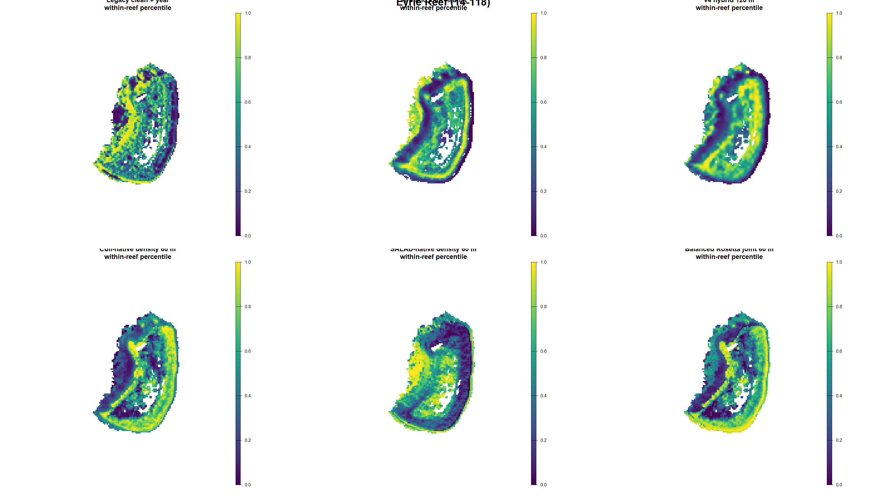
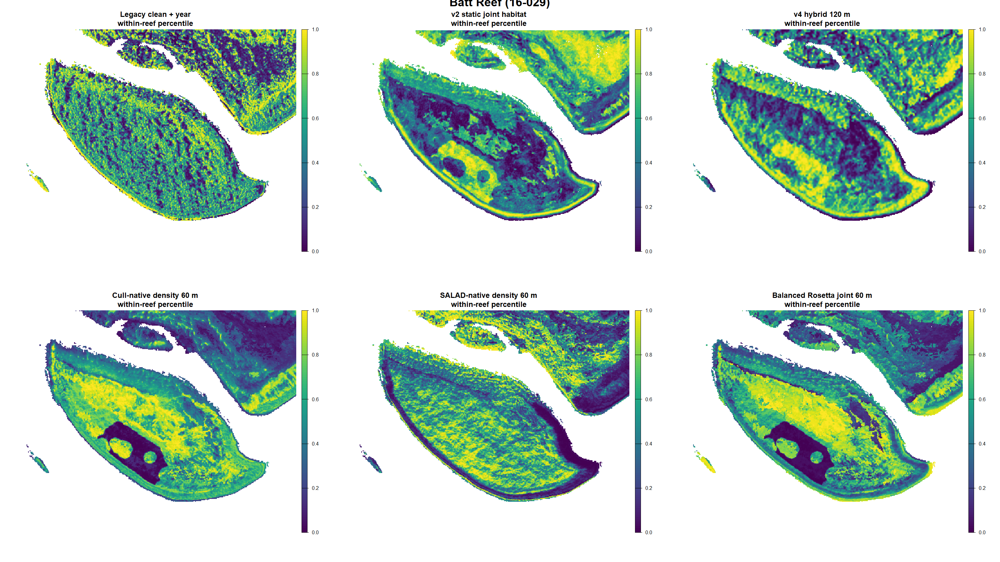
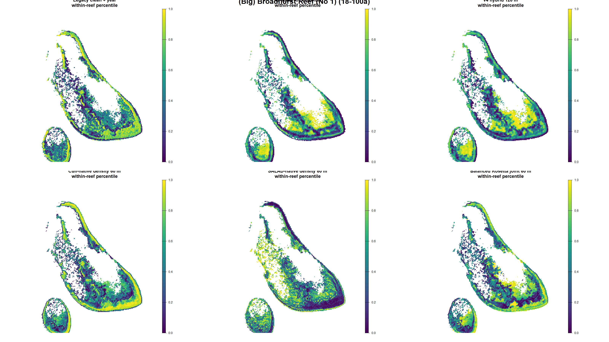
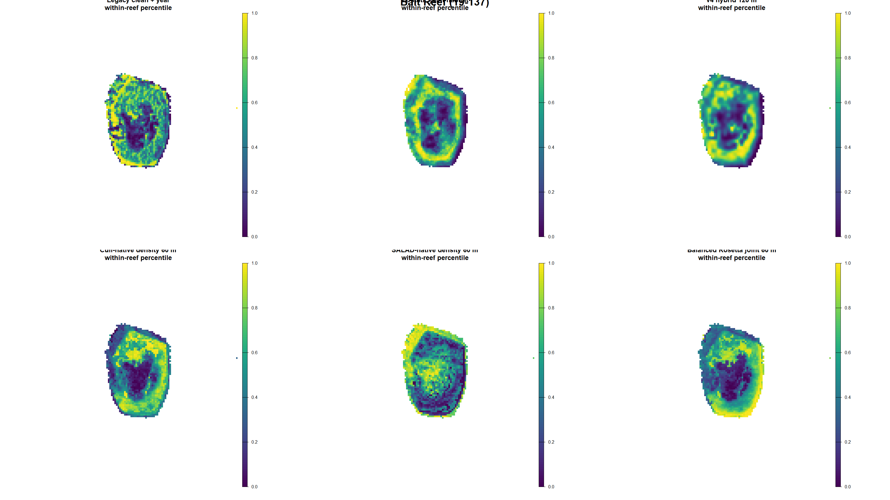

# Continuous COTS density and RosettaCOTS: iteration 07

Last evaluated: 2026-09-11

## Decision

**NOT PROMOTED. Legacy clean + year remains the production incumbent.**

Continuous density is a scientifically preferable target to a hard `CPUE >=
0.02` label when abundance information is reliable. In these data, however,
changing the response did not recover transferable within-reef habitat rank.
Cull-native density was essentially uninformative within reef-years. The 60 m
SALAD-native model had useful forward-year signal but failed held-cell and
leave-reef tests. Combining the methods through the published RosettaCOTS
calibration created a conflict rather than a stronger shared surface.

The density branch is therefore retained as a reproducible diagnostic, not a
successor. No clean fallback was fitted: its enhanced surface covers only
11-50% of the four diagnostic reef extents, and extending a candidate that
already fails independent transfer would create a more complete but still
unsupported product.

## Data and estimand

The deployable predictor is a static active-outbreak habitat score. It includes
geomorphology, Acropora suitability, exposure and the reduced multiscale terrain
basis used by the corrected Hmsc branch. Reef identity, calendar year, outbreak
probability, survey method, realised effort and Cull history are excluded from
the habitat score. Outbreak activation remains a separate reef-year layer.

| Input | 60 m | 120 m |
|---|---:|---:|
| Enhanced predictor cells | 23,922 | 18,330 |
| Eligible pre-depletion Cull visits | 6,793 | 6,667 |
| Cull zero fraction | 0.268 | 0.267 |
| Cull years | 2002-2026 | 2002-2026 |
| Retained SALAD tracks | 553 | 511 |
| SALAD tracks excluded for coverage | 161 | 197 |
| SALAD zero fraction | 0.136 | 0.131 |
| SALAD years | 2021-2026 | 2021-2026 |
| SALAD density reconciliation failures | 0 | 0 |

SALAD uses the curated `Total` column and reported swept area. Its
`Density_inclScars` equals `Total / AREA(5MWIDE) * 10,000` for every track.
Three curated totals intentionally differ from a naive COTS-plus-scar sum and
were preserved. A track is one likelihood observation: expected counts are
summed across all intersected cells, weighted by swept area. Track counts are
never copied into every crossed cell.

Cull uses its direct count with log dive-minutes as an offset. Only same-day or
pre-depletion ecological observations in active reef-years enter the habitat
fit. This restriction reduces, but cannot remove, preferential targeting and
CPUE hyperstability.

## RosettaCOTS calibration and unit audit

The analysis vendors RosettaCOTS 1.0.2 at source commit
`ef4e08e7566f3c849a9da905733e8b4cb06ca5de`. The package and its calibration
paper are available at:

- https://github.com/Scott-Foster/RosettaCOTS
- https://link.springer.com/article/10.1007/s00338-026-02878-z

At Cull CPUE 0.04, the local package returns a median SALAD prediction of 20.62
COTS-plus-scars per hectare; at 0.08 it returns 27.98 per hectare. These match
the paper closely. Package prose inconsistently labels SALAD values as per
minute, per square metre and per hectare. The posterior calibration itself is
consistent with **SALAD density per hectare**. An initial `/10,000` offset was
therefore rejected and its metrics archived as
`density_model_metrics_rejected_m2_unit_error.csv`. All results below use the
verified per-hectare parameterisation.

RosettaCOTS is used as a fixed observation link, not to manufacture converted
pseudo-observations. The joint latent score is expected SALAD-equivalent
COTS-plus-scars per hectare. SALAD retains its native track count/area
likelihood; Cull retains count/minute likelihood and is linked to the latent
density through the posterior-median Cull-from-SALAD calibration.

## Models

1. **Cull native:** negative-binomial Cull counts with dive-minutes offset;
   output is expected Cull CPUE.
2. **SALAD native:** negative-binomial curated track totals with exact
   footprint area; output is expected COTS-plus-scars per hectare.
3. **Rosetta joint:** shared SALAD-equivalent density with native likelihoods
   for both methods and a fixed Rosetta link.
4. **Method-balanced Rosetta sensitivity:** as above, but Cull observations
   receive weight `nSALAD / nCull` (0.081 at 60 m; 0.077 at 120 m), so each
   method has approximately equal total likelihood weight. This is a diagnostic
   sensitivity, not a sampling correction.

All models use negative-binomial dispersion by method and regularising Gaussian
priors. They were evaluated by five-fold held 3 km cells, five-fold leave-reef,
and forward-year testing (train through 2023, test 2024-2026). Overall Spearman
correlation is reported for context; the operational test is rank within the
same reef-year.

## Results

### Native density models

| Support/model | Validation | Overall rho | Within reef-year rho | Top-20% density lift |
|---|---|---:|---:|---:|
| 60 m Cull | held cell | 0.044 | -0.025 | 1.66 |
| 60 m Cull | leave reef | -0.003 | -0.006 | 1.46 |
| 60 m Cull | forward year | -0.034 | -0.004 | 1.20 |
| 60 m SALAD | held cell | 0.191 | -0.019 | 1.14 |
| 60 m SALAD | leave reef | 0.050 | 0.042 | 1.17 |
| 60 m SALAD | forward year | 0.398 | **0.218** | 1.57 |
| 120 m Cull | held cell | 0.036 | -0.034 | 1.50 |
| 120 m Cull | leave reef | 0.025 | -0.011 | 1.43 |
| 120 m Cull | forward year | -0.040 | 0.021 | 1.00 |
| 120 m SALAD | held cell | 0.189 | -0.052 | 0.96 |
| 120 m SALAD | leave reef | 0.164 | 0.013 | 1.00 |
| 120 m SALAD | forward year | 0.276 | 0.055 | 1.22 |

The 60 m SALAD result is the only encouraging density result: it ranks recent
SALAD density moderately well in forward years. It is not independently
replicated by held cells or unseen reefs. Cull CPUE has top-tail enrichment in
some splits but no monotonic within-reef rank, which is consistent with
preferential targeting, local depletion, effort heterogeneity and catch-rate
hyperstability overwhelming static habitat signal.

### Joint calibration models

| Support/model | Validation/method | Overall rho | Within reef-year rho | Top-20% lift |
|---|---|---:|---:|---:|
| 60 m unweighted | held / SALAD | -0.231 | -0.088 | 0.66 |
| 60 m unweighted | leave / SALAD | -0.135 | -0.109 | 0.83 |
| 60 m unweighted | forward / SALAD | -0.211 | -0.021 | 1.16 |
| 60 m balanced | held / SALAD | -0.178 | -0.035 | 0.77 |
| 60 m balanced | leave / SALAD | -0.056 | -0.051 | 1.05 |
| 60 m balanced | forward / SALAD | -0.251 | 0.026 | 0.54 |
| 120 m balanced | held / SALAD | -0.086 | 0.021 | 1.03 |
| 120 m balanced | leave / SALAD | -0.092 | 0.033 | 0.92 |
| 120 m balanced | forward / SALAD | -0.208 | 0.024 | 0.72 |

Equal method influence reduces the most extreme reversal but does not recover a
shared density surface. The problem is not merely the 13:1 row imbalance. Cull
CPUE and SALAD COTS-plus-scar density are observing different mixtures of true
abundance, spatial support, detection, scars, targeting and intervention. A
fixed pairwise calibration estimated in a separate experiment cannot absorb
those field processes.

All full and blocked fits returned convergence code zero with positive-definite
Hessians. Maximum gradients across folds were about 0.016 for Cull-native,
0.0025 for SALAD-native, 0.031 for unweighted joint and 0.0062 for balanced
joint fits. Numerical convergence therefore does not rescue the ecological
validation failure.

## Four-reef visual review

Panels show within-reef percentile to reveal spatial ordering. Colour stretch
is not used as a model score. The models were developed independently; neither
agreement nor disagreement with the incumbent is a promotion rule. Each panel
contains legacy clean + year, v2 static joint habitat, the v4 120 m hybrid,
Cull-native density, SALAD-native density and the balanced joint density model.

### Eyrie

### Batt

### Broadhurst

### Bait

Automated QA confirmed all four PNGs are 3200 by 1800 pixels and all 12 density
GeoTIFFs exist. Direct visual inspection remains the expert gate. Enhanced
coverage is 16.2% at Eyrie, 50.4% at Batt, 19.7% at Broadhurst and 11.2% at
Bait. SALAD-native rank correlations with v2 are -0.205 to 0.046 and with the
v4 hybrid are -0.280 to -0.051. This describes distinct spatial structure; it
is not itself evidence for or against the maps.

## Promotion gates

| Gate | Result |
|---|---|
| Continuous target and observation support | PASS |
| Exact SALAD footprints; no count duplication | PASS |
| Verified Rosetta units | PASS |
| Reef/year/effort absent from habitat score | PASS |
| Held-cell within-reef transfer | **FAIL** |
| Leave-reef within-reef transfer | **FAIL** |
| Forward-year transfer | mixed; SALAD-only 60 m signal |
| Joint-method compatibility | **FAIL** |
| Full coverage fallback | **FAIL / intentionally not extended** |
| Expert-map acceptance | PENDING |
| Promotion | **FAIL** |

## Harmonised next steps

1. Complete one final expert-zone review of the density panels and the earlier
   v2/v4/v5 panels, recording concrete accepted and rejected reef zones.
2. Do not fit further density variants from the current Cull/SALAD data unless
   a new design supplies independent validation, repeat pre-intervention counts,
   or a survey-standardised abundance response.
3. Retain SALAD density as an independent validation layer. Its 60 m
   forward-year result is worth revisiting only with more reefs and years.
4. Keep RosettaCOTS for cautious reporting-scale conversion with full intervals,
   not as a deterministic ecological observation model across historical field
   programmes.
5. Review candidates against the operational objective and choose between the
   accepted legacy incumbent and an expert-accepted geomorphic development
   surface. Do not promote on a small metric difference alone.
6. If a future candidate is accepted, apply the proven enhanced -> clean
   multiscale -> clean native fallback hierarchy and ship a prediction-source
   layer before deployment.

## Reproduction

Run scripts `01c`, `01b`, `02b`, `03`, `04`/`04b`, and `05b` in order. The
canonical corrected metrics are `outputs/density_model_metrics.csv` and
`outputs/density_balanced_joint_metrics.csv`. The explicitly named rejected
unit-error file is retained for audit only.
