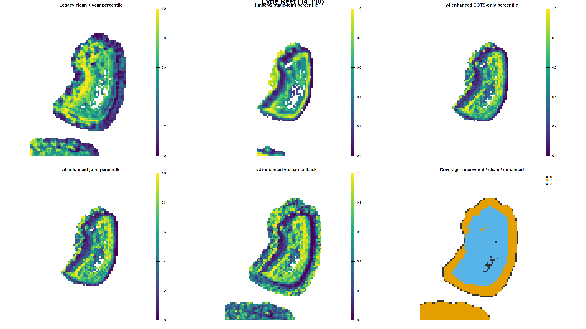
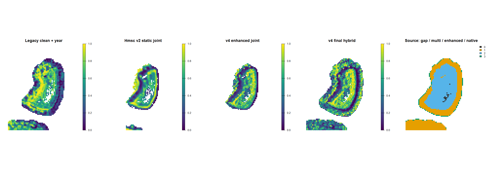
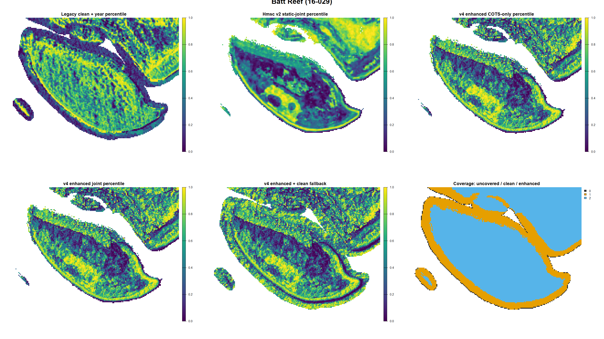
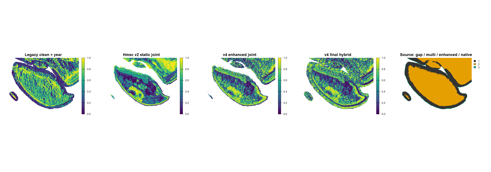
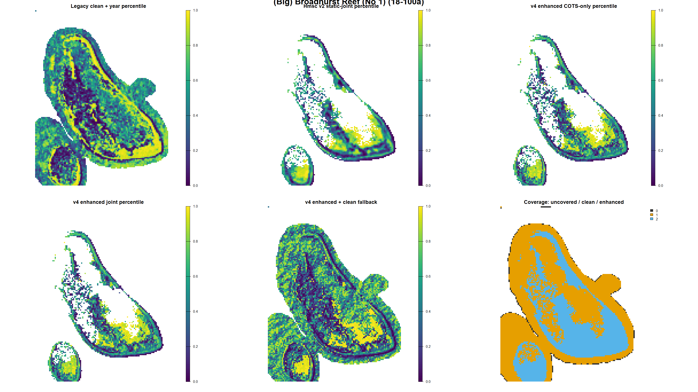
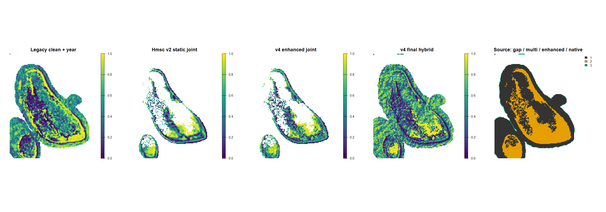
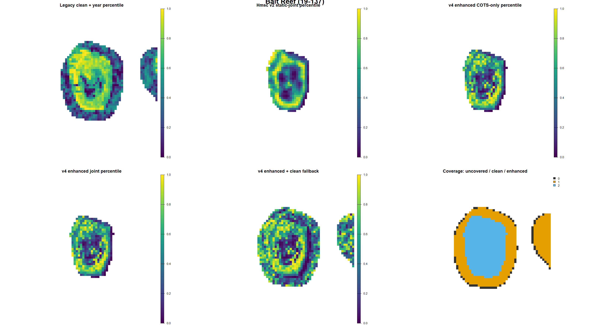
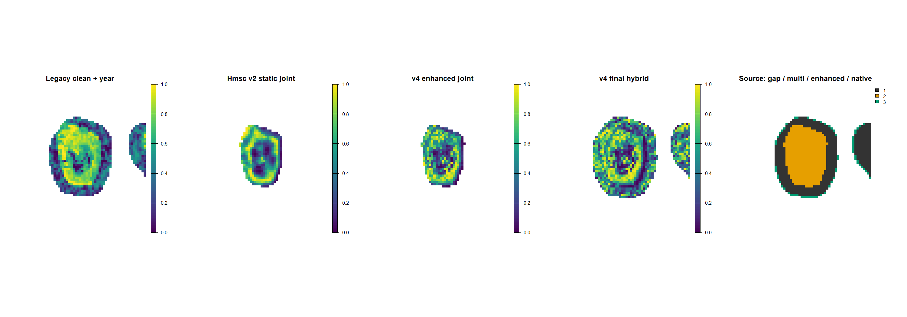

# Corrected conditional Hmsc v4: iteration 04

Last evaluated: 2026-09-09

## Decision

**NOT PROMOTED. Legacy clean + year remains the production incumbent.**

This iteration corrects the main design regressions identified in v3 and
recovers substantially more of the Hmsc v2 static-joint geography. It restores
active-reef-year conditioning, uses strong manta evidence at whole-tow
support, restores scars and continuous SALAD density, tests coral-resource
responses separately, and implements a three-stage full-coverage hierarchy.

The corrected map must still pass expert inspection. Statistical promotion is
not possible yet because forward ranking remains weak and the preliminary
enhanced Hmsc posterior does not meet convergence gates.

## Corrected estimand

The ecological model is once again conditional:

> Given credible evidence that COTS are present in a reef-year, where within
> that reef are problematic-density COTS most likely to occur?

The v3 Hmsc table had retained 896 rows from 349 reef-years with no positive in
its six-response block. V4 rebuilds activity using localized Cull, RHIS and
SALAD direct/scar evidence plus strong manta evidence. It excludes 4,671 of
25,412 localized units from inactive reef-years and retains 20,741 units from
1,278 active reef-years before predictor completeness.

Reef-year outbreak probability, reef identity, year, effort and method remain
outside the deployable habitat score.

## Manta evidence policy

A manta tow is a **strong positive** if any of the following holds:

- at least one COTS was directly observed;
- at least two scars were counted in the newer numeric field; or
- the older categorical scar field is `c` (common).

Single counted scars and the older `p` (present) class are weak evidence. They
are retained for sensitivity analysis but do not define the primary positive.
Strict negatives require zero COTS, categorical scars absent, and zero/no
numeric scar count.

| Evidence class | Tows |
|---|---:|
| Strict negative | 182,653 |
| Weak single or present scar | 15,467 |
| Direct COTS | 11,418 |
| Multiple counted scars, excluding direct-positive tows | 4,377 |
| Legacy common scars, excluding stronger classes | 404 |
| **Strong-positive union** | **16,199** |

Manta habitat predictors are length-weighted across every available crossed
120 m cell and aggregated back to one row per tow. Positive tow evidence is
never copied to every crossed cell. Strong manta positives also activate a
reef-year for the conditional ecological model.

### Footprint validation

| Definition | Domain | Validation | Overall AUC | Within-reef-year AUC |
|---|---|---|---:|---:|
| Strong primary | Clean | Held 3 km footprint | 0.557 | 0.557 |
| Strong primary | Enhanced | Held 3 km footprint | 0.561 | 0.560 |
| Strong primary | Enhanced | Leave reef | 0.540 | 0.544 |
| Strong primary | Enhanced | Forward 2024-2026 | 0.571 | 0.576 |
| Any scar sensitivity | Enhanced | Held 3 km footprint | 0.569 | 0.574 |
| Any scar sensitivity | Enhanced | Leave reef | 0.548 | 0.552 |
| Any scar sensitivity | Enhanced | Forward 2024-2026 | 0.577 | 0.575 |

The broader scar definition improves held data but does not improve forward
within-reef ordering. Strong evidence therefore remains primary; all scars
remain a sensitivity response.

## Response-block correction

The localized Hmsc block contains:

- Cull problematic density and direct evidence;
- SALAD problematic density, direct evidence, scars, and continuous
  `log1p(Density_inclScars)`;
- RHIS adult COTS, juvenile COTS, branching scars and table scars.

RHIS live branching/table coral responses are added only in the `joint`
variant. Recent coral mortality remains excluded. Mapped Acropora layers are
habitat covariates in both variants.

The COTS-only and joint-resource target predictions are almost identical:
Spearman correlation 0.9998 and mean absolute probability difference 0.0013.
Held and forward validation are likewise tied. The coral-resource responses
are therefore neither gaming nor materially improving the Cull target in this
fit; map morphology can determine whether they are worth retaining.

## Terrain representation screen

Five representations were compared with nested scale selection inside every
outer partition: no Gaussian terrain, one actual scale per family, one-PC per
family, up-to-two-PC per family, and all-scale shrinkage.

Key findings:

- terrain is essential: base-only models perform substantially worse;
- all-scale shrinkage is strongest for held clean cells (within AUC 0.558) and
  leave-reef clean cells (0.562), but falls to 0.509 forward;
- enhanced one-PC is the most balanced reduced representation: 0.566 held,
  0.557 leave reef, and 0.518 forward within-reef-year AUC;
- selected actual scales are unstable for several families and do not improve
  transfer. Stable selections include enhanced BPI at 360 m, eastness at
  360 m, and northness at 60 m.

The preliminary Hmsc fits consequently retain one PC per terrain family. This
choice is supported by transfer rather than used merely to improve mixing.

## Preliminary Hmsc results

| Model | Apparent overall / within AUC | Held 3 km overall / within | Leave reef overall / within | Forward overall / within |
|---|---:|---:|---:|---:|
| Enhanced COTS-only | 0.600 / 0.598 | 0.572 / 0.569 | not rerun | 0.513 / 0.515 |
| Enhanced joint-resource | 0.600 / 0.598 | 0.571 / 0.570 | 0.514 / 0.545 | 0.513 / 0.515 |
| Clean joint fallback | 0.576 / 0.585 | diagnostic screen only | diagnostic screen only | diagnostic screen only |
| Clean native fallback | 0.565 / 0.569 | coverage model only | coverage model only | coverage model only |

The cross-validation refits are intentionally short and diagnostic. The
enhanced COTS-only preliminary posterior has minimum beta ESS 74.7 and maximum
upper PSRF 1.148; the joint version has ESS 56.2 and PSRF 1.160. Neither meets
ESS >=400 and upper PSRF <=1.1. The clean multiscale fallback mixes better
(ESS 202, upper PSRF 1.036) but still fails the ESS gate.

Forward habitat ranking remains close to chance. Correcting the estimand has
improved interpretability and restored map form, but has not solved temporal
transfer.

## Coverage architecture

Deployment uses a fixed priority that never allows a fallback to replace an
available enhanced prediction:

1. enhanced geomorphology, ReefGuide exposure, Acropora and multiscale terrain;
2. clean Acropora plus multiscale terrain, calibrated over the overlap;
3. native clean stack, calibrated over the overlap;
4. missing only when the native clean stack itself has no usable value.

Calibration aligns probability scales using probit-linear overlap calibration
and preserves each fallback model's rank. It does not use the legacy model as
a teacher or ranking constraint.

| Reef | Enhanced cells | Clean multiscale | Clean native | Uncovered | Coverage |
|---|---:|---:|---:|---:|---:|
| Eyrie | 1,097 | 1,099 | 107 | 19 | 99.2% |
| Batt | 13,773 | 4,875 | 321 | 0 | 100% |
| Broadhurst | 3,864 | 6,758 | 206 | 0 | 100% |
| Bait | 472 | 556 | 70 | 0 | 100% |

The 19 Eyrie cells lack even the native clean predictor stack and should remain
explicitly missing rather than receive synthetic habitat values.

## Four-reef expert review

The first panels compare the COTS-only and joint response blocks. The second
panels compare legacy clean-year, Hmsc v2 static joint, the v4 enhanced surface,
the final hybrid, and prediction-source coverage. All probability surfaces are
displayed as within-map percentiles; colour stretching is not an assessment
criterion.

### Eyrie Reef

### Batt Reef

### Broadhurst Reef

### Bait Reef

The final v4 hybrid was not trained to match either incumbent. Its descriptive
rank correlation with Hmsc v2 is 0.686 at Eyrie, 0.547 at Batt, 0.721 at
Broadhurst and 0.701 at Bait. Correlation with legacy clean-year ranges from
0.060 to 0.388. Expert acceptance must be based on reef geography and plausible
search priorities, not either correlation.

## Extraction defect found

The v3 support extractor used `terra::extract(base, xy)[, -1]`, assuming that
matrix-coordinate extraction returned an ID column. It did not, so native BPI
was silently dropped from the support table. Gaussian BPI remained present and
all fitted multiscale models are unaffected. The clean native fallback uses the
11 correctly extracted native layers. The 200 m rebuild must correct this and
audit all raster names before fitting.

## Promotion gates

| Gate | Status |
|---|---|
| Active-reef-year conditional estimand restored | PASS |
| Strong manta positives defined without spreading to cells | PASS |
| Scars and continuous SALAD density restored | PASS |
| Reef/year/outbreak/effort absent from habitat score | PASS |
| Clean fallback restored | PASS |
| Four-reef coverage | PASS except 19 source-missing Eyrie cells |
| Held-cell within-reef transfer | PASS, diagnostic |
| Leave-reef within-reef transfer | marginal, 0.545 |
| Forward within-reef transfer | FAIL, 0.515 |
| Preliminary convergence | FAIL |
| Expert map review | PENDING |
| Promotion | **FAIL / NOT PROMOTED** |

## Harmonised next steps

1. Complete expert review of both panel sets. Record specific accepted and
   implausible reef zones rather than asking whether v4 resembles an incumbent.
2. Use the COTS-only enhanced block as the statistical default because the
   coral-resource block changes target predictions by only 0.0013 on average.
   Retain the joint map as an expert-review alternative.
3. Build the matched 200 m exact-footprint table with the raster-column defect
   corrected. Compare 120 m and 200 m at fitted support before downscaling.
4. Extend chains only after a v4 map passes expert review. Do not spend on
   production chains for an operationally rejected geography.
5. Improve forward transfer using independently mapped connectivity/current
   exposure and temporally compatible susceptible-coral condition—not reef
   identity, year or outbreak probability.
6. Treat the validated manta footprint model as a separate evidence layer or
   a footprint-support response in a future joint model. Do not assign tow
   positives to crossed cells whose within-tow location is unknown.
7. Validate reef-year outbreak probability separately as the activation layer;
   it must not reorder cells within a reef.

## Reproduction

Canonical completed entry points are `01a`, `01c`, `02`, `03`, `04`, `04b`,
`05e`, `06b`, `07`, and `08` under `scripts/`. Earlier failed map/aggregation
entry points are retained as an execution audit and should not be used.
