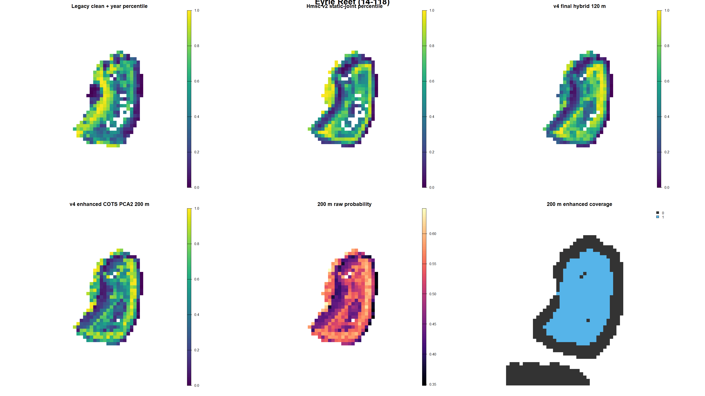
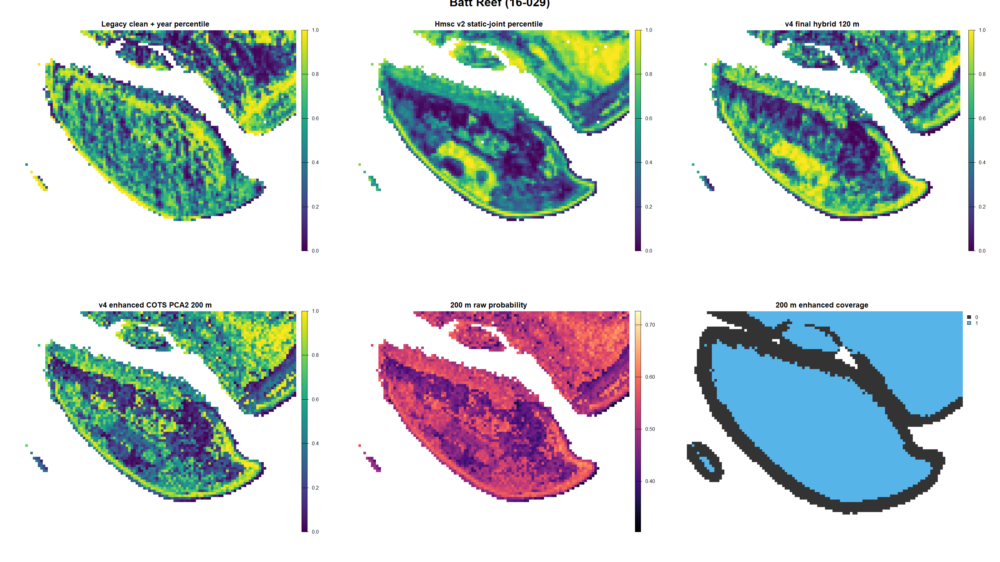
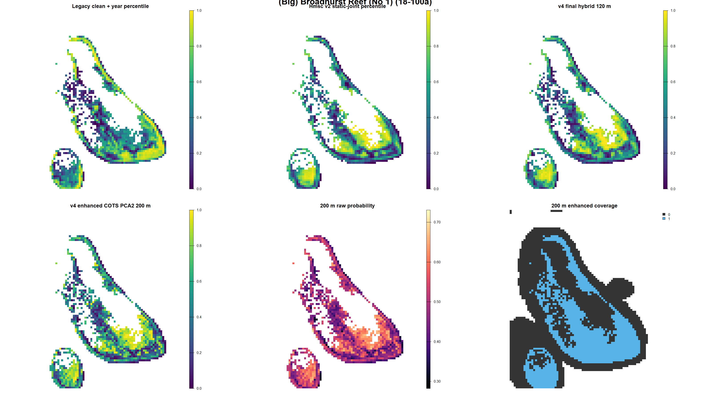
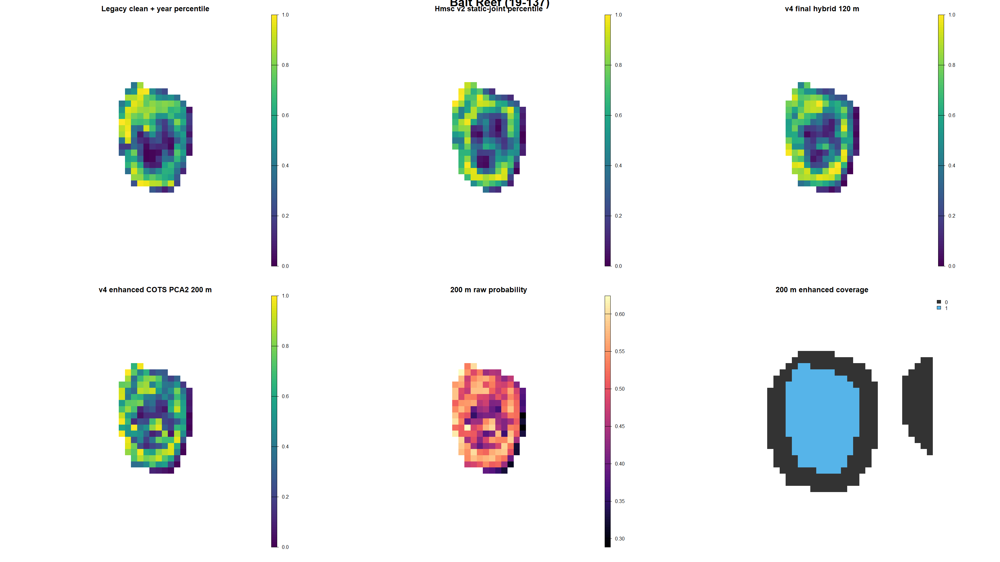
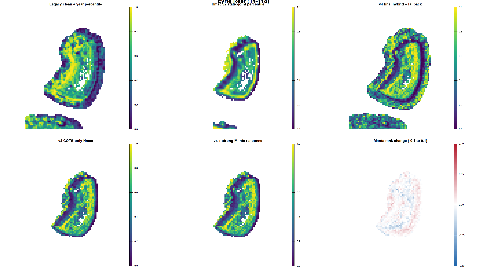
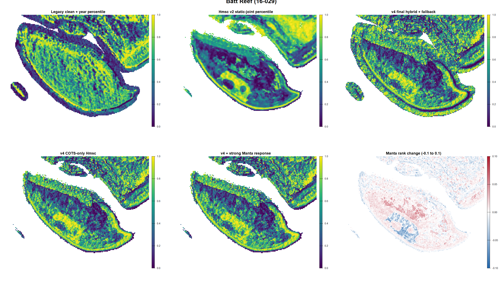
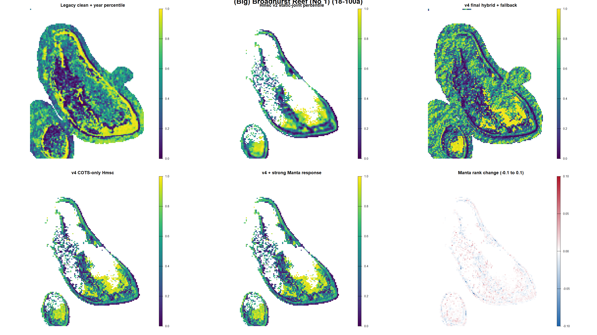
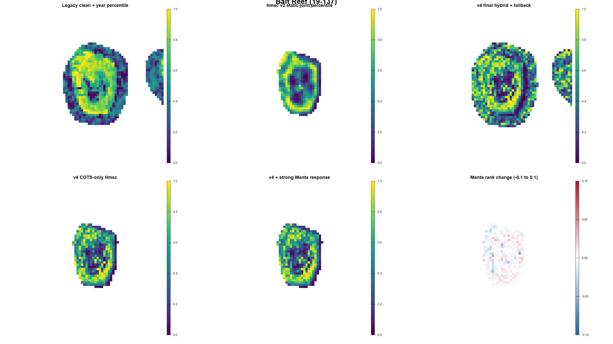

# Corrected Hmsc v4: support-size and Manta-response iteration 05

Last evaluated: 2026-09-09

## Decision

**NOT PROMOTED. Legacy clean + year remains the production incumbent.**

This iteration completes the corrected 200 m exact-footprint branch and tests
strong Manta evidence as a method-specific Hmsc response. Neither is a
successor to the 120 m v4 candidate or the incumbent:

- 200 m improves forward-year within-reef discrimination slightly, but loses
  substantially more held-cell and leave-reef discrimination and has poor
  enhanced-layer coverage;
- adding strong Manta evidence as another Hmsc response leaves the Cull target
  surface almost unchanged, makes convergence worse, and does not improve
  blocked transfer.

The corrected 120 m enhanced model with its clean multiscale and clean native
fallback remains the v4 development baseline. It is not promoted pending expert
map acceptance, forward transfer, and converged production chains.

## What was implemented

### Corrected 200 m support

Manta and SALAD lines were intersected with 200 m cells. Cull and RHIS
footprints were assigned to their 200 m cells, and visits were aligned with the
same three-day rule used at 120 m. Native raster predictors were averaged over
the complete 200 m polygon. The native BPI column was explicitly retained,
correcting the v3 matrix-extraction defect. Gaussian terrain was calculated at
30, 60, 120, 240 and 360 m and attached at 200 m cell centres.

| Audit | Result |
|---|---:|
| Predictor-support cells | 12,473 |
| Complete native stack | 12,158 |
| Complete Gaussian basis | 12,385 |
| Geomorphology observed | 10,625 |
| All localized ecological units | 19,528 |
| Active reef-year units | 15,779 |
| Excluded inactive units | 3,749 |
| Enhanced-complete units | 13,595 |

The same conditional estimand and activity definition were used at 120 and
200 m. Reef, year, outbreak probability, method and realised effort remain out
of the deployable habitat score.

### Strong Manta response

The primary Manta positive remains:

- directly observed COTS; or
- at least two counted scars; or
- legacy categorical `c` / common scars.

Single counted scars and legacy present (`p`) remain weak sensitivity evidence,
not primary positives. The Hmsc test appended one row per whole-tow footprint,
with length-weighted predictors. It retained all strong positives and no more
than three strict negatives per positive within reef-year; reef-years with no
Manta positive retained at most ten strict negatives. No positive was copied to
every crossed cell.

The fitted table contained 32,322 rows: 8,054 localized Cull/SALAD/RHIS rows
and 24,268 Manta footprints, including 7,185 strong Manta positives.

## 120 m versus 200 m terrain screen

The comparison below uses the enhanced two-PC-per-terrain-family
representation because it was the best balanced reduced basis at 200 m. These
are nested blocked ridge screens, not Hmsc apparent fits.

| Validation | 120 m within-reef-year AUC | 200 m within-reef-year AUC | Change |
|---|---:|---:|---:|
| Held 3 km cell | 0.564 | 0.543 | -0.020 |
| Leave reef | 0.554 | 0.555 | +0.000 |
| Forward 2024-2026 | 0.519 | 0.527 | +0.008 |

All-scale shrinkage at 200 m reached 0.546 held, 0.550 leave reef and 0.525
forward. Thus, the conclusion does not depend on choosing PCA2: the coarser
support improves forward stability only modestly while smoothing useful local
structure.

Scale selection at 200 m moves strongly toward broad terrain: DEM and HCU at
360 m, slope and local SD at 240 m, with several eastness/northness selections
at 360 m. That is ecologically plausible, but it does not compensate for the
loss created by fitting 200 m response cells.

## Matched Hmsc support comparison

| Candidate | Apparent within | Held 3 km within | Leave reef within | Forward within | ESS min | PSRF upper |
|---|---:|---:|---:|---:|---:|---:|
| 120 m enhanced COTS, PCA1 | 0.598 | 0.569 | not rerun | 0.515 | 74.7 | 1.148 |
| 120 m enhanced joint, PCA1 | 0.598 | 0.570 | 0.545 | 0.515 | 56.2 | 1.160 |
| 200 m enhanced COTS, PCA2 | 0.585 | 0.541 | 0.528 | 0.528 | 179.1 | 1.060 |

The 200 m posterior has an acceptable PSRF but fails the ESS >=400 gate. More
importantly, its held-cell and leave-reef discrimination are worse. The forward
gain is not large enough to justify that loss.

Enhanced 200 m coverage is also unsuitable as a deployment layer on its own:
46.5% at Eyrie, 71.8% at Batt, 35.2% at Broadhurst and 42.5% at Bait. The 120 m
three-stage enhanced, clean-multiscale and clean-native fallback remains
necessary for full coverage.

## Does strong Manta evidence help inside Hmsc?

### Independent evidence test

Static enhanced habitat predicts the whole-tow strong Manta label with within-
reef-year AUC 0.560 held-cell, 0.544 leave-reef and 0.576 forward. Manta therefore
contains genuine habitat signal and should be retained.

### Simple response augmentation

| Hmsc candidate | Apparent within | Held 3 km within | Leave reef within | Forward within |
|---|---:|---:|---:|---:|
| COTS-only response block | 0.598 | 0.569 | approximately 0.545 in matched enhanced model | 0.515 |
| COTS plus strong-Manta response | 0.599 | 0.569 | 0.546 | 0.515 |

The augmented model's target predictions correlate 0.9996 with the COTS-only
model on fitted Cull rows (mean absolute probability change 0.0019). Across the
four deployment maps, Spearman correlation is 0.9986-0.9994, mean absolute
probability change is 0.0018-0.0027, and mean absolute within-map rank change is
0.0068-0.0106.

Convergence worsened to minimum beta ESS 79.3 and upper PSRF 1.249. The simple
multi-response Hmsc formulation therefore does not transmit useful Manta
information to the Cull target. This is a modelling limitation, not evidence
that Manta observations are uninformative. A formal shared latent occupancy
state with method-specific detection is needed.

## Four-reef support comparison

Panels show within-map percentiles for spatial inspection and the raw 200 m
probability. Percent is not a promotion metric. The 200 m enhanced map is shown
only where its required predictors exist.

### Eyrie

### Batt

### Broadhurst

### Bait

The 200 m candidate correlates strongly with the 120 m final hybrid on common
cells: 0.803 at Eyrie, 0.623 at Batt, 0.820 at Broadhurst and 0.834 at Bait. It
preserves much of the geomorphic form but is smoother and far less complete.

## Four-reef Manta augmentation comparison

The final panel in each figure is the within-map rank change caused by the
strong-Manta Hmsc response. Its narrow visible changes should not be mistaken
for a material new habitat signal.

### Eyrie

### Batt

### Broadhurst

### Bait

Expert review remains pending. Acceptance should describe reef zones that are
plausible or implausible; agreement with the incumbent rank is not required.

## Promotion gates

| Gate | 200 m support | Manta-augmented 120 m |
|---|---|---|
| Conditional active reef-year estimand | PASS | PASS |
| Reef/year/outbreak/effort excluded | PASS | PASS |
| Exact/compatible observation support | PASS | PASS at whole-tow support |
| Held-cell transfer | FAIL versus 120 m | no improvement |
| Leave-reef transfer | FAIL versus 120 m | no improvement |
| Forward transfer | small improvement, still weak | no improvement |
| Convergence | FAIL ESS | FAIL ESS and PSRF |
| Full enhanced coverage | FAIL | requires existing fallback |
| Four-reef expert acceptance | PENDING | PENDING |
| Promotion | **FAIL** | **FAIL** |

## Harmonised next steps

1. Complete expert review of both four-reef panel sets and record concrete
   accepted/rejected reef zones. Do not require either candidate to reproduce
   incumbent ranks.
2. Keep 120 m as the development support. Test 60 m next as the finer matched
   alternative; evaluate it only at fitted support and retain the same 3 km,
   leave-reef and forward splits.
3. Keep strong Manta evidence as a separate, validated whole-tow evidence
   layer and as an activation input. Do not retain the simple extra-response
   Hmsc as a successor.
4. Build a formal latent occupancy/abundance model in which Cull, Manta, SALAD
   and RHIS observe a shared ecological state through method-specific detection
   functions. Model scar persistence/error separately and Cull depletion as an
   intervention process.
5. Preserve the strong Manta primary definition. Run single/present scars only
   as a labelled sensitivity analysis until scar age and false-positive rates
   can be modelled.
6. Keep the 120 m enhanced -> clean multiscale -> clean native fallback. Never
   let a fallback overwrite an available enhanced prediction, and always ship a
   prediction-source layer.
7. Improve forward transfer with independent connectivity/current exposure and
   temporally compatible susceptible-coral condition. Keep reef-year outbreak
   probability as a separate activation layer that cannot reorder sites.
8. Run longer production chains only after a spatial surface passes expert
   review; require beta ESS >=400, upper PSRF <=1.1, and all blocked validation
   gates.

## Reproduction

Canonical new entry points are `09`, `10`, `11b`, `12`, `13b`, `14`, `15`,
`16b`, `17`, `18`, `19`, `19b`, `20`, and `21b` under `scripts/`. Script `19`
saved a valid model and artifact before a metrics-only naming collision;
`19b` is the canonical recovery step. Script `21b` is the corrected executable
map wrapper.
