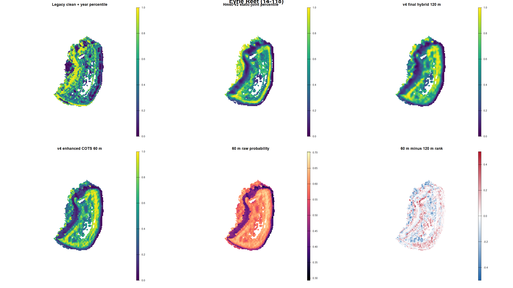
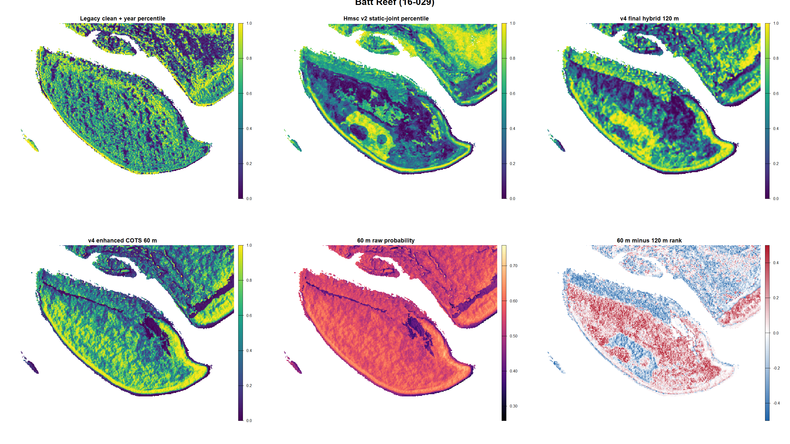
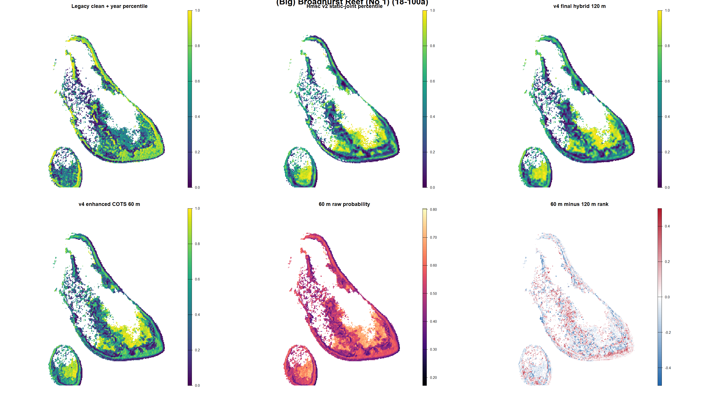
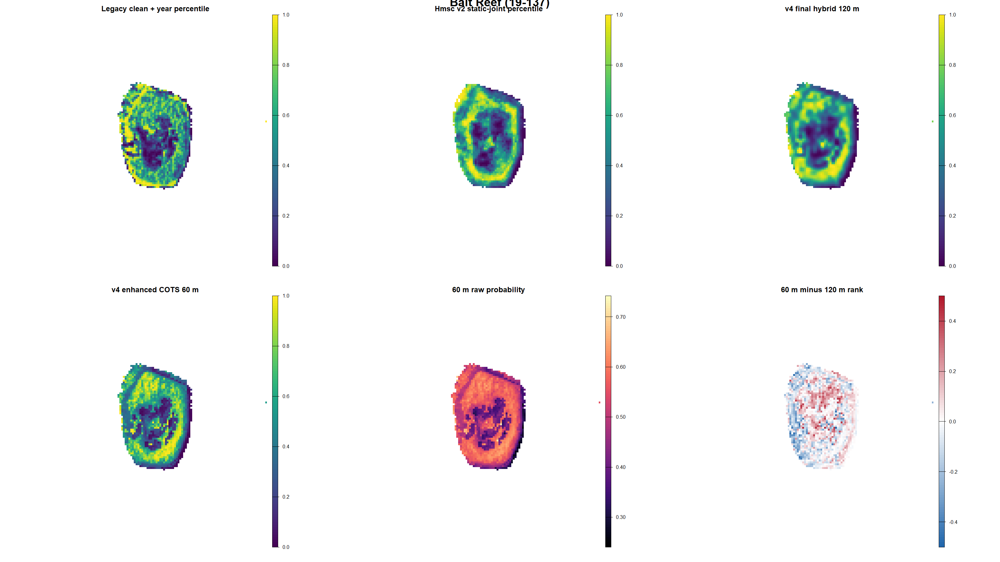
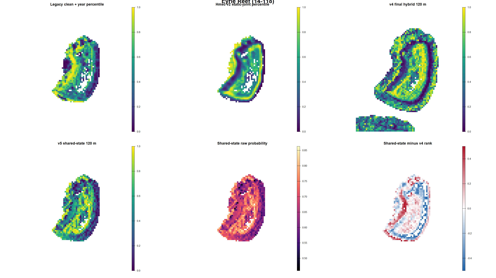
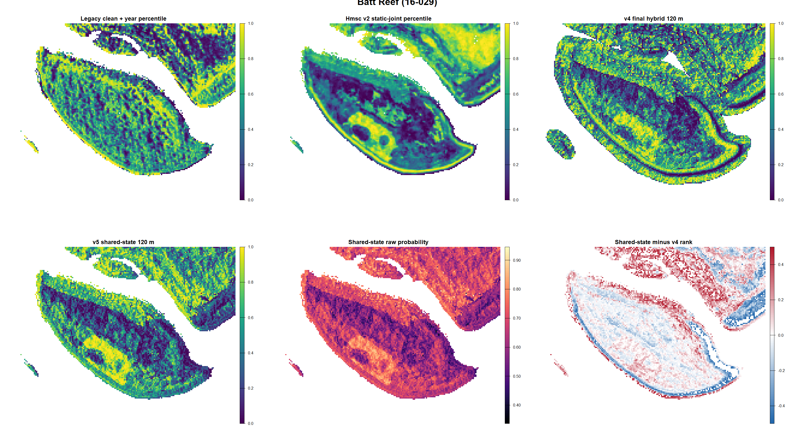
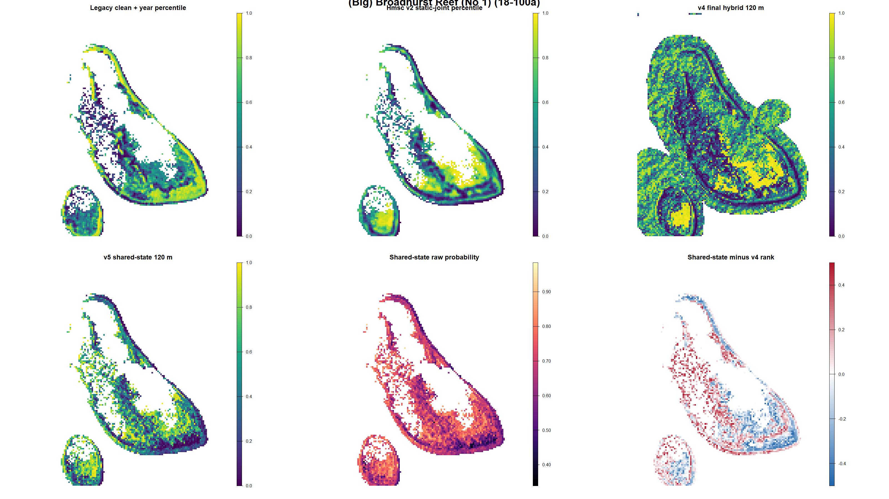
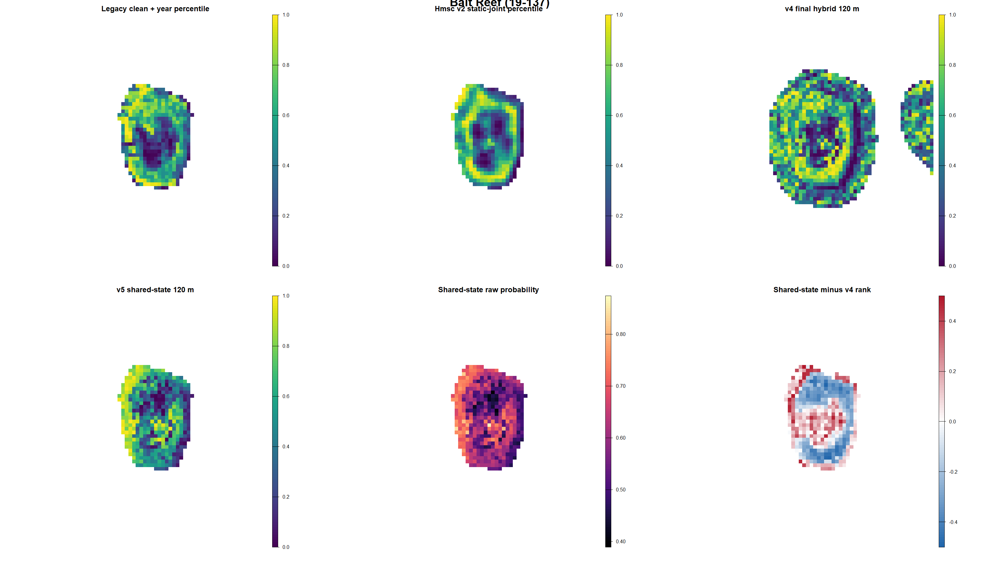

# Shared-state occupancy/detection v5: iteration 06

Last evaluated: 2026-09-10

## Decision

**NOT PROMOTED. Legacy clean + year remains the production incumbent.**

This iteration does align with the requested multi-method occupancy/detection
direction. Cull, RHIS, SALAD and Manta are observation processes conditional on
a shared latent COTS state; strong Manta evidence is no longer appended as a
simple Hmsc response. Scar false positives/persistence and post-Cull observations
are represented separately. Survey method and effort do not enter the habitat
score.

It is nevertheless a preliminary integrated model, not yet a production-grade
dynamic occupancy model. Its held-cell and leave-reef within-reef discrimination
are promising, but forward-year discrimination is at chance, the optimizer
reports false convergence, several scar-process terms are not identified, and
the Manta whole-track component is a weighted marginal composite likelihood.

The matched 60 m Hmsc candidate is retained for expert review. It materially
improves forward transfer relative to 120 m but does not pass convergence or
expert-map gates. No longer Hmsc run is justified until its surface is accepted.

## What was implemented

### Shared ecological state

The state is the probability that a 120 m cell-year supports problematic COTS
density. The state predictor contains geomorphology, Acropora suitability,
exposure and reduced Gaussian multiscale terrain. It excludes reef identity,
year, survey method, realised effort, Cull history and outbreak probability.

Reef-year outbreak probability remains a separate activation layer. It may
change whether an outbreak is active, but may not reorder sites within a reef.

### Method-specific observation processes

- Cull records `CPUE >= 0.02` and includes effort plus post-first-Cull timing.
- RHIS and SALAD direct observations have separate intercepts and effort terms.
- RHIS and SALAD scars have separate sensitivity and false-positive parameters.
- Manta direct positives and strong-scar positives are whole-track observations.
- Strong Manta evidence is direct COTS, at least two counted scars, or legacy
  common scars. Single/present scars are excluded from the primary model.
- Positive Manta tracks are not copied to every crossed cell. The likelihood
  asks whether detection occurred somewhere along the intersected footprint.

The state is exactly marginalized for repeated point observations. Overlapping
Manta tracks are handled with a downweighted composite likelihood, so the model
does not yet capture their full joint spatial dependence.

### Observation audit

| Quantity | Count |
|---|---:|
| State cell-years | 27,753 |
| Point site-years | 10,869 |
| Repeated point site-years | 6,481 |
| Direct observations / positives | 20,739 / 13,141 |
| Scar observations / positives | 3,682 / 1,716 |
| Manta tows | 13,318 |
| Manta direct / strong-scar positives | 5,087 / 2,098 |
| Manta strict negatives | 6,133 |
| Manta cell links | 24,583 |

### Matched 60 m support

The 60 m branch intersects Manta/SALAD footprints with 60 m cells and averages
native predictors over the true fitted support. It uses the same PCA1 reduction,
active-reef-year estimand and blocked tests as the 120 m candidate.

| Candidate | Held within | Leave-reef within | Forward within | ESS min | PSRF upper |
|---|---:|---:|---:|---:|---:|
| v4 enhanced Hmsc 120 m | 0.569-0.570 | 0.545 | 0.515 | 56-75 | 1.15-1.16 |
| v4 enhanced Hmsc 60 m | 0.560 | 0.546 | 0.543 | 63.7 | 1.336 |

The 60 m model gives up about 0.009 held-cell AUC, is effectively tied on
unseen reefs, and gains 0.028 forward-year AUC. It fails both ESS and PSRF gates.
Its four-reef rank correlation with the 120 m hybrid is 0.695-0.885, preserving
broad geomorphic form while adding a meaningful support-dependent difference.

## Shared-state results

| Validation | Rows | Positives | Overall AUC | Within-reef-year AUC |
|---|---:|---:|---:|---:|
| Held 3 km cell, 5-fold | 3,844 | 1,852 | 0.554 | 0.604 |
| Leave reef, 5-fold | 3,844 | 1,852 | 0.518 | 0.579 |
| Forward, train through 2023 | 1,059 | 487 | 0.470 | 0.504 |

The held and leave-reef results show that explicit method/detection separation
can recover transferable within-reef structure. The forward result shows that
the current static state and observation assumptions do not transfer to new
years. This is a stronger modelling foundation, but not a better operational
map yet.

The refined full fit has a positive-definite Hessian and maximum absolute
gradient 0.0022, but `nlminb` reports false convergence. Latent-state
probabilities span 0.115-0.967 (median 0.678). Fold gradients reach 0.090, so
all blocked scores remain preliminary.

The Cull process estimates lower detection at baseline, a positive immediate
post-Cull association and declining evidence with days since first Cull. This
is consistent with preferential targeting followed by depletion, but it is not
a clean causal depletion estimate. Scar effort and post-Cull scar terms are not
currently informed by the likelihood and must not be interpreted.

## Covariate audit

No independent larval/current connectivity layer was located in the repository.
Reef identity or outbreak probability will not be used as a proxy. Existing
`waves_Hs`, `waves_Tp` and turbidity are exposure variables in the enhanced
ReefGuide stack. `AhyaD`, `Aspat` and `Aten` are static susceptible-coral
suitability proxies, not measured coral condition. RHIS branching/table coral
can be tested only after leakage-safe temporal alignment to pre-treatment visits.

Enhanced coverage remains incomplete: approximately 47% at Eyrie, 73% at Batt,
36% at Broadhurst and 43% at Bait. Any candidate therefore requires the existing
enhanced -> clean multiscale -> clean native hierarchy and a prediction-source
layer. The shared-state panels currently show the enhanced domain for diagnosis;
they are not deployment-ready full-coverage products.

## Four-reef 60 m versus 120 m comparison

Panels use within-map percentile for spatial review and include raw probability
separately. Colour stretching is not a validation metric.

### Eyrie

### Batt

### Broadhurst

### Bait

## Four-reef shared-state comparison

These panels compare legacy clean + year, Hmsc v2, the v4 120 m hybrid and the
v5 shared-state surface. Agreement with the incumbent is context, not a gate.

### Eyrie

### Batt

### Broadhurst

### Bait

The shared-state candidate is not a disguised incumbent: reef-specific rank
correlations with legacy are -0.003 to 0.358 and with the v4 hybrid are
0.604-0.696. Expert judgement must now identify specifically useful and harmful
zones rather than accepting or rejecting global similarity.

Automated QA confirmed that all eight comparison PNGs, eight candidate GeoTIFFs
and both manifests were created. Direct visual inspection from this session was
blocked by the Windows split-root image sandbox; the expert gate remains pending.

## Promotion gates

| Gate | 60 m Hmsc | Shared-state 120 m |
|---|---|---|
| Correct target and support | PASS | PASS, preliminary |
| Method/effort excluded from habitat score | PASS | PASS |
| Multi-method detection formulation | not applicable | PASS in first integrated form |
| Held-cell transfer | competitive | promising |
| Leave-reef transfer | competitive | promising |
| Forward-year transfer | improved but weak | **FAIL: chance** |
| Convergence | **FAIL** | **FAIL** |
| Full coverage fallback | available, must be applied | required, not yet applied |
| Four-reef expert acceptance | PENDING | PENDING |
| Promotion | **FAIL** | **FAIL** |

## Harmonised next steps

1. Complete `expert_zone_review_20260910.csv` for all four reefs, including the
   new 60 m and shared-state panels. Record concrete accepted/rejected zones.
2. Use those annotations as an independent operational gate. Do not optimize
   coefficients or ranks directly against the expert panel.
3. If the 60 m surface is accepted, extend only that Hmsc candidate and require
   ESS >=400 and upper PSRF <=1.1 before reconsidering it.
4. Refactor the TMB likelihood to include actual scar effort, distinguish scar
   recency classes, and remove or identify uninformed parameters. Add repeated
   starts and stricter gradient checks to every blocked fold.
5. Develop a dynamic state process separating persistent habitat suitability
   from reef-year activation. External outbreak probability may inform
   activation but must remain constant within a reef-year.
6. Replace the Manta composite likelihood with a joint track/cell formulation,
   or validate the approximation with simulation and repeated-track subsets.
7. Build temporally aligned, pre-treatment RHIS branching/table coral covariates
   and test them as ecological predictors, not as dominant response species.
8. Acquire an independent connectivity/current layer before claiming a
   connectivity effect. Retain existing exposure only in the enhanced branch.
9. Apply and validate the enhanced -> clean multiscale -> clean native fallback
   to any expert-accepted shared-state surface before deployment.

Longer chains or more complex Hmsc fits are intentionally deferred. More
sampling cannot rescue a surface that fails expert review, and Hmsc chain
diagnostics do not apply to the TMB shared-state model.
