# Current best COTS fine-scale model

Last evaluated: 2026-09-08

## Current decision

**Legacy clean + year**

The legacy clean-year model remains the incumbent. The independent 120 m
geomorphology-led Hmsc v3 candidate is not promoted yet: held-cell and
leave-reef within-reef ranking are promising, but forward transfer is weak,
minimum beta ESS is below the production gate, and four-reef expert review is
pending. The candidate was fitted without legacy scores/ranks, reef identity,
year, outbreak probability or realised effort. The earlier two-part candidate
remains rejected by expert review.

## Incumbent evidence

- Within-reef-year AUC: 0.568
- Top-20% capture: 0.251
- Top-20% lift: 1.095
- The legacy 2026 raster can be reproduced exactly from its frozen model.
- It remains the statistically accepted production surface. The geomorphic
  form of Hmsc v3 is now the preferred direction for a future operational
  successor, without requiring agreement with incumbent ranks.

## Latest successor attempt: geomorphology-led Hmsc v3, not promoted

The v3 candidate uses exact manta/SALAD line-to-cell intersections, saved
SALAD event-time locations, 1/3/7-day alignment sensitivity, support-matched
60 m and 120 m predictors, and a one-PC-per-terrain-family Hmsc basis. Its
response block contains six COTS signals; coral mortality is excluded and
mapped Acropora layers are covariates.

| Evaluation | Overall AUC | Within-reef-year AUC |
|---|---:|---:|
| Apparent fit | 0.597 | 0.602 |
| Held 3 km cell blocks, 5-fold | 0.565 | 0.572 |
| Leave reef out, 5-fold | 0.493 | 0.565 |
| Forward, train through 2023 | 0.512 | 0.522 |

The four-chain 120 m fit has maximum upper PSRF 1.053 and minimum beta ESS
354; the ESS>=400 gate is not yet met. Fine-cell occupancy/detection fits were
also rejected because only 323-337 localized sites had repeat visits. Scar
persistence and Cull depletion were estimable as separate processes and both
converged. Four 120 m comparison maps are embedded in the iteration report:
`iterations/hmsc_geomorphic_v3/reports/HMSC_GEOMORPHIC_V3_ITERATION_03.md`.
Expert review remains pending.

### Current v3 expert-review panels (120 m fitted support)

The incumbent percentile is context only. The Hmsc percentile, raw habitat
probability and geomorphic class are shown independently; rank agreement is
not an acceptance requirement.

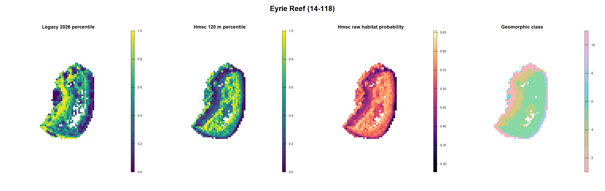

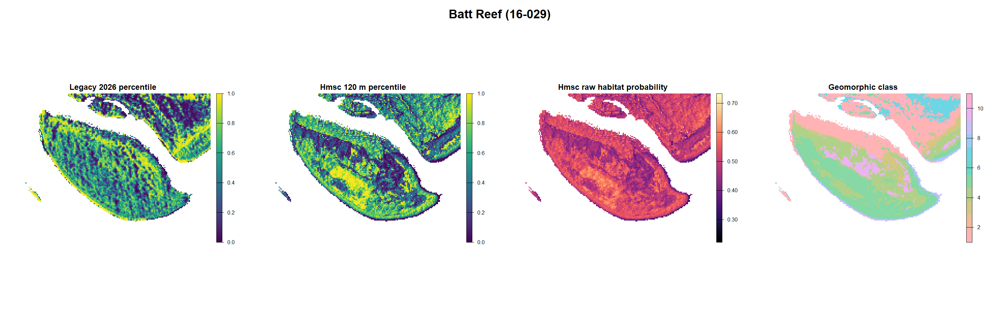

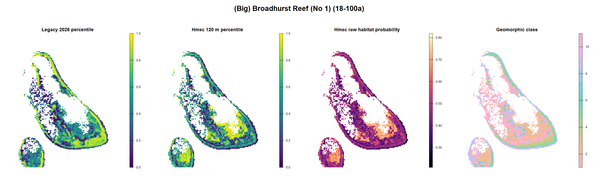

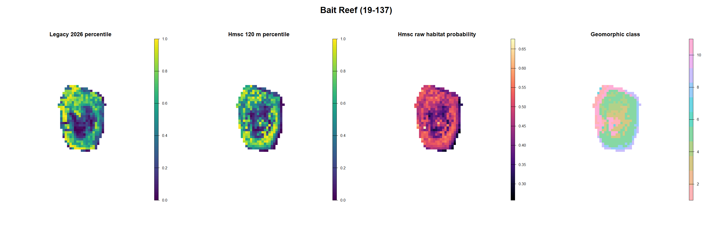

## Latest successor attempt: Hmsc v2, not promoted

This candidate aligns Cull, manta, RHIS and SALAD at visit/footprint scale,
identifies pre- and post-cull records, includes Gaussian terrain at 30-360 m
and GBR10 geomorphology, and excludes reef identity, cell identity and realised
effort from the habitat score.

| Evaluation | Overall AUC | Within-reef-year AUC | Top-20% capture |
|---|---:|---:|---:|
| Apparent fit | 0.610 | 0.601 | 0.253 |
| Held 200 m cell, 3-fold | 0.570 | 0.545 | 0.236 |
| Leave reef out, 3-fold | 0.530 | 0.535 | 0.207 |
| Forward 2024-2025 | 0.511 | 0.570 | 0.203 |

The core used four chains, 1,000 transient iterations and 250 retained
samples per chain. It failed the production convergence gate: minimum beta
ESS 17.7 and worst upper PSRF 4.02. The blocked-validation refits are therefore
diagnostic only and cannot promote the model.

The separate observation/depletion analysis supports the architecture:
cross-method-confirmed apparent detection was 0.974 for Cull, 0.609 for RHIS
and 0.183 for manta, and post-cull status materially changed observations.
Method, effort, scar discordance and Cull depletion remain outside the
deployable habitat score.

| Reef | Raw probability (5%-median-95%) | Rank correlation with incumbent | Status |
|---|---|---:|---|
| Eyrie | 0.348-0.514-0.664 | -0.138 | geomorphic form preferred; statistics pending |
| Batt | 0.321-0.474-0.635 | -0.056 | geomorphic form preferred; statistics pending |
| Broadhurst | 0.303-0.481-0.745 | 0.118 | geomorphic form preferred; statistics pending |
| Bait | 0.279-0.430-0.592 | 0.243 | geomorphic form preferred; statistics pending |

### Eyrie Reef

### Batt Reef

### Broadhurst Reef

### Bait Reef

Full methods, diagnostics and acceptance gates are in
`HMSC_V2_VISIT_MULTISCALE_ITERATION_02.md`.

## Earlier successor attempt (rejected)

Candidate: **Two-part: multiscale_topography_annual**
- Mean repeated within-reef-year AUC: 0.577
- Mean top-20% capture / lift: 0.254 / 1.111
- Promotion status: **candidate_not_promoted**

The successor architecture keeps static habitat rank, reef-year outbreak
state and fixed-effort observation probability as separate named layers.
Neither state nor effort is allowed to reorder cells within a reef-year.

## Rejected candidate reef maps

The incumbent and candidate use identical within-reef percentile scales.
These patterns were reviewed and rejected as operationally implausible.

| Reef | Rank correlation | Mean absolute rank difference | Status |
|---|---|---|---|
| Eyrie Reef (14-118) | 0.076 | 0.322 | pending_visual_acceptance |
| Batt Reef (16-029) | 0.174 | 0.298 | pending_visual_acceptance |
| (Big) Broadhurst Reef (No 1) (18-100a) | 0.304 | 0.266 | pending_visual_acceptance |
| Bait Reef (19-137) | 0.389 | 0.251 | pending_visual_acceptance |

### Eyrie Reef (14-118)

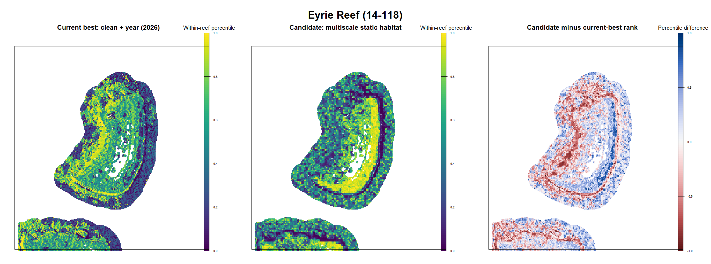

### Batt Reef (16-029)

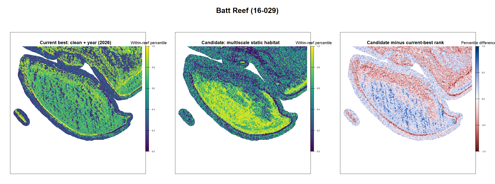

### (Big) Broadhurst Reef (No 1) (18-100a)

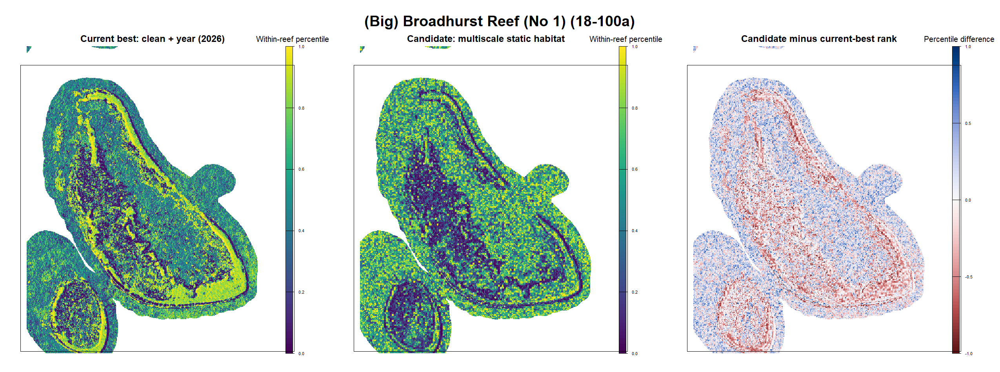

### Bait Reef (19-137)

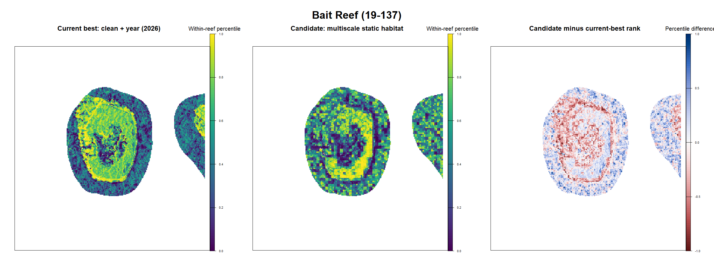

The decision is recorded in
../artifacts/two_part_iteration_01_expert_review.csv.

## Previous Hmsc fixed-protocol reef comparison: diagnostic only

This is the requested map from the fitted production Hmsc model, not the
XGBoost successor candidate. It uses posterior-mean fixed effects for the
Cull high-density response in 2026, holds survey effort at the matched-data
median, and excludes reef and cell random effects. Consequently it is a
pre-survey habitat ordering rather than a reconstruction using known reef
identity or realised effort.

The Hmsc fixed-effect ordering is negatively correlated with the incumbent
on all four reefs. Its full-model validation score must not be assigned to
this map: the full score includes strong reef/cell and effort information.

| Reef | Raw probability (5%-median-95%) | Rank correlation | Mean absolute rank difference | Status |
|---|---|---|---|---|
| Eyrie Reef (14-118) | 0.056-0.063-0.074 | -0.147 | 0.371 | pending_visual_acceptance |
| Batt Reef (16-029) | 0.055-0.061-0.073 | -0.168 | 0.378 | pending_visual_acceptance |
| (Big) Broadhurst Reef (No 1) (18-100a) | 0.053-0.066-0.085 | -0.089 | 0.334 | pending_visual_acceptance |
| Bait Reef (19-137) | 0.051-0.062-0.080 | -0.053 | 0.339 | pending_visual_acceptance |

### Eyrie Reef (14-118)

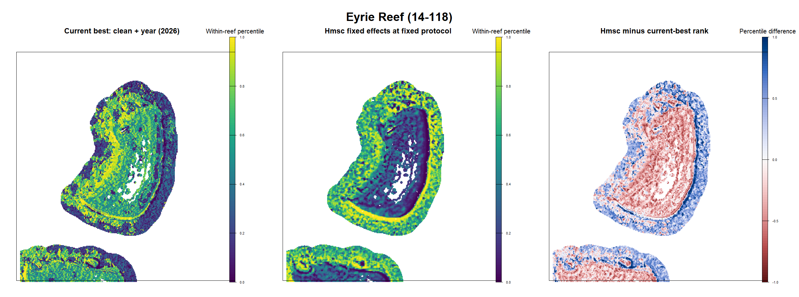

### Batt Reef (16-029)

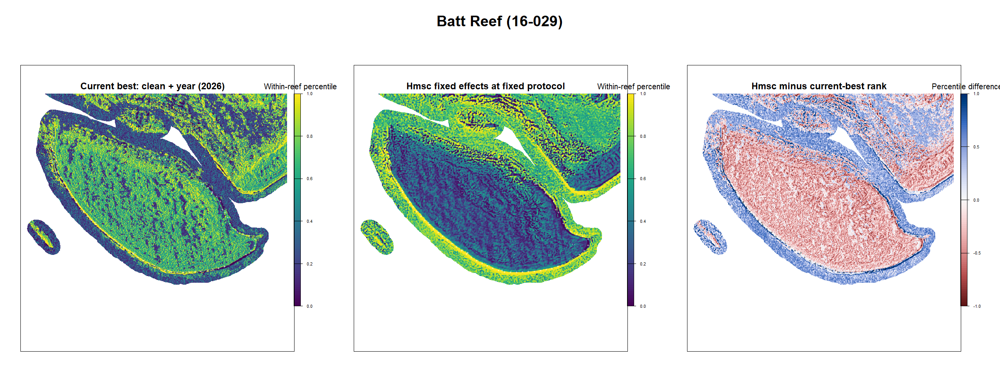

### (Big) Broadhurst Reef (No 1) (18-100a)

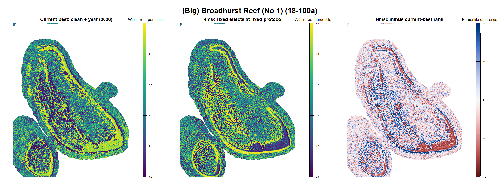

### Bait Reef (19-137)

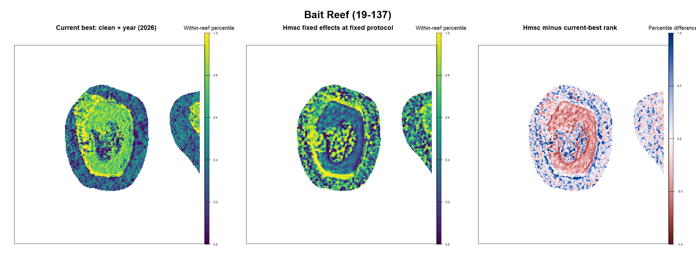

See HMSC_VISUAL_JOINT_MODELLING_ROADMAP.md for interpretation, data needs
and a staged route toward a genuinely joint ecological model.

## Earlier two-part promotion gates

| Gate | Status | Evidence |
|---|---|---|
| Mean within-reef-year AUC improves by at least 0.005 | PASS | 0.577 versus 0.568 |
| Mean top-20% lift is no worse than incumbent | PASS | 1.111 versus 1.095 |
| Minimum repeat within-reef-year AUC is at least 0.55 | PASS | 0.577 |
| State and fixed-effort transforms preserve within-reef rank | PASS | 0 operational rank violations |
| Operational prediction excludes realised survey effort | PASS | Fixed at 2 dives and 600 bottom-time units |
| Outbreak probability provenance has passed audit | PENDING/FAIL | Pending |
| Blinded expert map review has accepted candidate | PENDING/FAIL | Rejected: Candidate significantly worse on visual inspection and unlikely to receive field-expert buy-in |

## Harmonised next steps

1. Complete blinded/operational expert review of the four 120 m panels and
   record accepted and implausible geomorphic features for each reef.
2. Build a manta-inclusive footprint occupancy model at observation support,
   using line-weighted habitat, method-specific detection and repeat visits.
   Do not spread a positive tow across every crossed cell.
3. Fit the reduced Hmsc response block at 60 m with the same partitions, then
   compare 60 m and 120 m maps at their fitted support.
4. Extend the final 120 m Hmsc chain only if expert review is plausible;
   require beta ESS >=400 and upper PSRF <=1.1.
5. Improve forward transfer using independently mapped connectivity/exposure
   and compatible susceptible-coral data. Keep method, effort, reef identity,
   year and outbreak state out of habitat X.
6. Validate reef-year outbreak probability as a separate activation layer.
   It may alter absolute activation between reefs but must never alter the
   within-reef habitat order.
7. Repeat held-cell, leave-reef, forward-year and four-reef map gates for every
   candidate. Incumbent correlation remains descriptive only; promotion needs
   convergence, independent transfer and expert operational acceptance.

## Update rule

The latest independent v3 iteration is reproduced by scripts 01-11 under
`iterations/hmsc_geomorphic_v3`. This report changes incumbent only when
convergence, statistical transfer, provenance and expert-map gates all pass.
The complete decision history is retained in
`outputs/model_successor_registry.csv`.
