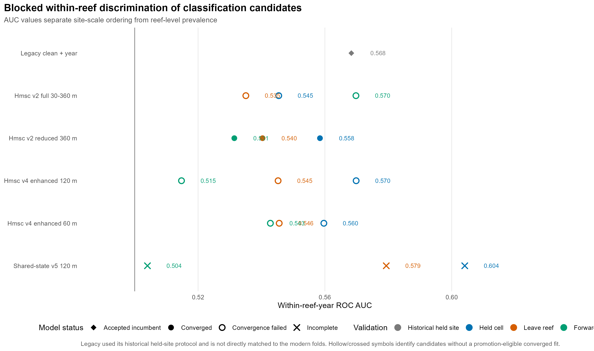
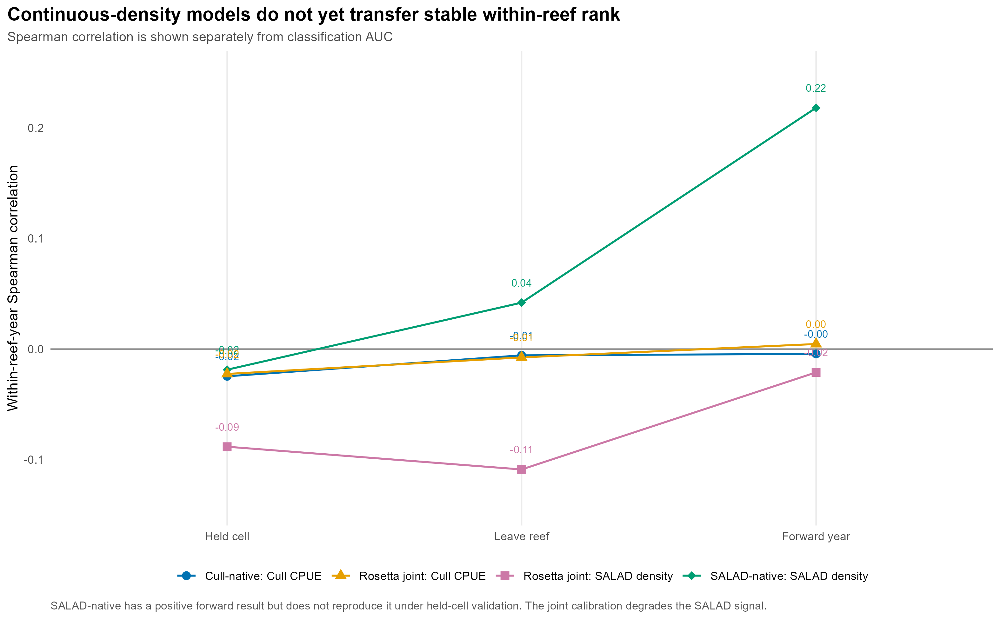
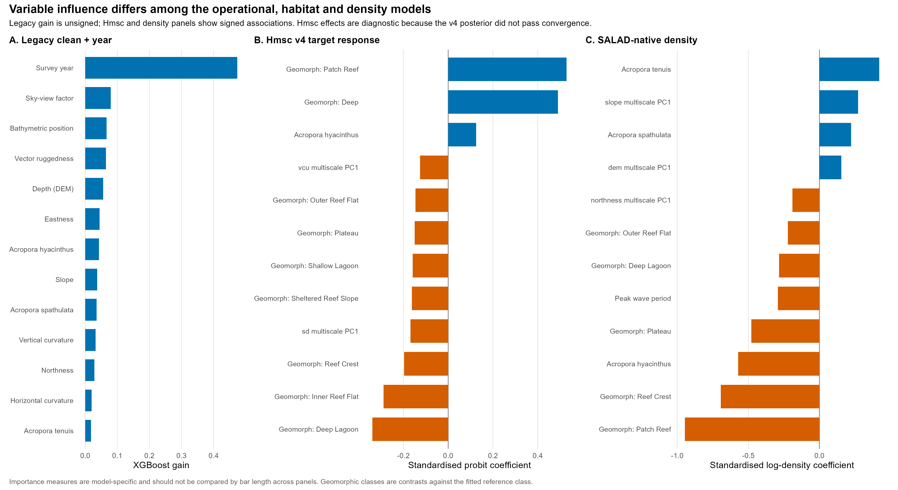
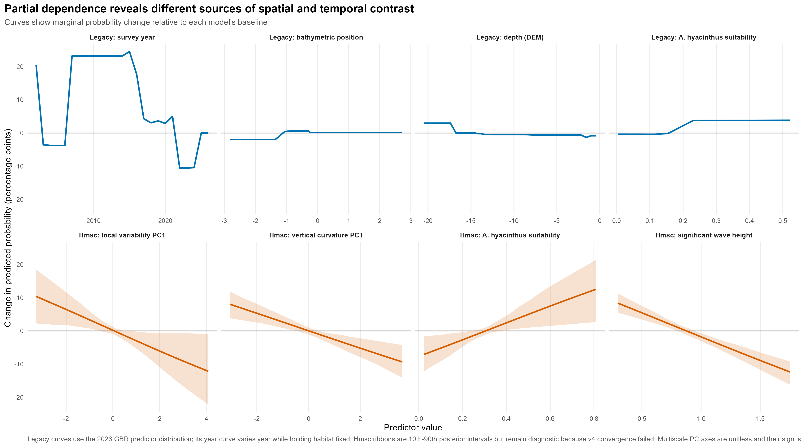
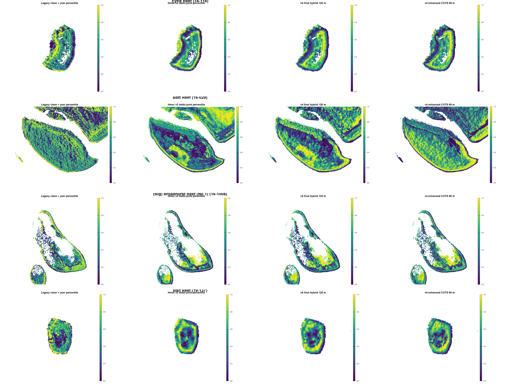

# Final COTS fine-scale SDM synthesis

Last updated: 2026-09-14

## Executive decision

**Retain legacy clean + year as the accepted operational model.**

The analysis does not identify a replacement that simultaneously passes
convergence, held-cell, leave-reef, forward-year, coverage and expert-map
acceptance. The later models nevertheless clarify what the operational product
needs:

- the legacy model provides recognised fine-scale spatial contrast but mixes
  habitat with a strong year effect;
- the geomorphology-led Hmsc models provide more coherent, explainable habitat
  structure, with the 60 m and 120 m variants remaining the most relevant
  expert-review candidates;
- the reduced 360 m Hmsc is the converged structural control, rather than the
  best transferring surface;
- the shared-state model is the most appropriate framework for separating
  ecological state from method-specific detection, scars and culling;
- the continuous-density branch does not yet produce stable held-out
  within-reef abundance rank.

No candidate was trained or selected to reproduce the incumbent rank. The
legacy surface is retained as an operational reference, while geomorphic
surfaces must be judged on ecological and operational plausibility.

## Figure 1: classification validation

The shared-state v5 model has the strongest held-cell and leave-reef
within-reef AUCs, 0.604 and 0.579, but falls to 0.504 in forward validation and
has incomplete optimisation/identification. Hmsc v4 at 60 m retains more
forward signal than the 120 m version, while the converged reduced 360 m model
is more stable statistically but only moderately discriminating.

The legacy result is shown under its historical held-site protocol. It is not a
matched comparison with the modern folds and is not presented as proof that
the legacy architecture transfers better.

## Figure 2: continuous-density validation

Cull-native density has near-zero held-out within-reef rank correlation. The
SALAD-native 60 m model reaches forward within-reef Spearman correlation 0.218,
but its held-cell result is -0.019 and leave-reef result is 0.042. The Rosetta
joint model does not reconcile the Cull and SALAD signals and degrades the
SALAD response.

This confirms that the 0.02 threshold is not the only limitation. Historical
targeting, depletion, incompatible effort units and imperfect method alignment
also constrain stable abundance modelling.

## Figure 3: variable importance and signed effects

Survey year accounts for 47.4% of total XGBoost gain in the legacy clean + year
model. Static variables such as sky-view factor, bathymetric position,
ruggedness and depth remain influential, but each contributes much less than
year.

The Hmsc v4 target response is instead dominated by geomorphic contrasts,
particularly Patch Reef and Deep habitat. SALAD-native density produces a
different set and direction of geomorphic associations, including a strong
negative Patch Reef coefficient. Those differences are evidence that the
methods and responses are not interchangeable.

The three panels use different importance definitions. XGBoost gain is unsigned;
Hmsc and density bars are signed standardised coefficients. Bar lengths must
not be compared across panels, and the v4 Hmsc coefficients remain diagnostic
because that posterior did not pass convergence.

## Figure 4: partial dependence

The legacy year response is large and step-like, spanning approximately 35
percentage points across 2002-2026 while the habitat predictors are held
fixed. Its selected static partial dependencies are smaller, although depth,
bathymetric position and Acropora suitability still create meaningful
fine-scale contrast. This helps explain why a narrow 2026 probability range can
contain operationally meaningful ordering.

The Hmsc curves show broad, approximately monotonic responses to multiscale
local variability, vertical curvature, Acropora hyacinthus suitability and
wave height. These relationships naturally generate coherent geomorphic bands.
The ribbons represent 10th-90th posterior intervals, but should not be treated
as production uncertainty because the v4 posterior failed its convergence
gate. Multiscale PC axes are unitless and their signs are specific to the
fitted PCA.

Legacy partial dependence is calculated after applying the fitted recipe's
centering and scaling. Curves are expressed as change from each model's own
baseline so the compressed legacy probabilities are not visually discarded.

## Figure 5: four-reef spatial comparison

Rows show Eyrie, Batt, Broadhurst and Bait. Columns show the legacy clean + year
surface, Hmsc v2 static-joint surface, the v4 final hybrid at 120 m, and the v4
enhanced COTS surface at 60 m. Each map is displayed as a within-reef
percentile. The colour stretch is for inspection only.

The spatial gate is not agreement with legacy. Review should identify named
rims, slopes, lagoons, flats and windward/leeward zones that are plausible,
missed, spuriously prioritised or operationally unusable. The geomorphic nature
of the Hmsc surfaces is a useful feature and should be preserved unless
specific ecological evidence rejects it.

## Final model positions

| Role | Model | Position |
|---|---|---|
| Operational incumbent | Legacy clean + year | Retain and keep exactly reproducible |
| Engineered habitat baseline | Hmsc v4 enhanced 120 m with fallback hierarchy | Development only; expert and convergence gates incomplete |
| Finer-support alternative | Hmsc v4 enhanced 60 m | Expert review; better forward result but unconverged |
| Converged structural control | Reduced geomorphic Hmsc 360 m | Use to distinguish stable broad structure from unstable multiscale effects |
| Observation-process framework | Shared-state v5 | Revisit with repeated visits and better detection information |
| Independent abundance evidence | SALAD-native density 60 m | Retain as research/validation layer, not a deployable successor |

## Harmonised next steps

1. Complete named-zone expert review of Figure 5 before further model fitting.
2. Decide whether the operational package should contain legacy alone or
   legacy plus one explicitly experimental geomorphic layer for prospective
   field testing.
3. If either v4 surface passes expert review, run production chains for only
   that surface and require minimum ESS 400, upper PSRF 1.1, and held-cell,
   leave-reef and forward acceptance.
4. Design prospective fixed-effort, pre-cull sampling across stratified
   geomorphic zones, with compatible direct COTS, juvenile and scar evidence.
5. Revisit shared-state abundance only with repeated detection data, known
   search area/time, scar-age information, and sufficient untouched
   reefs/years.
6. Keep reef-year outbreak probability as a separate activation component. It
   may scale a habitat surface but must not determine within-reef habitat rank.

## Reproducibility

All five figures and their plotted data are generated by
`scripts/91_build_final_synthesis_figures.R`. The figure manifest and source
tables are written under `outputs/final_synthesis_*.csv`.

