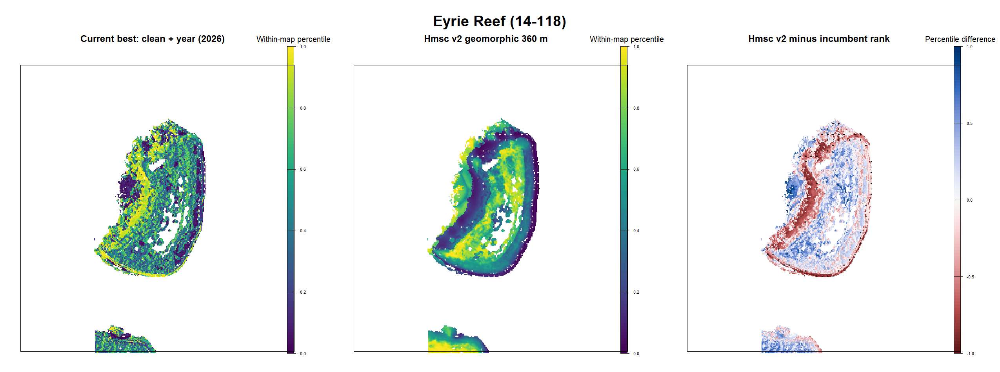
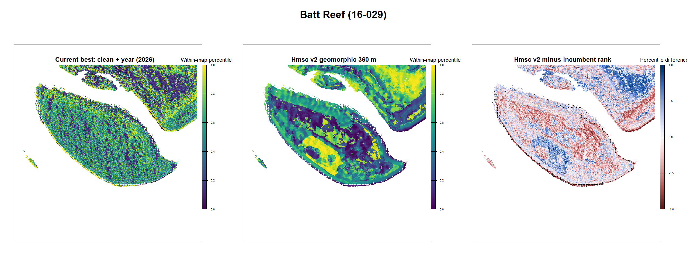
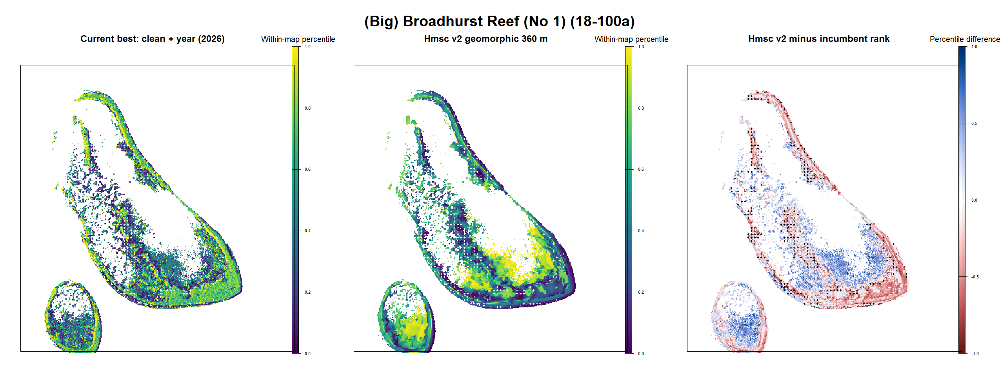
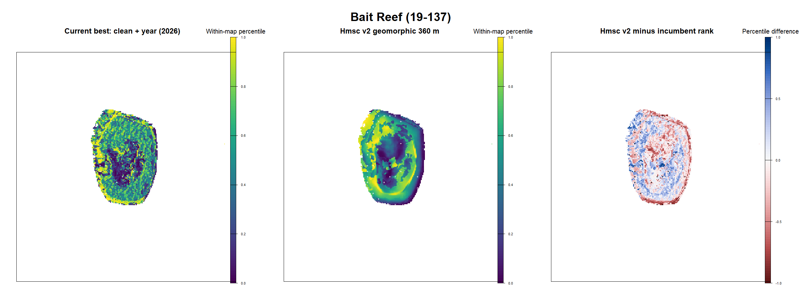

# Hmsc v2 reduced geomorphic 360 m iteration 03

Last evaluated: 2026-09-14

## Decision

**Retain this model as the converged geomorphic structural benchmark, but do
not promote it over legacy clean + year.**

This focused refit answers a specific question from iteration 02: can the
operationally attractive geomorphic pattern be retained while removing the
unstable, opposing terms from the full 30-360 m terrain basis? Yes. An
independent scale screen selected 360 m support, and the reduced 23-predictor
Hmsc posterior now passes the production convergence gate. Its held-cell and
leave-reef within-reef discrimination are modest, however, and its forward
overall AUC is effectively chance.

Agreement with the incumbent rank was not used to choose the scale, fit the
model, or accept the maps. The old surface is shown only as a familiar spatial
reference. The geomorphic character of this candidate is a positive feature:
it is easier to describe, inspect and implement operationally.

## Estimand and safeguards

The target remains conditional within-reef habitat:

> Given that a reef-year is active, where on that reef is Cull CPUE most likely
> to be at least 0.02?

The score uses static habitat only. It contains no reef or cell identity, year,
outbreak probability, realised survey effort, method, or incumbent prediction.
Cull, Manta, RHIS and SALAD evidence were aligned at visit/footprint level;
post-cull observations were excluded from ecological absence construction and
retained for separate depletion diagnostics.

## Scale selection

Before fitting Hmsc, otherwise matched target-specific GLMs compared
geomorphology alone with a single Gaussian terrain support. Selection used the
mean and minimum within-reef AUC over held-cell, leave-reef and forward-year
tests.

| Candidate | Mean within AUC | Minimum within AUC | Mean overall AUC |
|---|---:|---:|---:|
| Geomorphology + 360 m | **0.551** | **0.538** | **0.542** |
| Geomorphology + 240 m | 0.543 | 0.537 | 0.539 |
| Geomorphology + 120 m | 0.539 | 0.530 | 0.532 |
| Geomorphology only | 0.539 | 0.524 | 0.536 |
| Geomorphology + 60 m | 0.525 | 0.518 | 0.535 |
| Geomorphology + 30 m | 0.522 | 0.514 | 0.531 |

This is evidence for broad neighbourhood context in the current observation
support, not evidence that prediction rasters must be 360 m pixels. Output can
remain at operational pixel resolution while covariates describe a 360 m
neighbourhood.

## Production Hmsc fit

The response matrix has 13 responses and 23,490 conditional cell-years from
16,211 cells, 560 reefs and 20 years. The fixed effects comprise 11 estimable
geomorphic contrasts, coral suitability, turbidity and wave variables, and
eight Gaussian terrain summaries at 360 m.

| Diagnostic | Result | Gate |
|---|---:|---:|
| Chains | 4 | 4 |
| Transient iterations | 2,000 | descriptive |
| Retained samples per chain | 2,500 | descriptive |
| Total retained draws | 10,000 | descriptive |
| Minimum beta ESS | **457.2** | >= 400 |
| Worst upper PSRF | **1.032** | <= 1.10 |
| Production convergence | **PASS** | both gates |

Prediction summaries are streamed for the target response only. This avoids
materialising a roughly 23,490 by 13 by 10,000 posterior prediction array and
makes the production script safely reproducible.

## Predictive validation

Apparent fit is diagnostic only. Blocked scores come from refits that keep
cells or reefs together and from a forward split trained through 2023.

| Evaluation | Overall AUC | Within-reef AUC | Top-20% capture |
|---|---:|---:|---:|
| Apparent | 0.595 | 0.587 | 0.237 |
| Held 200 m cell, 3-fold | 0.573 | 0.558 | 0.232 |
| Leave reef out, 3-fold | 0.522 | 0.540 | 0.194 |
| Forward: train through 2023 | 0.504 | 0.531 | 0.203 |

The gap between forward overall and forward within-reef AUC supports keeping
reef-year outbreak activation outside this static habitat score. It also shows
that the present habitat response is not strong enough for promotion: unseen
reef and future-year transfer remain weak even though posterior convergence is
now satisfactory.

## Target-response interpretation

The largest standardised posterior effects are broad geomorphic contrasts:
Deep is positive (+0.450), while Inner Reef Flat (-0.379), Deep Lagoon
(-0.368), Patch Reef (-0.284), Sheltered Reef Slope (-0.261), Reef Crest
(-0.191) and Outer Reef Flat (-0.169) are negative relative to the Unknown
reference. Wave height (-0.128) and 360 m local depth variability (-0.112) are
also negative. Eastness and slope at 360 m have smaller positive effects.

These are conditional associations, not causal preferences. The Unknown
reference and unequal sampling among geomorphic classes make class contrasts
especially important to check against survey coverage. The result nevertheless
explains why the maps form coherent rims, slopes and depth bands instead of
small high-resolution patches.

## Four-reef visual comparison

Each candidate and incumbent panel is displayed on its own within-reef
percentile scale so compressed raw probabilities remain visible. Colour
stretching is a display operation only. Rank correlation is reported
descriptively and is not an acceptance gate.

| Reef | Candidate probability 5%-median-95% | Rank correlation |
|---|---|---:|
| Eyrie | 0.379-0.511-0.626 | -0.020 |
| Batt | 0.362-0.492-0.633 | -0.010 |
| Broadhurst | 0.339-0.454-0.704 | 0.144 |
| Bait | 0.323-0.432-0.530 | 0.271 |

### Eyrie Reef

### Batt Reef

### Broadhurst Reef

### Bait Reef

The production maps retain the smoother, concentric geomorphic structure seen
in the short-chain checkpoint. Expert feedback already favours that general
character. Final acceptance should now record which specific rims, slopes,
lagoons or flats are plausible or implausible, without asking the surface to
reproduce the incumbent ordering.

## Promotion gates

| Gate | Status | Evidence |
|---|---|---|
| No identity, year, effort or incumbent rank in habitat score | **PASS** | 23 static predictors |
| Visit alignment and pre-cull handling | **PASS** | iteration 02 audit |
| Independent scale selection | **PASS** | blocked one-scale screen |
| Production posterior convergence | **PASS** | ESS 457; upper PSRF 1.032 |
| Held-cell within-reef transfer | **MARGINAL** | AUC 0.558 |
| Leave-reef within-reef transfer | **FAIL** | AUC 0.540 |
| Forward overall transfer | **FAIL** | AUC 0.504 |
| Geomorphic map morphology | **PASS, directional** | preferred operational character |
| Named-zone expert acceptance | **PENDING** | four panels supplied |
| Promotion | **NO** | transfer and expert-zone gates incomplete |

## Harmonised next steps

1. Use this converged reduced model as a structural control when reviewing the
   richer 60 m and 120 m geomorphology-led Hmsc candidates; do not optimise
   either toward incumbent rank.
2. Record named plausible and implausible geomorphic zones on Eyrie, Batt,
   Broadhurst and Bait. Test those statements on additional untouched reefs.
3. Replace hard single-scale selection with regularised grouped shrinkage or a
   small pre-declared combination of broad and local supports, retaining the
   coherent 360 m context while allowing justified local variation.
4. Refine the ecological response: pre-treatment direct COTS, juvenile and
   scar evidence; RHIS branching/table coral resources; SALAD density; explicit
   scar persistence/error; and method-specific detection outside Hmsc where
   required.
5. Keep the dynamic reef-year outbreak process separate and combine it with
   habitat only after both components are validated. It must not change
   within-reef habitat rank.
6. Require held-cell, leave-reef, forward-year, calibration, coverage and
   expert-zone acceptance before replacing legacy clean + year.

