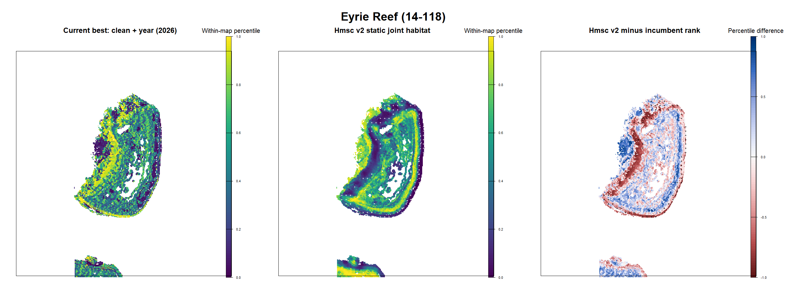
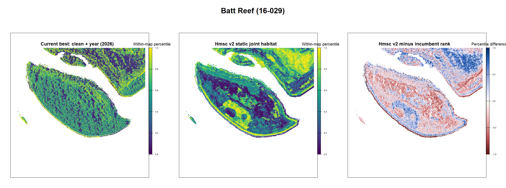
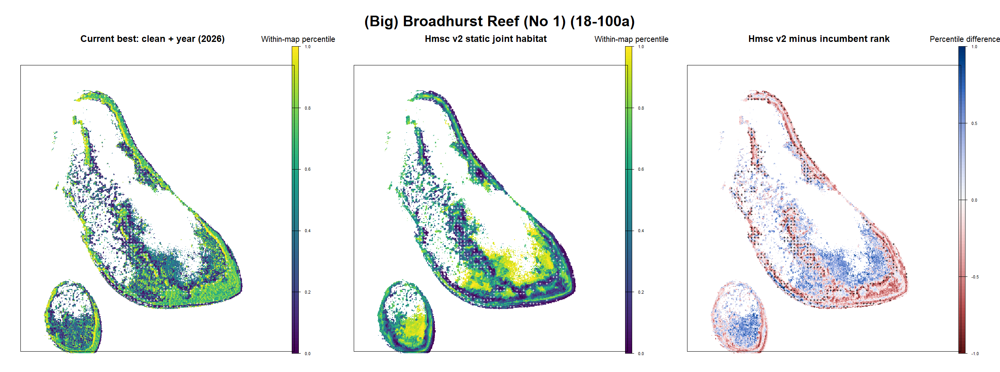
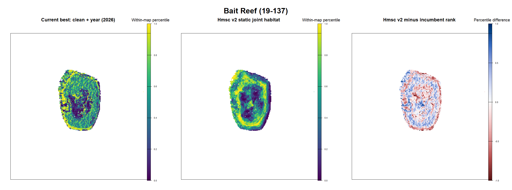

# Hmsc v2 visit-aligned multiscale iteration 02

Last evaluated: 2026-09-07

## Decision

**Do not promote this fitted posterior yet. Keep legacy clean + year as the
current production model while developing Hmsc v2 as an independent,
geomorphology-led successor.**

This iteration is a materially better Hmsc experiment than the earlier joint
model: observations are aligned at visit/footprint scale, post-cull evidence is
excluded from the ecological response, SALAD is included, terrain is derived
from Gaussian-smoothed bathymetry at 30-360 m, and neither reef/cell identity
nor realised effort enters the deployable habitat score. Nevertheless, it
fails convergence and blocked geographic transfer. Expert feedback on the map
structure is positive: its geomorphic pattern should be retained and assessed
on its own operational merits rather than forced to reproduce incumbent rank.

The candidate is useful diagnostically. It shows that unrestricted correlated
multiscale terms lead Hmsc toward broad geomorphic/depth bands. That broad
structure is easier to implement operationally and is a desirable direction;
the remaining task is to make it statistically stable and transferable.

## Operational estimand

The intended score is conditional within-reef habitat suitability:

> If a reef-year is active and COTS are present, which parts of that reef are
> most likely to contain problematic density (Cull CPUE >= 0.02)?

Reef outbreak state is therefore not a deployable habitat predictor. The
training domain is restricted to reef-years with positive COTS/scar evidence,
but the score contains only static habitat. Outbreak probability can later be
combined as a separate activation layer without reordering cells within a
reef.

## Data alignment and intervention handling

- Cull, manta, RHIS and SALAD were assigned to a common 200 m grid and grouped
  into visit windows separated by no more than 14 days.
- The first Cull date was calculated locally for each 200 m cell.
- Non-Cull records strictly before first local Cull, or in cells with no local
  Cull record, were eligible for the ecological model.
- Non-Cull same-day records were treated as ambiguous and excluded.
- The first same-day Cull record was retained as the initial Cull target;
  subsequent local records were treated as post-cull.
- Post-cull records were retained for the separate depletion diagnostic, not
  silently treated as ecological zeros.

The aligned visit artifact contains 170,709 model units. The source timing
audit includes 13,678 strictly pre-cull records, 62,623 post-cull records,
8,919 same-day ambiguous records and 183,438 records in cells with no local
Cull record.

## SALAD integration

- 754 tracks were read from `COTS SALAD MASTER 2021-2026.xlsx`.
- 722 tracks had usable midpoint coordinates.
- Median track length was 760 m.
- `Density_inclScars` was used as the initial continuous response, with direct
  and scar presence retained separately.
- 4,293 rows from `COTS recorded` were audited; 3,123 matched a track and 2,917
  could be positioned by within-track time interpolation.

The fitted model deliberately uses track midpoints. The event interpolation is
saved as a diagnostic and should be tested in the next footprint refinement,
not mixed into this iteration after seeing its performance.

## Ecological responses

The core Hmsc response matrix contains 13 compatible responses:

- Cull direct presence and Cull CPUE >= 0.02;
- manta direct COTS and scar presence;
- RHIS adult and juvenile COTS;
- RHIS scars on branching and table corals;
- SALAD direct COTS, scars and log density including scars;
- RHIS live branching and table coral cover as resource responses.

Recent mortality of branching/table coral was added only in a 15-response
sensitivity model. It is nonspecific and is not interpreted as COTS-caused
mortality or used to define the deployable target score.

Manta absences entered the ecological response only when a cell-year had at
least three tows and at least 1,000 m surveyed. Positive direct/scar evidence
was retained without that negative-evidence threshold.

## Habitat predictors

The final core used 55 fixed-effect predictors:

- 40 Gaussian terrain variables at 30, 60, 120, 240 and 360 m: smoothed depth,
  slope, eastness, northness, horizontal/profile curvature, BPI and local SD;
- 11 estimable GBR10 geomorphic contrasts, with Unknown as reference;
- coral suitability from the clean layers;
- Reef Guidance turbidity, significant wave height and peak period.

No compatible local larval/current connectivity surface was found. It was
explicitly recorded as unavailable rather than proxied with reef identity or
outbreak probability.

## Hmsc fit and convergence

The model used 23,490 conditional cell-years, 16,211 cells, 560 reefs and 20
years. The core was fitted with four chains, 1,000 transient iterations, thin
5 and 250 retained samples per chain. The mortality sensitivity used two
chains, 500 transient iterations and 100 retained samples per chain.

| Diagnostic | Result | Gate |
|---|---:|---:|
| Core runtime | 40.9 min | descriptive |
| Minimum beta ESS | 17.7 | >= 400 |
| Worst upper PSRF | 4.02 | <= 1.10 |
| Production convergence | **FAIL** | both gates pass |

The longer chains improved the earlier no-geomorph checkpoint but did not
resolve mixing. Posterior signs and ranks must therefore be treated as
provisional.

## Predictive validation

Apparent fit is shown only to diagnose overstatement. Blocked validations used
short two-chain refits and are explicitly not promotion-eligible while the
main posterior fails convergence.

| Evaluation | Overall AUC | Within-reef-year AUC | Top-20% capture |
|---|---:|---:|---:|
| Apparent fit | 0.610 | 0.601 | 0.253 |
| Held 200 m cell, 3-fold | 0.570 | 0.545 | 0.236 |
| Leave reef out, 3-fold | 0.530 | 0.535 | 0.207 |
| Forward: train through 2023, test 2024-2025 | 0.511 | 0.570 | 0.203 |

The forward result is instructive: within-reef ordering retains some signal,
but the overall score fails to transfer reef-year prevalence. That is
consistent with a two-part architecture in which outbreak state is modelled
separately. It does not rescue this habitat candidate because leave-reef and
held-cell within-reef performance remain weak and the posterior is not
converged. The geomorphic maps themselves have received positive operational
feedback.

## Observation, scar and depletion diagnostics

The separate diagnostic contains 268,658 method records across 192,155
visit-cluster cells. Effort, method and Cull timing are allowed here because
this component is not deployed as habitat.

Among footprints where another method independently recorded direct COTS in
the same cluster-cell, apparent direct detection was:

| Method | Confirmed footprints | Apparent direct detection |
|---|---:|---:|
| Cull | 1,146 | 0.974 |
| Manta | 4,813 | 0.183 |
| RHIS | 1,031 | 0.609 |
| SALAD | 13 | 1.000 |

SALAD is too sparse for a stable detection estimate. These are not formal
sensitivities because the cross-method reference is imperfect.

Scar-positive footprints without same-cluster direct evidence accounted for
61.7% of manta scar positives, 21.2% of RHIS scar positives and 10.4% of SALAD
scar positives. These are discordance rates, not false-positive rates: direct
surveys also have false negatives, and scars can persist after COTS move or are
removed.

Post-cull status materially changed direct detection. Within Cull records,
counts declined with log time since first local Cull after adjusting for
bottom time and dive type. This validates the decision to keep post-cull
records out of the ecological absence class.

## Four-reef visual comparison

Candidate and incumbent are shown on identical within-map percentile scales.
The third panel is candidate minus incumbent rank. The colour ramp is a
display aid only and is not part of model assessment.

| Reef | Candidate raw probability 5%-median-95% | Rank correlation | Mean absolute rank difference |
|---|---|---:|---:|
| Eyrie | 0.348-0.514-0.664 | -0.138 | 0.358 |
| Batt | 0.321-0.474-0.635 | -0.056 | 0.345 |
| Broadhurst | 0.303-0.481-0.745 | 0.118 | 0.316 |
| Bait | 0.279-0.430-0.592 | 0.243 | 0.286 |

### Eyrie Reef

### Batt Reef

### Broadhurst Reef

### Bait Reef

The candidate is visually smoother and more concentric than the incumbent. It
emphasises reef rims, broad slopes and depth/geomorphic bands. Expert feedback
favours this geomorphic structure because it is easier to interpret and
implement operationally. Low correlation with the incumbent is therefore not
an acceptance failure and will not be used as an optimisation target.

## Why this candidate behaves this way

The largest provisional standardised target effects include 240 m local SD
(-0.915), 240 m BPI (-0.901), 360 m depth (-0.724), 120 m local SD (+0.570),
240 m depth (+0.498), Deep geomorphology (+0.497), 30 m slope (+0.473) and
360 m local SD (+0.462).

Strong opposing effects for the same terrain family at adjacent scales are a
classic symptom of multiscale collinearity. Combined with poor ESS/PSRF, this
means individual scale effects are not stably identified. The geomorphic
pattern should be preserved, but the full 30-360 m basis needs shrinkage or
scale selection so that the pattern is supported by a stable posterior.

## Promotion gates

| Gate | Status | Evidence |
|---|---|---|
| Reproducible clean-year incumbent | PASS | Frozen incumbent retained |
| No reef/cell identity in habitat score | PASS | Fixed habitat only |
| No realised effort in habitat score | PASS | Effort is diagnostic only |
| Post-cull records excluded from ecology | PASS | Local timing audit |
| Gaussian multiscale terrain included | PASS | 40 variables, 30-360 m |
| Geomorphology included | PASS | 11 fitted contrasts |
| Connectivity included or honestly absent | PASS | Unavailable and omitted |
| Main posterior convergence | **FAIL** | ESS 17.7; upper PSRF 4.02 |
| Held-cell within-reef transfer | **FAIL** | AUC 0.545 |
| Leave-reef within-reef transfer | **FAIL** | AUC 0.535 |
| Forward overall transfer | **FAIL** | AUC 0.511 |
| Expert-map morphology | **PASS, directional** | Geomorphic structure preferred for operational implementation |
| Exact candidate acceptance | PENDING | Requires stable refit and final review |

## Harmonised next iteration

1. Keep legacy clean + year frozen as the incumbent benchmark, but do not use
   its linear predictor as an offset, teacher or ranking constraint. Develop
   the geomorphology-led Hmsc score independently.
2. Preserve the broad geomorphic form while reducing the multiscale basis:
   select one defensible scale per terrain family using nested blocked
   validation, or use within-family PCA/shrinkage. The purpose is stable
   coefficients and transfer, not finer texture or closer incumbent ranks.
3. Fit matched 60 m and 120 m cell versions, and a footprint-weighted version,
   because a 30 m deployment raster is finer than many approximately 10 ha
   observations. Compare maps at their fitted support before downscaling.
4. Tighten visit alignment: test 1-day, 3-day and 7-day windows; intersect
   manta/SALAD lines with cells rather than relying on midpoints; test the
   saved SALAD time-interpolated event positions.
5. Build a formal multi-method occupancy/detection model for repeated visits.
   Estimate method-specific detection and scar persistence separately, and
   model Cull depletion as an intervention process.
6. In Hmsc, prioritise a smaller COTS evidence response block. Treat coral
   growth forms as ecological covariates or a clearly separated response
   block so abundant broad habitat responses cannot dominate the target.
7. Keep reef-year outbreak probability as a separate activation layer. Assess
   habitat with within-reef ranks and assess outbreak state separately; never
   allow state to reorder sites within a reef.
8. Repeat held-cell, leave-reef, forward-year and four-reef expert review for
   every candidate. Compare maps with the incumbent for context, but never
   require matching rank. Promote only when convergence, independent transfer
   and operational visual acceptance all pass.

## Reproducible artifacts

- `scripts/35_prepare_hmsc_v2_visits.R`
- `scripts/36_prepare_hmsc_v2_predictors.R`
- `scripts/37_fit_hmsc_v2_ecological.R`
- `scripts/38_fit_hmsc_v2_observation.R`
- `scripts/39_validate_hmsc_v2_blocked.R`
- `scripts/40_build_hmsc_v2_reef_maps.R`
- `outputs/hmsc_v2_blocked_metrics.csv`
- `outputs/hmsc_v2_blocked_decomposition.csv`
- `outputs/hmsc_v2_observation_coefficients.csv`
- `outputs/hmsc_v2_target_standardised_effects.csv`
- `outputs/hmsc_v2_visual_map_manifest.csv`
