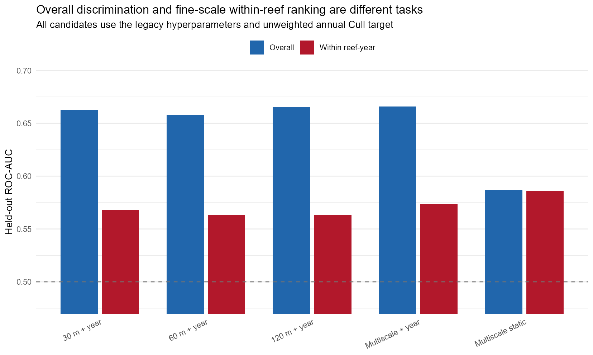
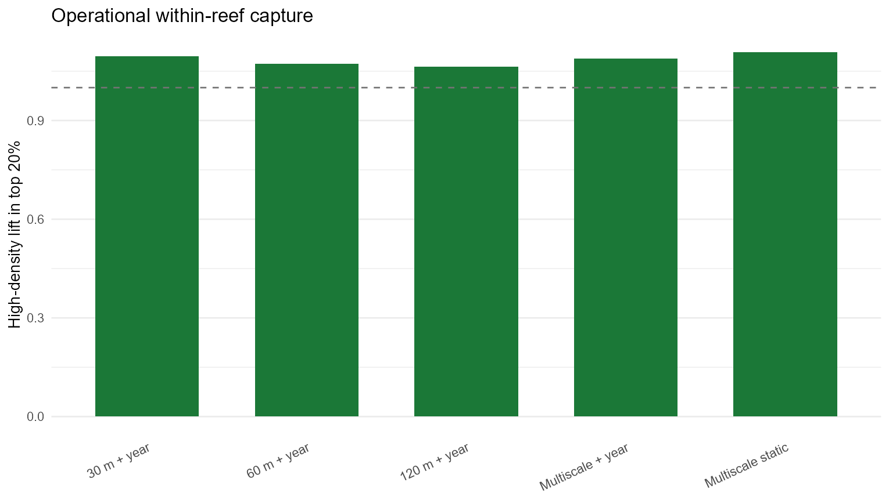
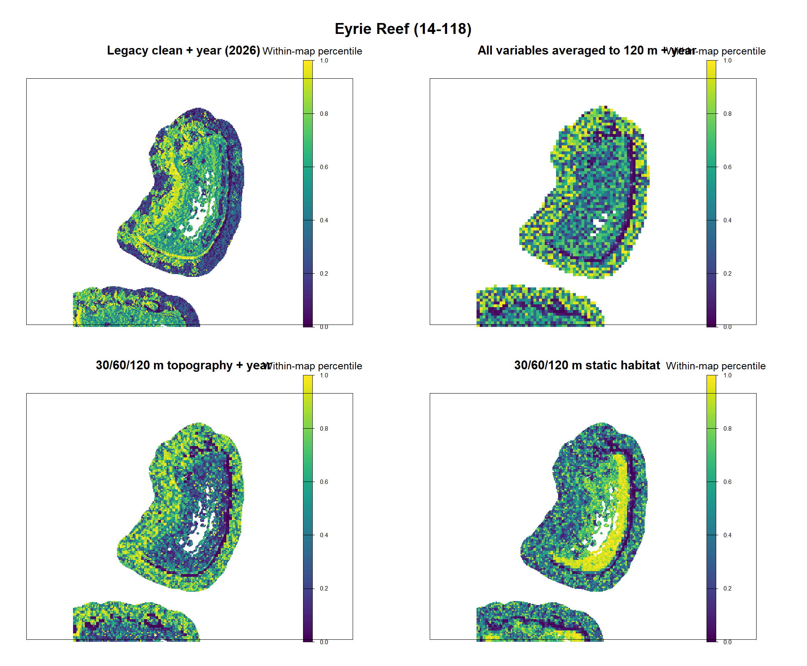
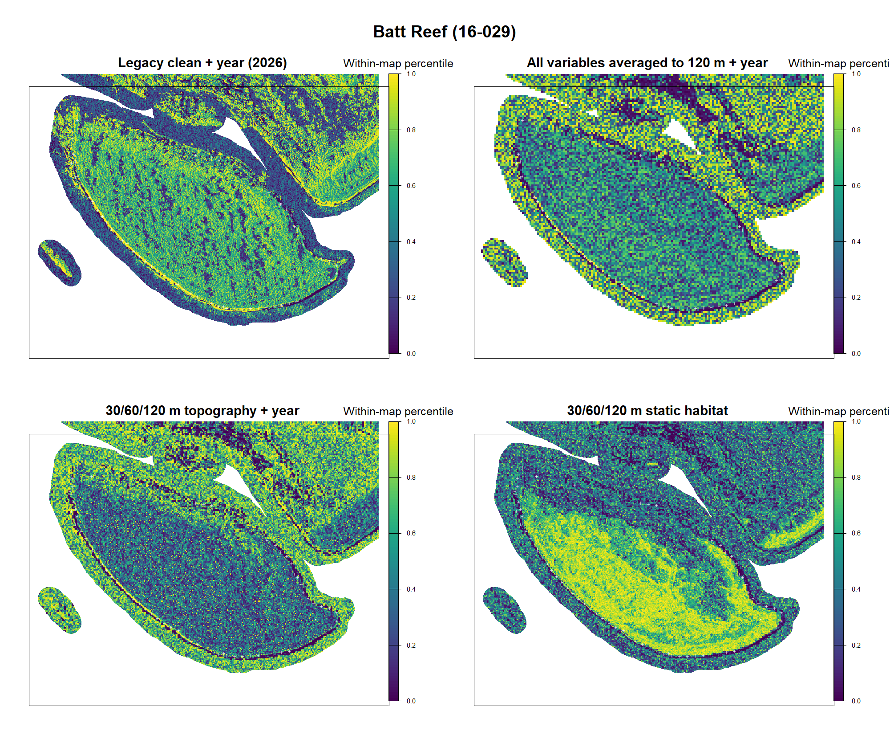
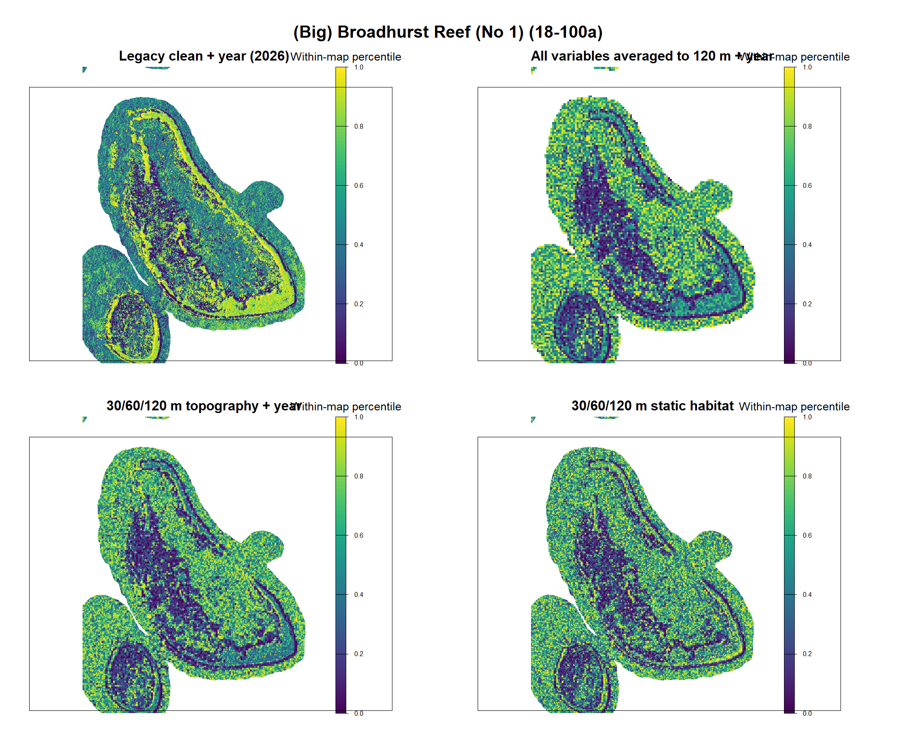
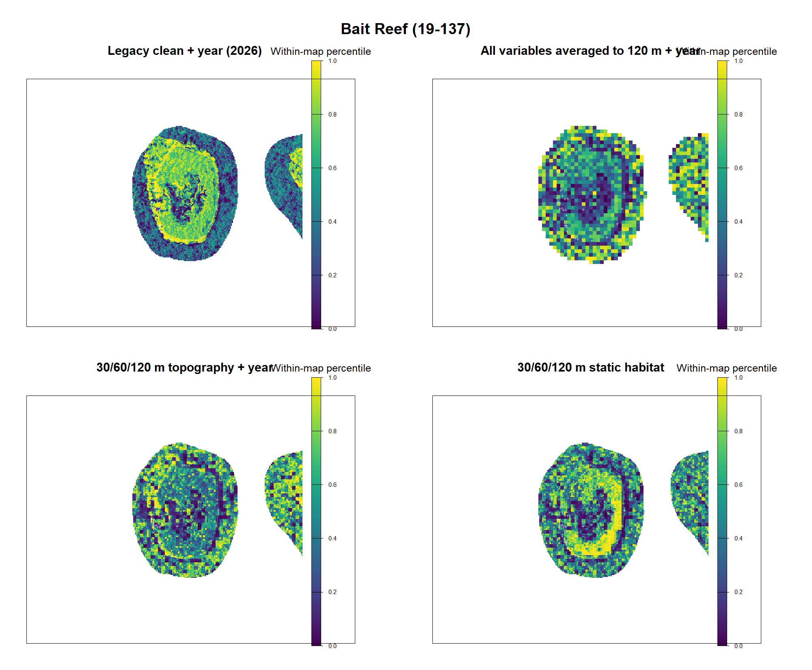
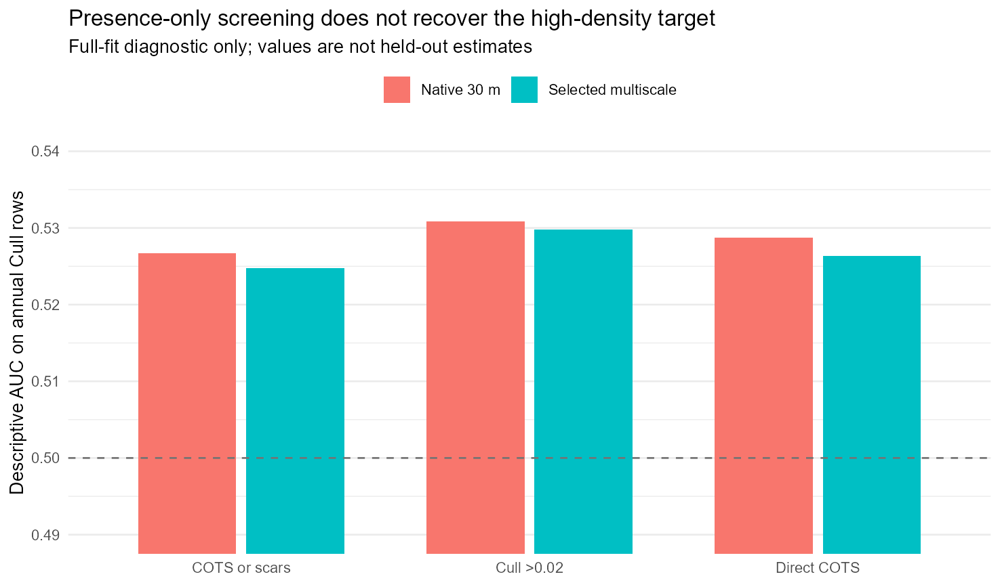
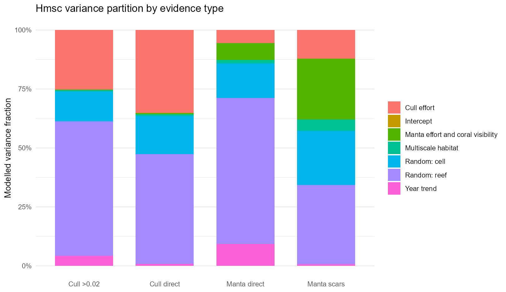
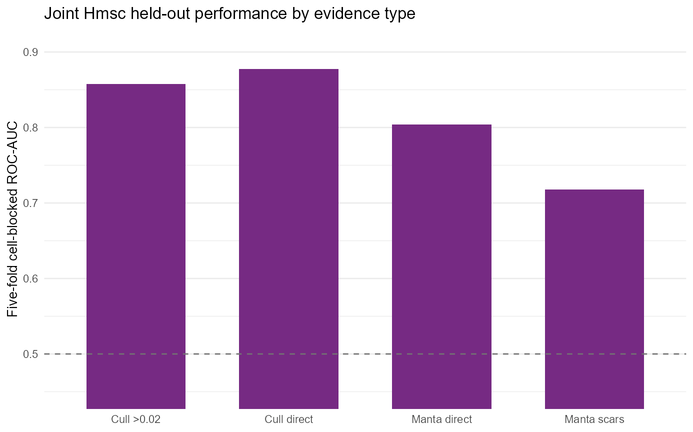
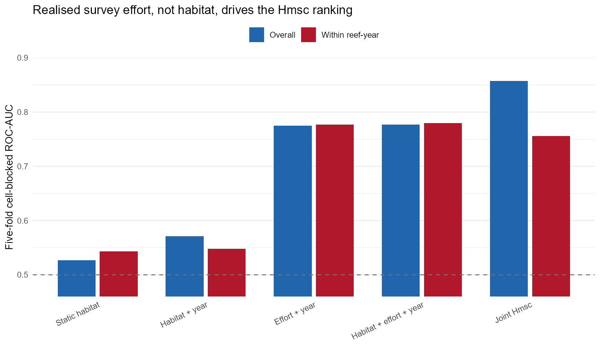

# COTS fine-scale habitat: multiscale, resolution, MaxEnt and Hmsc assessment

## Executive conclusion

The legacy clean-plus-year model is exactly reproducible and remains a useful
benchmark, but its apparent strength is a mixture of two signals:

1. broad reef/year outbreak state; and
2. a much weaker, compressed ordering of locations within a reef-year.

The second signal is not invalid merely because its probabilities occupy a
narrow range. Held-out rank metrics retain the full numerical precision of the
predictions. The relevant test is whether high-density observations occur near
the top of a held-out within-reef ordering, not how wide the map's colour ramp
is.

The current results do not justify replacing the legacy layer with a single
new model. They support a two-component product:

- a static or slowly changing within-reef habitat score; and
- a separately validated reef/year outbreak-state probability used to
  calibrate or gate that score without changing its within-reef rank.

Among the new XGBoost candidates, multiscale topography gives a small but
consistent improvement in held-out within-reef-year AUC over the 30 m
clean-plus-year baseline. The static multiscale model has the strongest
within-reef ordering and top-20% capture, but deliberately gives up much of the
between-reef/year signal. That is desirable behaviour for a habitat component,
not a complete operational probability model.

## Questions and acceptance criteria

The target is pooled annual Cull CPUE at a site, with high density defined as
`total COTS / bottom time >= 0.02`. Candidate layers are assessed separately on:

- overall ROC-AUC, PR-AUC, Brier score and log loss;
- held-out site ranking within the same reef-year;
- capture and lift of positives in the top 10%, 20% and 30% of that ordering;
- transfer to new sites/reefs and future years; and
- blinded expert spatial review.

Raw prediction range, contrast, and colour stretching are visualisation
choices, not model-performance criteria. Percentile maps are used below only
to expose the ordering already present in each surface.

## 1. Legacy clean-plus-year reproduction

The saved legacy workflow, hyperparameters and 2026 raster have been frozen in
an auditable manifest. The exact settings are 1,500 trees, tree depth 5,
learning rate 0.0013738238, loss reduction `1e-10`, and minimum node size 20.
The target year is 2026 and the threshold is 0.02 CPUE.

On 2,000 sampled valid raster cells, a new prediction from the saved workflow
matched the published legacy raster exactly:

| Check | Result |
|---|---:|
| Correlation | 1.000 |
| Mean absolute error | 0 |
| Maximum absolute error | 0 |
| Exact matches | 2,000 / 2,000 |

The frozen inputs and SHA-256 hashes are in
`outputs/legacy_clean_year_file_manifest.csv`; the reconstruction record is in
`artifacts/legacy_clean_year_manifest.rds`.

## 2. Multiscale design

The attached Guillaume et al. study derives terrain variables from bathymetry
at multiple spatial scales and fits scale-aware MaxEnt models. Its main lesson
for this workflow is that terrain variables represent different ecological
processes at different scales; slope or ruggedness at 30 m is not
interchangeable with the same quantity at 120 m. The paper tested 15/30/60/120
m products, found many useful predictors in the 15-60 m range, and used
leave-one-reef-out evaluation rather than random point splits
([Guillaume et al. 2025](https://doi.org/10.1002/ece3.71292)).

This first implementation is deliberately a screening approximation. It takes
aligned 2 x 2 and 4 x 4 block means of the existing derived 30 m layers to
produce 60 m and 120 m support. It does **not** yet smooth the underlying
bathymetric DEM and re-derive slope, aspect, BPI, VRM and curvature at each
scale. Therefore:

- the result tests sensitivity to observation support and neighbourhood
  averaging;
- it does not yet reproduce the paper's scale-specific terrain construction;
  and
- a positive result is a reason to build a DEM-first pyramid, not a final
  terrain product.

Three representations were compared with the legacy hyperparameters and the
same unweighted annual Cull rows:

- all predictors at 30, 60 or 120 m support plus year;
- 30/60/120 m topographic predictors plus 30 m coral suitability and year; and
- the same multiscale topography without year.

All rows for one physical site are assigned to the same validation fold, so a
site's other years cannot leak into its test prediction.

## 3. Resolution and multiscale results

| Candidate | Overall AUC | Between-reef AUC | Within-reef-year AUC | Top-20% capture | Top-20% lift |
|---|---:|---:|---:|---:|---:|
| 30 m + year | 0.662 | 0.674 | 0.568 | 0.251 | 1.095 |
| 60 m + year | 0.658 | 0.669 | 0.563 | 0.246 | 1.072 |
| 120 m + year | 0.665 | 0.683 | 0.563 | 0.244 | 1.064 |
| Multiscale topography + year | 0.666 | 0.681 | 0.574 | 0.249 | 1.088 |
| Multiscale topography, static | 0.587 | 0.610 | **0.586** | **0.254** | **1.108** |

The lift values compare selected prevalence with the eligible held-out base
prevalence; they are not simply capture divided by 0.20 because reef-years have
small, unequal numbers of sites and the top fraction is rounded within each
group.

Interpretation:

- Averaging all variables to 120 m improves overall AUC, but the gain is
  between reefs; it slightly worsens the intended within-reef ranking and
  top-20% capture.
- Multiscale topography plus year modestly improves within-reef AUC from 0.568
  to 0.574 while keeping overall AUC near 0.666.
- Removing year raises within-reef AUC again to 0.586 and produces the best
  top-20% result, while overall AUC falls to 0.587. This is strong evidence that
  the static surface and outbreak/year state should be separate products.
- The gains are small enough that repeated fold assignments and a proper
  DEM-first pyramid are required before promotion.

### Pixel-size versus observation-support finding

The 30, 60 and 120 m cell-pooling experiment barely merged observations. At
120 m there were 4,750 occupied cells for 9,931 rows; the mean number of source
sites per cell-year was 1.0009 and the maximum was 2. The apparent resolution
effect therefore comes almost entirely from averaging predictors over a larger
support, not from matching multiple observations to a common coarse pixel.

For the approximate 10 ha sampling footprint, the next experiment should use
footprint summaries (mean, SD, quantiles, range and directional exposure)
inside the actual dive/tow geometry where available. A nominal 120 m cell is
only 1.44 ha, so none of 30/60/120 m fully represents a 10 ha observation.

## 4. Map review without using colour range as evidence

The four maps below convert each local surface to its own within-map
percentile. This makes a 0.49-0.53 legacy ordering visible without treating its
spread as a success or failure. The same colour denotes the same *rank within
that panel*, not the same probability across panels. Cross-model conclusions
must come from held-out metrics and blinded expert scoring.

Raw 5th, median and 95th percentiles, spatial ranges and Spearman rank
correlations with the legacy map are retained in
`outputs/multiscale_reef_map_summary.csv`. Those summaries diagnose whether a
model is merely rescaled or actually changes the spatial ordering.

The new maps are not simple rescalings. Spearman rank correlations with the
legacy surface were:

| Reef | 120 m + year | Multiscale + year | Multiscale static |
|---|---:|---:|---:|
| Eyrie | -0.016 | 0.250 | 0.130 |
| Batt | -0.040 | 0.221 | 0.217 |
| Broadhurst No. 1 | 0.194 | 0.420 | 0.329 |
| Bait | 0.100 | 0.355 | 0.415 |

This is an important caution. The 120 m-only surface largely discards the
legacy ordering at Eyrie and Batt. The multiscale surfaces preserve more of it,
especially at Broadhurst and Bait, but still reorganise large areas. In the
panels, the multiscale-year model often retains reef-edge or central features
seen in the legacy map while becoming more locally patchy; the static model
can create broad bands that are absent from the legacy year surface. None of
these maps should replace the legacy product from validation scores alone.
They should be scored in the existing blinded expert-review workflow, with
reef identities and model keys concealed during review.

## 5. Presence-only MaxEnt review

The legacy MaxEnt scripts combine manta detections with every row in the
ReefScan CSV files after selecting only latitude and longitude. Consequently,
they implicitly label all ReefScan records as presences, even where an explicit
COTS/scar response was not checked. They then sample background across the
available predictor domain. That model is a broad sampling/accessibility and
COTS-evidence surface, not a validated predictor of Cull CPUE above 0.02.

The v2 screening models separate three presence definitions:

1. Cull observations above 0.02 CPUE;
2. direct COTS evidence from Cull plus external data; and
3. direct COTS or feeding-scar evidence.

They also compare native 30 m predictors with a compact, paper-informed
multiscale subset. A spatial thinning rule limits duplicate local presences.
The available valid background contained only about 2,833 points, and the
linear regularisation-multiplier-2 fits are reported as descriptive full-data
diagnostics because a defensible held-out evaluation was not completed.

| Presence definition | Training presences | 30 m descriptive AUC | Multiscale descriptive AUC |
|---|---:|---:|---:|
| Cull >0.02 | 2,379 | 0.531 | 0.530 |
| Direct COTS | 8,102 | 0.529 | 0.526 |
| COTS or scars | 11,732 | 0.527 | 0.525 |

The high-density definition is the least poor, while adding scars dilutes
alignment with the operational target. Multiscale MaxEnt does not improve this
screen. These fits should not enter an ensemble until presence-background
sampling bias, ReefScan absences, and spatially blocked validation are resolved.

## 6. Hmsc joint evidence model

Hmsc is a joint species distribution modelling framework that can estimate
response-specific environmental associations and residual co-occurrence while
representing hierarchical sampling design and random levels
([Tikhonov et al. 2020](https://doi.org/10.1111/2041-210X.13345);
[official Hmsc repository](https://github.com/hmsc-r/HMSC)).

### Preliminary fit

The initial two-response fit used 3,000 sampled site-years, seven habitat/year
covariates, a reef random level, two chains and 100 retained samples per chain.
Its explanatory AUCs were 0.846 for COTS presence and 0.824 for high density,
but these are in-sample. Minimum beta ESS was 48.6 and maximum upper PSRF was
1.379, so neither the performance nor all coefficient estimates are suitable
for inference.

### Production-style joint fit

The expanded model uses only 200 m cell-years where Cull and manta evidence
both exist. After predictor completeness filtering it contains 6,253 rows,
3,449 cells, 302 reefs and 15 years. Four probit responses are fitted jointly:

- Cull direct presence;
- Cull pooled CPUE >= 0.02;
- manta direct COTS presence; and
- manta feeding-scar presence.

The model includes multiscale BPI, slope, VRM, depth, sky-view factor and mean
coral suitability; a standardised year trend; Cull bottom time and dive count;
manta tow count, distance and observed hard-coral fraction. Repeated 200 m cell
and reef are separate random levels. The run uses four chains, 500 transient
iterations, thinning 5 and 250 retained samples per chain. Validation assigns
all years from a 200 m cell to one of five folds.

The fixed-effect chains are much better than the preliminary model: minimum
beta ESS is 147 and the maximum upper PSRF is 1.08. The random-effect
association matrices have **not** converged, however. Minimum ESS is 67 for the
cell matrix and 48.5 for the reef matrix; maximum upper PSRF is 1.63 and 1.28,
respectively. Posterior residual correlations, several of which are near one,
must therefore not be interpreted biologically.

Variance partitioning is more informative about the model's present role:

| Component | Cull direct | Cull >0.02 | Manta direct | Manta scars |
|---|---:|---:|---:|---:|
| Year trend | 0.9% | 4.2% | 9.3% | 0.7% |
| Multiscale habitat | 0.8% | **0.6%** | 1.5% | 4.7% |
| Cull effort | 35.2% | 25.2% | 5.5% | 12.1% |
| Manta effort/coral visibility | 0.4% | 0.3% | 7.2% | 25.9% |
| Repeated cell random level | 16.2% | 12.7% | 14.7% | 23.1% |
| Reef random level | 46.6% | **57.0%** | 61.9% | 33.5% |

For Cull high density, the present Hmsc fit is dominated by reef and survey
effort, not the selected fine-scale habitat predictors. That can still produce
a strong overall cell-blocked score while failing the operational within-reef
question. The within-reef-year decomposition below is therefore the primary
gate. This is also a warning against treating Hmsc as a way to reintroduce the
reef-level shortcut rejected earlier.

There are 2,016 cells with only one matched year and 1,433 cells with at least
two years (4,237 rows). The poorly identified cell association matrix is
consistent with asking a repeated-cell random level to represent too many
singletons. A repeated-cell-only sensitivity fit is recommended for detection
and residual-correlation inference, while retaining the full dataset for
predictive evaluation.

The better-converged high-density coefficients show positive posterior support
for mean coral suitability (support 1.000), Cull bottom time (1.000), Cull dive
count (1.000), and hard-coral observation fraction (0.977), a negative year
trend (positive support 0.000), and a weak negative BPI association (positive
support 0.029). VRM, slope and sky-view effects are not well supported for this
response. Coefficient magnitudes are not compared because predictors are in
different raw units. The effort terms are controls, not causal effects: survey
effort is partly responsive to known outbreaks and can encode preferential
sampling.

<!-- HMSC_RESULTS_START -->
The posterior fit took 14.6 minutes. Five-fold conditional prediction took
288.2 minutes, illustrating why explanatory prediction from the full fit is
not an adequate shortcut.

| Joint response | Prevalence | Cell-blocked AUC | PR-AUC | Brier | Calibration slope |
|---|---:|---:|---:|---:|---:|
| Cull direct presence | 0.778 | 0.877 | 0.961 | 0.110 | 1.025 |
| Cull CPUE >= 0.02 | 0.452 | **0.857** | **0.852** | **0.151** | 1.030 |
| Manta direct presence | 0.148 | 0.804 | 0.463 | 0.102 | 0.999 |
| Manta scars | 0.486 | 0.718 | 0.713 | 0.213 | 1.033 |

For Cull high density, overall AUC decomposes to 0.823 between reefs and 0.756
within reef-year. Within the 316 evaluable reef-years, the top 20% of cells
captures 33.1% of positives. Selected prevalence is 0.733 versus an eligible
base prevalence of 0.510, a lift of 1.44.

Those numbers look impressive but do not establish a habitat map. A matched
five-fold ablation on the same rows shows:

| Cell-blocked candidate | Overall AUC | Within-reef-year AUC | Top-20% within-reef capture |
|---|---:|---:|---:|
| Static habitat GLM | 0.527 | 0.543 | 0.239 |
| Habitat + year GLM | 0.571 | 0.548 | 0.237 |
| Realised effort + year GLM | 0.775 | **0.777** | **0.345** |
| Habitat + effort + year GLM | 0.777 | **0.780** | **0.344** |
| Joint Hmsc, detection-conditioned | **0.857** | 0.756 | 0.331 |

Within reef-year, Hmsc probability correlates 0.889 with Cull dive count and
0.845 with Cull bottom time, but only 0.136 with mean coral suitability and
between -0.069 and 0.067 with the individual terrain covariates. The simple
effort model actually ranks within-reef high density better than Hmsc, while
adding habitat to that effort model changes little.

The correct interpretation is therefore **detection/response-effort
conditioned prediction**, not fine-scale habitat suitability. Realised Cull
effort is unavailable before a new survey and is preferential: more dives and
bottom time are often allocated where COTS are already suspected or being
managed. Supplying that realised effort to held-out cells leaks operational
knowledge into the prediction task, even though response rows and cells are
properly held out. The reef random level adds further broad state information.

The Hmsc run is valuable because it exposes this structure clearly. It should
not be mapped as the answer to "where on a reef should we look?". A suitable
follow-up must either model ecological state and observation detection as
separate processes, or generate habitat predictions at a fixed, pre-specified
survey effort while validating against a sampling design whose effort was not
chosen in response to known COTS.
<!-- HMSC_RESULTS_END -->

Hmsc is not an explicit occupancy/detection model. Effort covariates and
repeated random effects reduce important biases, but they do not separately
identify ecological occupancy and observation detection probability. A later
integrated occupancy or N-mixture-style model is preferable if estimating true
absence/detectability is the primary objective. The Hmsc model is most useful
here for learning whether Cull high density, direct manta detections and scars
share fine-scale environmental structure after method effort is represented.

## 7. Recommended implementation path

### Retain now

1. Keep the exact legacy clean-plus-year workflow and hashes as a reproducible
   benchmark.
2. Use held-out within-reef-year rank, top-area capture and blinded expert
   review as the acceptance gate for habitat maps.
3. Keep outbreak/year state separate from the static spatial score. Combine
   them through a monotonic calibration or hurdle architecture so the reef
   state cannot overwrite local ordering.
4. Carry forward multiscale topography as a candidate, not yet as the final
   layer.

### Build next

1. Generate a Gaussian bathymetric pyramid and re-derive slope, aspect, BPI,
   VRM, curvature and exposure at each scale, matching the Guillaume et al.
   method more faithfully.
2. Add larger ecological supports (240, 300 and approximately 360 m, the latter
   near 10 ha) and footprint summary statistics rather than only nominal pixel
   resampling.
3. Repeat site-blocked folds across several seeds and add leave-one-reef-out or
   spatial-cluster validation for transfer.
4. Add a second-stage probability calibration fitted only on training folds;
   preserve the accepted static rank within each reef.
5. Audit ReefScan response fields and sampling protocol. Do not treat a CSV row
   as a presence solely because coordinates exist.
6. For Hmsc, inspect beta and residual-association convergence, posterior
   predictive checks and fold stability. Increase retained samples further for
   coefficient inference if ESS/PSRF remain weak.

## Reproducibility inventory

| Purpose | Script |
|---|---|
| Freeze and verify legacy model | `scripts/18_freeze_legacy_clean_year.R` |
| Build 30/60/120 m point features and balanced tests | `scripts/19_fit_multiscale_resolution.R` |
| Presence-only definitions and MaxEnt screen | `scripts/20_fit_presence_only_multiscale.R` |
| Preliminary Hmsc fit | `scripts/21_fit_hmsc_preliminary.R` |
| Exact legacy-weight scale comparison | `scripts/22_fit_legacy_unweighted_scale_check.R` |
| Joint Hmsc model and cell-blocked CV | `scripts/23_fit_hmsc_joint_production.R` |
| Percentile reef-map comparison | `scripts/24_build_multiscale_reef_maps.R` |
| Report figures | `scripts/25_build_multiscale_report_figures.R` |
| Hmsc residual association and variance summaries | `scripts/26_summarise_hmsc_joint.R` |
| Hmsc effort-versus-habitat blocked ablation | `scripts/27_diagnose_hmsc_effort_signal.R` |

Generated tables, raw held-out predictions, fold assignments and fitted model
objects are retained under `outputs/`, `artifacts/` and `models/` respectively.
