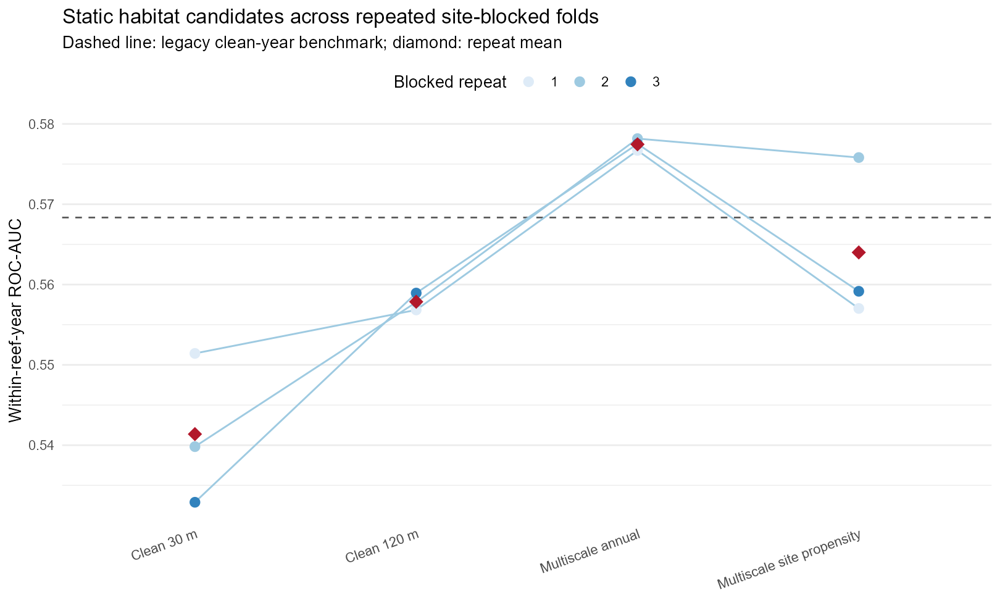
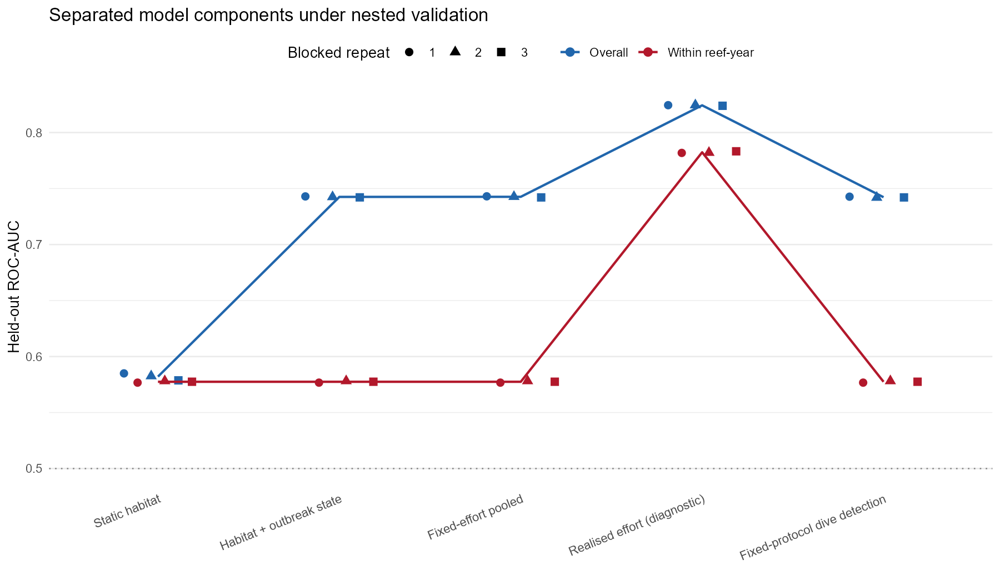
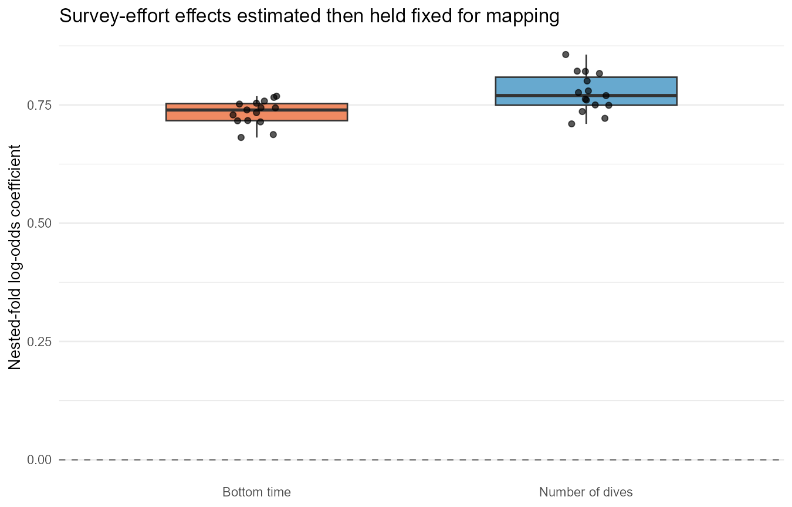

# Two-part habitat, outbreak-state and fixed-effort model: iteration 01

## Decision

**NOT PROMOTED: the frozen legacy clean-year model remains current best.**

The candidate separates the operational question into three components:

1. a static habitat score fitted without year, reef identity, outbreak
   probability or survey effort;
2. a reef-year outbreak-state bridge that can change absolute probability
   but is mathematically unable to reorder cells within a reef-year; and
3. an observation layer estimated from dive effort, then evaluated at a
   fixed protocol of two dives and 600 bottom-time units.

The repeated-dive output estimates the chance of at least one high-density
dive under the fixed protocol. It is an observation proxy and is not
labelled as the probability that pooled site CPUE exceeds 0.02.

## Data and validation

The common complete domain contains 9,321 site-years, 4,627 sites and 346 reefs
covering 2002-2025. Three repeated five-fold splits hold out 200 m spatial
site groups within reefs. The selected composition then uses nested
cross-fitting, so the state and effort calibrators never train on the
outer held-out sites.

Fold-specific calibrators naturally have different numeric scales. Before
pooling held-out folds, each operational component is monotonically
quantile-aligned to the held-out habitat score within reef-year, without
using outcomes. This reproduces the rank contract of the single deployed
bridge while retaining the held-out component probability distribution.

## Static habitat screen

| Model | Overall AUC | Within-reef AUC | Repeat SD | Top-20 capture | Top-20 lift |
|---|---|---|---|---|---|
| multiscale_topography_annual | 0.582 | 0.577 | 0.001 | 0.254 | 1.111 |
| multiscale_topography_propensity | 0.581 | 0.564 | 0.010 | 0.248 | 1.082 |
| clean_120m_annual | 0.570 | 0.558 | 0.001 | 0.248 | 1.083 |
| clean_30m_annual | 0.563 | 0.541 | 0.009 | 0.241 | 1.053 |

Selected for composition: multiscale_topography_annual (mean within-reef-year AUC 0.577).

## Separated components

| Component | Overall AUC | Within-reef AUC | PR-AUC | Brier | Top-20 lift |
|---|---|---|---|---|---|
| fixed_effort_pooled | 0.743 | 0.577 | 0.704 | 0.211 | 1.111 |
| fixed_protocol_dive_detection | 0.742 | 0.577 | 0.704 | 0.338 | 1.111 |
| habitat_static | 0.582 | 0.577 | 0.525 | 0.243 | 1.111 |
| realised_effort_diagnostic | 0.824 | 0.782 | 0.821 | 0.167 | 1.482 |
| state_bridge | 0.743 | 0.577 | 0.704 | 0.208 | 1.111 |

Outbreak state and fixed-effort transformations must have the same
within-reef rank metrics as the static habitat component. The realised
effort result is retained only as a leakage diagnostic and is never an
operational map input.

Outbreak state raises overall AUC from 0.582 to 0.743 without changing the
within-reef AUC of 0.577. Fixed-effort standardisation adds essentially no
discrimination beyond state and slightly worsens Brier score (0.211 versus
0.208). In contrast, supplying realised effort inflates within-reef AUC to
0.782, independently confirming that realised effort is leakage-prone.

## Candidate reef maps: visual acceptance required

Each panel uses the same within-reef percentile scale for the incumbent and
candidate. The third map is candidate minus incumbent percentile. White or
black crosses mark historical Cull site locations but do not encode the
response. These maps are evidence for expert acceptance, not a numerical
model metric.

| Reef | Rank correlation | Mean absolute rank difference | Status |
|---|---|---|---|
| Eyrie Reef (14-118) | 0.076 | 0.322 | pending_visual_acceptance |
| Batt Reef (16-029) | 0.174 | 0.298 | pending_visual_acceptance |
| (Big) Broadhurst Reef (No 1) (18-100a) | 0.304 | 0.266 | pending_visual_acceptance |
| Bait Reef (19-137) | 0.389 | 0.251 | pending_visual_acceptance |

### Eyrie Reef (14-118)

### Batt Reef (16-029)

### (Big) Broadhurst Reef (No 1) (18-100a)

### Bait Reef (19-137)

The expert rejection is recorded in
../artifacts/two_part_iteration_01_expert_review.csv and is a hard
promotion failure for this candidate.

## Hmsc fixed-protocol reef comparison: diagnostic only

This is the requested map from the fitted production Hmsc model, not the
XGBoost successor candidate. It uses posterior-mean fixed effects for the
Cull high-density response in 2026, holds survey effort at the matched-data
median, and excludes reef and cell random effects. Consequently it is a
pre-survey habitat ordering rather than a reconstruction using known reef
identity or realised effort.

The Hmsc fixed-effect ordering is negatively correlated with the incumbent
on all four reefs. Its full-model validation score must not be assigned to
this map: the full score includes strong reef/cell and effort information.

| Reef | Raw probability (5%-median-95%) | Rank correlation | Mean absolute rank difference | Status |
|---|---|---|---|---|
| Eyrie Reef (14-118) | 0.056-0.063-0.074 | -0.147 | 0.371 | pending_visual_acceptance |
| Batt Reef (16-029) | 0.055-0.061-0.073 | -0.168 | 0.378 | pending_visual_acceptance |
| (Big) Broadhurst Reef (No 1) (18-100a) | 0.053-0.066-0.085 | -0.089 | 0.334 | pending_visual_acceptance |
| Bait Reef (19-137) | 0.051-0.062-0.080 | -0.053 | 0.339 | pending_visual_acceptance |

### Eyrie Reef (14-118)

### Batt Reef (16-029)

### (Big) Broadhurst Reef (No 1) (18-100a)

### Bait Reef (19-137)

See HMSC_VISUAL_JOINT_MODELLING_ROADMAP.md for interpretation, data needs
and a staged route toward a genuinely joint ecological model.

## Promotion gates

| Gate | Status | Evidence |
|---|---|---|
| Mean within-reef-year AUC improves by at least 0.005 | PASS | 0.577 versus 0.568 |
| Mean top-20% lift is no worse than incumbent | PASS | 1.111 versus 1.095 |
| Minimum repeat within-reef-year AUC is at least 0.55 | PASS | 0.577 |
| State and fixed-effort transforms preserve within-reef rank | PASS | 0 operational rank violations |
| Operational prediction excludes realised survey effort | PASS | Fixed at 2 dives and 600 bottom-time units |
| Outbreak probability provenance has passed audit | PENDING/FAIL | Pending |
| Blinded expert map review has accepted candidate | PENDING/FAIL | Rejected: Candidate significantly worse on visual inspection and unlikely to receive field-expert buy-in |

## Interpretation and limitations

- The architecture now prevents reef outbreak state from masking local
  site differences.
- Fixed-effort prediction removes the direct advantage obtained by
  supplying realised Cull effort to held-out observations.
- It does not fully identify ecological occupancy and detection: survey
  effort was historically preferential, and fixing it at prediction time
  cannot remove every bias in coefficients estimated from those data.
- Same-year outbreak probabilities improve absolute-risk discrimination
  but remain external reef-level information; they are not evidence that
  the fine-scale habitat model has improved.
- The existing multiscale map panels remain the visual evidence for the
  selected static family. Expert acceptance remains a hard gate.

## Harmonised next steps

1. Keep the XGBoost candidate rejected and retain its expert feedback as
   promotion evidence; do not tune directly to the four review maps.
2. Align individual Cull, manta and RHIS visits by footprint, date and
   pre-intervention status, using the locally available size, scar, coral
   growth-form, visibility and effort fields.
3. Re-derive terrain variables from Gaussian-smoothed bathymetry at
   30, 60, 120, 240 and 360 m supports; do not rely only on block means.
4. Refit a transferable Hmsc benchmark with static multiscale habitat and
   compatible ecological responses, excluding realised effort and reef/cell
   identity from the deployable habitat score.
5. Fit a visit-level multi-method detection model with observer, effort,
   scar error and Cull-removal processes; use Hmsc only where its observation
   model matches the data-generating process.
6. Validate prospectively or on fixed-effort surveys using held-out cells,
   reefs, future years and two-to-four expert reef map comparisons.
7. Audit the 1993-2026 outbreak layer provenance and confirm that each
   validation year uses a genuinely available hindcast rather than a
   smoothed estimate informed by future observations.
8. Promote a successor only when statistical, provenance and expert-map
   gates all pass; otherwise retain the frozen legacy model.

## Reproducibility

- scripts/28_fit_two_part_fixed_effort.R: repeated and nested validation.
- scripts/29_plot_two_part_diagnostics.R: diagnostic figures.
- scripts/31_build_candidate_reef_maps.R: exact candidate/incumbent maps.
- scripts/30_update_model_reports.R: registry and report decision.
- outputs/model_successor_registry.csv: machine-readable model history.
- models/two_part_fixed_effort_iteration_01.rds: candidate bundle.
